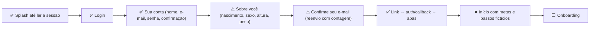
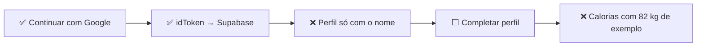
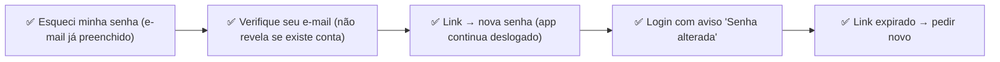
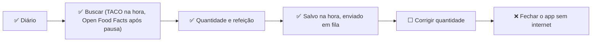
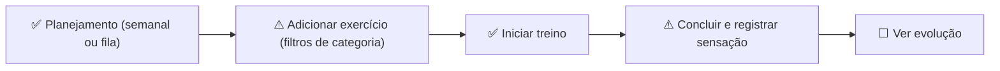
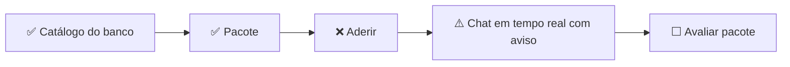
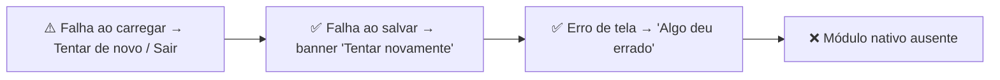

# Auditoria do Treina — análise técnica (2ª edição)

Commit analisado: `25f3a9b` (branch `main`). 2026-11-12. 18.084 linhas em 154 arquivos de `src/`. 33 commits.

> **Contexto da fase.** O objetivo declarado é ter um front funcional antes de depender do backend. Na prática, a main já tem os dois caminhos: o modo demo, com dados em memória e sem servidor, e o Supabase, com autenticação e persistência reais, escolhido por variáveis de ambiente. A auditoria avalia o front nos dois modos e mede separadamente a distância até a produção.

O relatório visual interativo está em [`index.html`](index.html). Este documento traz as mesmas conclusões em texto, com as evidências.

## Resumo

| Indicador | Valor |
|---|---|
| Nota geral (produção) | **6,5 / 10** |
| Nota do front para a fase atual | **6,9 / 10** |
| Nota da auditoria anterior (5fd90b1 (02/11/2026)) | 5,2 / 10 |
| Maturidade | **MVP funcional** |
| Telas analisadas | 28 (+ 6 diálogos) |
| Features identificadas | 23 |
| Problemas comprovados | 31 (+ 3 hipóteses) |
| Tarefas de roadmap | 32 |
| Features ausentes recomendadas | 20 |

**Por que MVP funcional.** Subiu um nível desde a auditoria anterior. Os fluxos principais funcionam com conta real, dados persistidos e isolados por usuário, e o modo demo continua permitindo usar o front sem servidor. Ainda não é um produto em evolução porque falta fechar ciclos básicos (editar registros, editar e completar o perfil), metas e passos seguem fictícios, não há testes nem verificação antes das atualizações, e o último build Android fechava ao abrir até o commit 25f3a9b.

**Nota da fase.** Média de qualidade técnica, arquitetura, UX/UI, funcionalidades, completude, performance e manutenibilidade, sem contar segurança, escalabilidade e prontidão, que medem a distância até a produção.

## Evolução desde a auditoria anterior

| ID | Problema | Situação | Observação |
|---|---|---|---|
| I-01 | Nenhuma persistência local | Parcial | Resolvido no modo Supabase. No modo demo/local os dados ainda ficam só em memória. |
| I-02 | Dados não isolados por conta | Resolvido | useUserStore recomeça do vazio ao trocar de conta; repositórios locais por usuário. |
| I-03 | Histórico de peso fictício | Resolvido | Pesagens vêm do repositório; a primeira é criada no cadastro. |
| I-04 | Metas fixas | Aberto | Meta base de 2.200 kcal, macros e 400 kcal de exercício continuam em dashboard-data.ts. |
| I-05 | Passos fictícios | Aberto | 6.840 passos para todos (index.tsx:37). |
| I-06 | Aderir apaga o plano sem aviso | Aberto | O diálogo só aparece quando já existe outro pacote. |
| I-07 | Desfazer conclusão antiga desalinha a fila | Aberto | undoCompletion ainda recua o ponteiro sempre. |
| I-08 | Login em inglês | Resolvido | Textos em pt-BR, 'Esqueci minha senha' incluído. |
| I-09 | E-mail não normalizado | Resolvido | normalizeEmail usado em login, cadastro e recuperação. |
| I-10 | Autenticação simulada | Resolvido | Supabase Auth real; o modo demo é opcional. |
| I-11 | Exclusões sem confirmação | Aberto | Excluir treino, sair do pacote, remover alimento e tarefa seguem com um toque. |
| I-12 | Registros não editáveis | Aberto | Repositórios de alimento e exercício só têm add/remove. |
| I-13 | Perfil não editável | Parcial | Data de nascimento substituiu a idade fixa, mas nada além do peso pode ser editado. |
| I-14 | Chat sem resposta | Parcial | Tempo real e aviso visível; o treinador ainda não tem como responder. |
| I-15 | Duas fontes de peso | Resolvido | Peso atual = última pesagem (data/profile.ts). |
| I-16 | Nenhum teste | Parcial | Teste SQL de RLS; nenhum teste JavaScript. |
| I-17 | Erro de lint | Aberto | Mesmo erro em use-color-scheme.web.ts. |
| I-18 | Helpers duplicados | Parcial | EMAIL_PATTERN e createId unificados; parseNumber e initials continuam duplicados. |
| I-19 | Código sem uso | Resolvido | Removido no a645770; nenhum módulo sem importador. |
| I-20 | Sem camada de dados | Resolvido | src/data com contratos e duas implementações. |
| I-21 | Dependência implícita entre providers | Aberto | Agora 11 providers aninhados. |
| I-22 | Catálogo fixo no código | Parcial | Vem do banco no modo Supabase; o modo local usa trainers.ts e as fotos seguem de randomuser.me. |
| I-23 | iOS não configurado | Aberto | iosUrlScheme de exemplo e sem bundleIdentifier. |
| I-24 | Seis abas | Aberto | Mesmas 6 abas. |
| I-25 | Busca de exercícios em inglês | Parcial | Filtros por categoria adicionados; busca continua só ao enviar e em inglês. |
| I-26 | Ícone errado em Tentar novamente | Aberto | log-exercise/index.tsx ainda usa Plus. |
| I-27 | Datas futuras inconsistentes | Aberto | Diário e exercícios avulsos aceitam o futuro; o treino não. |
| I-28 | 0 kcal sem MET | Aberto | Visível na captura de exercício manual. |
| I-29 | Dashboard com 714 linhas | Aberto | Agora 718 linhas. |
| I-30 | Gramas sem limite | Aberto | App aceita qualquer valor > 0; o banco aceita até 999.999,9 g. |
| I-31 | Typecheck depende de arquivo gerado | Aberto | expo-env.d.ts continua no .gitignore. |
| I-32 | Sessão de treino perdida ao fechar | Aberto | Estado só na tela. |
| I-33 | Sair do pacote apaga o histórico | Aberto | leavePackage remove os treinos; conclusões perdem a referência. |

## O que foi verificado e o que não foi

- **TypeScript (tsc --noEmit):** Passa. 0 erros com o expo-env.d.ts gerado pelo expo start (o arquivo está no .gitignore, então um clone novo falha até gerá-lo).
- **ESLint (expo lint):** 1 erro. O mesmo da auditoria anterior: src/hooks/use-color-scheme.web.ts:11, setState síncrono em useEffect.
- **Testes automatizados:** Só SQL. supabase/tests/rls.sql verifica as políticas RLS com duas contas numa transação desfeita no fim. Nenhum teste JavaScript nem test runner.
- **CI de qualidade:** Inexistente. .eas/workflows/preview.yml publica OTA ou gera build Android a cada push na main, sem lint, typecheck, testes ou teste do APK.

- Não verificado: O app não foi executado em Android ou iOS nesta auditoria. As capturas vêm da versão web exportada (expo export -p web) em modo demo, com dados criados pela interface.
- Não verificado: O Supabase real não foi acessado: as migrações, as políticas RLS e o teste supabase/tests/rls.sql foram lidos, mas não executados contra um banco.
- Não verificado: O fluxo real de e-mail (confirmação e recuperação de senha) e o Google Sign-In não puderam ser testados de ponta a ponta. As telas foram abertas diretamente pelo endereço.
- Não verificado: Desempenho em aparelho não foi medido.
- Não verificado: Continua sem documento de produto ou público-alvo no repositório; o posicionamento foi inferido do código.

## 1. Mapeamento

### Stack

- **Plataforma:** Expo SDK 58 (expo ~58.0.23); React Native 0.88.1 · React 19.3; TypeScript 6 estrito; React Compiler e typed routes habilitados
- **Navegação:** Expo Router 58, 35 arquivos de rota; Stack.Protected separa as pilhas com e sem sessão; Abas próprias com swipe (sliding-tabs)
- **UI:** Design system Material 3 gerado do ícone; 17 componentes base em components/ui (inclui password-field); lucide-react-native, react-native-svg, Reanimated 4 + Worklets, expo-image
- **Dados:** 9 contextos de domínio sobre useUserStore (estado por conta + fila de salvamento); Repositórios por domínio: local (memória) ou Supabase (src/data); expo-sqlite guarda a sessão no aparelho; expo-crypto gera ids
- **Backend:** Supabase: Auth (e-mail, Google, PKCE), Postgres com 18 tabelas e RLS, Realtime no chat; 5 migrações versionadas, seed do catálogo e teste SQL de RLS
- **Integrações:** ExerciseDB (catálogo de exercícios); Open Food Facts (produtos brasileiros); TACO embarcada (597 alimentos); Google Sign-In; Fotos de exemplo em randomuser.me
- **Entrega:** EAS Build (development, preview APK, production); EAS Update com runtime por fingerprint; Workflow: OTA ou build Android a cada push na main

### Telas e rotas

| Tela | Rota | Grupo | Importância | Arquivo principal |
|---|---|---|---|---|
| Login | `/login` | Autenticação | Alta | `src/app/login.tsx` |
| Criar conta: sua conta | `/signup` | Autenticação | Alta | `src/app/signup/index.tsx` |
| Criar conta: sobre você | `/signup/details` | Autenticação | Alta | `src/app/signup/details.tsx` |
| Confirme seu e-mail | `/signup/confirm` | Autenticação | Alta | `src/app/signup/confirm.tsx` |
| Esqueceu a senha? | `/forgot-password` | Autenticação | Média | `src/app/forgot-password/index.tsx` |
| Verifique seu e-mail | `/forgot-password/check-email` | Autenticação | Baixa | `src/app/forgot-password/check-email.tsx` |
| Nova senha | `/forgot-password/new-password` | Autenticação | Média | `src/app/forgot-password/new-password.tsx` |
| Confirmação pelo link | `/auth/callback` | Autenticação | Média | `src/app/auth/callback.tsx` |
| Carregando / erro de carregamento | `(tabs)/_layout` | Autenticação | Alta | `src/app/(tabs)/_layout.tsx` |
| Início (dashboard) | `/(tabs)` | Abas | Alta | `src/app/(tabs)/index.tsx` |
| Diário alimentar | `/(tabs)/diary` | Abas | Alta | `src/app/(tabs)/diary.tsx` |
| Adicionar alimento (busca) | `/log-food` | Modais | Alta | `src/app/log-food/index.tsx` |
| Quantidade do alimento | `/log-food/[id]` | Modais | Alta | `src/app/log-food/[id].tsx` |
| Refeições | `/meals` | Modais | Baixa | `src/app/meals.tsx` |
| Exercícios | `/(tabs)/exercise` | Abas | Alta | `src/app/(tabs)/exercise.tsx` |
| Adicionar exercício (busca) | `/log-exercise` | Modais | Alta | `src/app/log-exercise/index.tsx` |
| Detalhes do exercício | `/log-exercise/[id]` | Modais | Alta | `src/app/log-exercise/[id].tsx` |
| Planejamento | `/workouts` | Modais | Alta | `src/app/workouts/index.tsx` |
| Treino (edição) | `/workouts/[id]` | Modais | Média | `src/app/workouts/[id].tsx` |
| Sessão de treino | `/workout-session` | Modais | Alta | `src/app/workout-session.tsx` |
| Treinador (lista) | `/(tabs)/trainers` | Abas | Média | `src/app/(tabs)/trainers.tsx` |
| Perfil do treinador | `/trainer/[id]` | Treinadores | Média | `src/app/trainer/[id].tsx` |
| Pacote de treinos | `/trainer/package/[id]` | Treinadores | Alta | `src/app/trainer/package/[id].tsx` |
| Treino do pacote | `/trainer/workout` | Treinadores | Baixa | `src/app/trainer/workout.tsx` |
| Chat com o treinador | `/chat/[trainerId]` | Treinadores | Média | `src/app/chat/[trainerId].tsx` |
| Tarefas | `/(tabs)/tasks` | Abas | Média | `src/app/(tabs)/tasks.tsx` |
| Nova tarefa / subtarefa | `/add-task` | Modais | Média | `src/app/add-task.tsx` |
| Perfil | `/(tabs)/profile` | Abas | Média | `src/app/(tabs)/profile.tsx` |

Diálogos: registrar peso, meta de peso (`components/weight/weight-dialog.tsx`), escolher treino do dia (`app/workouts/index.tsx`), substituir planejamento (`app/trainer/package/[id].tsx`), sair do treino (`app/workout-session.tsx`).

A documentação da arquitetura, dos domínios e das integrações está em [`architecture.md`](architecture.md).

### Galeria de telas

Capturas do app exportado para web (expo export -p web) em modo demo (EXPO_PUBLIC_AUTH_MODE=demo, dados em memória), navegado com Playwright num viewport de 390 × 844 em 12/11/2026. As telas logadas usaram dados criados pela interface; as de recuperação de senha e confirmação foram abertas pelo endereço, sem e-mail real. A versão web aproxima o app nativo. O ambiente da auditoria bloqueia ExerciseDB, Open Food Facts e randomuser.me.

**Login** (`/login`)

- *login:* Login em pt-BR com 'Esqueci minha senha' (I-08 resolvido).

**Criar conta: sua conta** (`/signup`)

- *signup-account:* Etapa 1 de 3, agora com confirmação de senha.

**Criar conta: sobre você** (`/signup/details`)

- *signup-details:* Etapa 2: data de nascimento no lugar da idade. A descrição ainda promete estimar calorias (I-04).

**Confirme seu e-mail** (`/signup/confirm`)

- *signup-confirm:* Etapa 3: confirmar o e-mail, com reenvio e contagem regressiva.

**Esqueceu a senha?** (`/forgot-password`)

- *forgot-password:* Recuperação de senha. No modo demo, avisa que não está disponível.

**Verifique seu e-mail** (`/forgot-password/check-email`)

- *forgot-check-email:* Confirmação de envio que não revela se a conta existe.

**Nova senha** (`/forgot-password/new-password`)

- *forgot-new-password:* Nova senha aberta sem código: estado de link inválido com 'Pedir novo link'.

**Confirmação pelo link** (`/auth/callback`)

- *auth-callback:* Callback de confirmação sem código: link expirado ou já usado.

**Carregando / erro de carregamento** (`(tabs)/_layout`)

*Sem captura:* No modo demo os dados carregam na hora, então a tela de carregamento dura um quadro e a de erro só aparece se um domínio falhar. Não dá para capturar sem alterar o código.

**Início (dashboard)** (`/(tabs)`)

  

- *home:* Início com dados reais de alimentação e exercício; meta fixa de 2.200 kcal e 6.840 passos fictícios (I-04, I-05).
- *home-edit:* Modo de edição da tela inicial, agora salvo por conta.
- *home-dark:* Tema escuro numa conta nova.

**Diário alimentar** (`/(tabs)/diary`)

- *diary:* Diário com café da manhã e almoço.

**Adicionar alimento (busca)** (`/log-food`)

- *log-food:* Busca com resultados da TACO; a parte online aparece com erro porque o ambiente da auditoria bloqueia o Open Food Facts.

**Quantidade do alimento** (`/log-food/[id]`)

- *food-details:* Quantidade, refeição e nutrientes.

**Refeições** (`/meals`)

- *meals:* Refeições do diário.

**Exercícios** (`/(tabs)/exercise`)

- *exercise:* Aba Exercícios: treino do dia (descanso) e lista única de exercícios, com botão flutuante.

**Adicionar exercício (busca)** (`/log-exercise`)

- *log-exercise:* Filtros por categoria (novos); o catálogo aparece com erro porque o ambiente bloqueia o ExerciseDB.

**Detalhes do exercício** (`/log-exercise/[id]`)

- *exercise-details:* Exercício manual com categoria escolhida e 0 kcal, sem MET (I-28).

**Planejamento** (`/workouts`)

- *workouts:* Planejamento após aderir ao pacote.

**Treino (edição)** (`/workouts/[id]`)

- *workout:* Treino próprio com exercício manual.

**Sessão de treino** (`/workout-session`)

 

- *session:* Sessão cronometrada com um exercício concluído.
- *dialog-leave-session:* Confirmação ao sair da sessão.

**Treinador (lista)** (`/(tabs)/trainers`)

- *trainers:* Catálogo de treinadores (fotos de exemplo bloqueadas no ambiente, iniciais no lugar).

**Perfil do treinador** (`/trainer/[id]`)

- *trainer:* Perfil do treinador.

**Pacote de treinos** (`/trainer/package/[id]`)

- *package:* Pacote com treinos, comentários e 'Aderir ao treino'.

**Treino do pacote** (`/trainer/workout`)

- *package-workout:* Treino do pacote com notas.

**Chat com o treinador** (`/chat/[trainerId]`)

- *chat:* Chat com aviso de que o treinador ainda não responde (I-14 parcial).

**Tarefas** (`/(tabs)/tasks`)

- *tasks:* Tarefas com subtarefas.

**Nova tarefa / subtarefa** (`/add-task`)

- *add-task:* Nova tarefa com repetição diária.

**Perfil** (`/(tabs)/profile`)

 

- *profile:* Perfil com idade pela data de nascimento.
- *dialog-weight:* Registrar peso, agora com data da medição.

## 2. Análise por tela

### Login — `/login`

**Objetivo:** Entrar com e-mail e senha ou Google. **Contexto:** Quem não tem sessão salva. **Importância no fluxo principal:** Alta.

Arquivos: `src/app/login.tsx`, `src/context/session.tsx`, `src/lib/auth.ts`, `src/components/ui/password-field.tsx`

- *login:* Login em pt-BR com 'Esqueci minha senha' (I-08 resolvido).

**Funciona**

- Supabase Auth com e-mail e senha
- Google via idToken (build nativo)
- Conta não confirmada leva à tela de confirmação
- Esqueci minha senha com o e-mail já preenchido
- Aviso 'Senha alterada' após recuperação
- Modo demo entra sem servidor

**Parcial**

- Google depende dos client IDs no ambiente; sem eles mostra erro

**UX/UI (+ positivo, − negativo)**

- + Todo em pt-BR e com grafia correta
- + Mostrar senha com ícone e rótulo de acessibilidade
- + Erros anunciados como alerta
- − Sem indicação visual de modo demo quando ativo

Estados: carregando **sim** · vazio **n/a** · erro **sim** · sucesso **sim (guard troca a tela)**

**Técnica**

- normalizeEmail e EMAIL_PATTERN compartilhados com cadastro e recuperação
- Formulário remontado por key após troca de senha: simples e correto

**Oportunidades**

- Selo 'Modo demo' quando IS_AUTH_MOCKED
- Validar as variáveis do Google no início do app

Problemas relacionados: N-06 (Configuração de ambiente fora do repositório)

| Critério | Nota | Justificativa |
|---|---|---|
| Qualidade técnica | 8 | Estados e erros bem tratados, helpers compartilhados. |
| UX/UI | 8 | Claro e consistente; resolveu os problemas de idioma. |
| Completude funcional | 8 | Cobre e-mail, Google, recuperação e conta não confirmada. |
| Maturidade | 7 | Depende de configuração de ambiente não validada. |

### Criar conta: sua conta — `/signup`

**Objetivo:** Nome, e-mail, senha e confirmação (etapa 1 de 3). **Contexto:** Novo usuário. **Importância no fluxo principal:** Alta.

Arquivos: `src/app/signup/index.tsx`, `src/components/signup/step-screen.tsx`, `src/context/signup.tsx`

- *signup-account:* Etapa 1 de 3, agora com confirmação de senha.

**Funciona**

- Exige nome completo
- Valida e-mail e senha mínima
- Confirmação de senha
- Mostrar senha nos dois campos
- Dados preservados ao voltar

**UX/UI (+ positivo, − negativo)**

- + Indicador de 3 etapas
- + Foco encadeado entre campos
- − Erro único no rodapé
- − Sem termos de uso e consentimento

Estados: carregando **n/a** · vazio **n/a** · erro **sim** · sucesso **sim**

**Técnica**

- StepScreen reaproveitado em cadastro e recuperação

**Oportunidades**

- Consentimento de dados de saúde nesta etapa
- Erros por campo

| Critério | Nota | Justificativa |
|---|---|---|
| Qualidade técnica | 8 | Curto e reaproveitável. |
| UX/UI | 7 | Claro; erro centralizado. |
| Completude funcional | 7 | Falta consentimento. |
| Maturidade | 7 | Integrado ao Auth real. |

### Criar conta: sobre você — `/signup/details`

**Objetivo:** Nascimento, sexo, altura e peso (etapa 2 de 3). **Contexto:** Continuação do cadastro. **Importância no fluxo principal:** Alta.

Arquivos: `src/app/signup/details.tsx`, `src/lib/profile.ts`, `supabase/migrations/20261102000300_new_user_profile.sql`

- *signup-details:* Etapa 2: data de nascimento no lugar da idade. A descrição ainda promete estimar calorias (I-04).

**Funciona**

- Data de nascimento DD/MM/AAAA validada (dia real, idade mínima)
- Altura em seletor, peso 30–400 kg
- Dados enviados no signUp e gravados pelo trigger (perfil e primeira pesagem)

**Parcial**

- A descrição promete estimar calorias, mas as metas são fixas (I-04)

**UX/UI (+ positivo, − negativo)**

- + Data de nascimento no lugar da idade
- − Sem objetivo nem nível de atividade
- − Data digitada à mão, sem seletor de data

Estados: carregando **sim** · vazio **n/a** · erro **sim** · sucesso **sim**

**Técnica**

- parseDate rejeita datas impossíveis
- Trigger ignora valores inválidos sem falhar (testado em rls.sql)

**Oportunidades**

- Objetivo e atividade
- Usar os dados nas metas
- Reaproveitar a tela para completar perfil do Google

Problemas relacionados: I-04 (Metas fixas apesar de o cadastro prometer cálculo), N-01 (Quem entra com Google nunca informa os dados corporais)

| Critério | Nota | Justificativa |
|---|---|---|
| Qualidade técnica | 8 | Validação boa no app e no banco. |
| UX/UI | 7 | Promessa da tela não cumprida. |
| Completude funcional | 6 | Faltam objetivo e atividade. |
| Maturidade | 7 | Persistido de verdade. |

### Confirme seu e-mail — `/signup/confirm`

**Objetivo:** Pedir que o usuário abra o link de confirmação (etapa 3 de 3). **Contexto:** Após o cadastro, ou ao entrar com conta não confirmada. **Importância no fluxo principal:** Alta.

Arquivos: `src/app/signup/confirm.tsx`, `src/components/auth/*`

- *signup-confirm:* Etapa 3: confirmar o e-mail, com reenvio e contagem regressiva.

**Funciona**

- Texto diferente para recém-cadastrado e para conta antiga não confirmada
- Reenviar com contagem regressiva
- Redireciona ao cadastro se aberta sem e-mail

**Parcial**

- Reenviar não checa modo demo nem configuração (N-09)

**UX/UI (+ positivo, − negativo)**

- + Explica que o link deve ser aberto no mesmo celular
- − 'Já confirmei, entrar' só volta ao login; o usuário digita a senha de novo

Estados: carregando **sim (reenvio)** · vazio **n/a** · erro **sim** · sucesso **sim (contagem)**

**Técnica**

- Componente ResendEmail compartilhado com a recuperação

**Oportunidades**

- Abrir o app de e-mail
- Manter o e-mail e a senha para entrar direto após confirmar

Problemas relacionados: N-09 (Reenviar confirmação não checa o modo demo nem a configuração)

| Critério | Nota | Justificativa |
|---|---|---|
| Qualidade técnica | 7 | Simples; uma guarda faltando. |
| UX/UI | 7 | Clara, com um passo a mais no fim. |
| Completude funcional | 7 | Cobre os dois casos de entrada. |
| Maturidade | 7 | Depende do e-mail real (não testado). |

### Esqueceu a senha? — `/forgot-password`

**Objetivo:** Pedir o link de redefinição. **Contexto:** A partir do login. **Importância no fluxo principal:** Média.

Arquivos: `src/app/forgot-password/index.tsx`

- *forgot-password:* Recuperação de senha. No modo demo, avisa que não está disponível.

**Funciona**

- E-mail preenchido a partir do login
- Validação e envio pelo Supabase
- No modo demo, avisa que não está disponível

**UX/UI (+ positivo, − negativo)**

- + Etapa 1 de 3 clara
- − Mensagem de erro fala em 'código' (N-08)

Estados: carregando **sim** · vazio **n/a** · erro **sim** · sucesso **sim (próxima etapa)**

**Técnica**

- Mesmos helpers de e-mail do login

**Oportunidades**

- Corrigir o texto

Problemas relacionados: N-08 (Texto de recuperação fala em código, o fluxo usa link)

| Critério | Nota | Justificativa |
|---|---|---|
| Qualidade técnica | 8 | Curta e correta. |
| UX/UI | 8 | Objetiva. |
| Completude funcional | 8 | Faz o que promete. |
| Maturidade | 7 | E-mail real não testado. |

### Verifique seu e-mail — `/forgot-password/check-email`

**Objetivo:** Confirmar o envio sem revelar se a conta existe. **Contexto:** Após pedir o link. **Importância no fluxo principal:** Baixa.

Arquivos: `src/app/forgot-password/check-email.tsx`

- *forgot-check-email:* Confirmação de envio que não revela se a conta existe.

**Funciona**

- Texto que não confirma a existência da conta
- Reenviar com contagem
- Voltar para o login

**UX/UI (+ positivo, − negativo)**

- + Cuidado de privacidade bem comunicado

Estados: carregando **sim** · vazio **n/a** · erro **sim** · sucesso **sim**

**Técnica**

- Reaproveita ResendEmail e StepScreen

| Critério | Nota | Justificativa |
|---|---|---|
| Qualidade técnica | 8 | Reaproveitamento limpo. |
| UX/UI | 8 | Clara. |
| Completude funcional | 8 | Completa. |
| Maturidade | 7 | E-mail real não testado. |

### Nova senha — `/forgot-password/new-password`

**Objetivo:** Definir a senha nova a partir do link. **Contexto:** Aberta pelo link do e-mail. **Importância no fluxo principal:** Média.

Arquivos: `src/app/forgot-password/new-password.tsx`, `src/context/session.tsx (startPasswordReset, resetPassword)`

- *forgot-new-password:* Nova senha aberta sem código: estado de link inválido com 'Pedir novo link'.

**Funciona**

- Troca o código uma única vez
- App continua deslogado durante a troca
- Confirmação de senha
- Sai de todos os aparelhos após trocar
- Estado de link inválido ou expirado com 'Pedir novo link'

**UX/UI (+ positivo, − negativo)**

- + Estados de abrindo, inválido e pronto bem distintos

Estados: carregando **sim** · vazio **n/a** · erro **sim** · sucesso **sim (login com aviso)**

**Técnica**

- Fluxo de recuperação isolado por ref (recovery) para não logar o app
- Mapeia error_code do Supabase para mensagens

| Critério | Nota | Justificativa |
|---|---|---|
| Qualidade técnica | 9 | Melhor tratamento de fluxo do app. |
| UX/UI | 8 | Estados claros. |
| Completude funcional | 9 | Cobre sucesso e expiração. |
| Maturidade | 7 | Não testado com e-mail real. |

### Confirmação pelo link — `/auth/callback`

**Objetivo:** Trocar o código do link de confirmação pela sessão. **Contexto:** Aberta pelo e-mail de confirmação. **Importância no fluxo principal:** Média.

Arquivos: `src/app/auth/callback.tsx`

- *auth-callback:* Callback de confirmação sem código: link expirado ou já usado.

**Funciona**

- Troca o código e entra
- Link expirado ou sem código mostra erro com 'Ir para o login'

**UX/UI (+ positivo, − negativo)**

- + Mensagem clara de link usado ou expirado

Estados: carregando **sim** · vazio **n/a** · erro **sim** · sucesso **sim**

**Técnica**

- Fica fora dos dois guards, de propósito (comentado no layout)

**Oportunidades**

- Oferecer reenviar o link a partir do erro

| Critério | Nota | Justificativa |
|---|---|---|
| Qualidade técnica | 8 | Simples e correta. |
| UX/UI | 7 | Erro claro, sem atalho para reenviar. |
| Completude funcional | 7 | Faz o essencial. |
| Maturidade | 7 | Não testado com e-mail real. |

### Carregando / erro de carregamento — `(tabs)/_layout`

**Objetivo:** Carregar perfil e os 9 domínios antes das abas. **Contexto:** A cada login ou abertura com sessão. **Importância no fluxo principal:** Alta.

Arquivos: `src/app/(tabs)/_layout.tsx`, `src/hooks/use-main-flow-bootstrap.ts`, `src/hooks/use-user-data-status.ts`, `src/components/main-flow-loading.tsx`

**Funciona**

- Carrega o perfil (profiles + última pesagem)
- Espera os 9 domínios
- Tentar de novo e Sair

**Parcial**

- Qualquer domínio que falhe bloqueia o app inteiro (N-05)

**UX/UI (+ positivo, − negativo)**

- + Mensagem útil
- − Tela de carregamento cresce com o histórico (N-04)

Estados: carregando **sim** · vazio **n/a** · erro **sim** · sucesso **sim**

**Técnica**

- Agrega status de todos os stores
- Carrega o histórico completo de cada domínio

**Oportunidades**

- Bloquear só no perfil
- Carregar por período

Problemas relacionados: N-04 (Login baixa todo o histórico da conta), N-05 (Uma falha em qualquer domínio bloqueia o app inteiro)

| Critério | Nota | Justificativa |
|---|---|---|
| Qualidade técnica | 7 | Correto, mas tudo-ou-nada. |
| UX/UI | 6 | Espera e falhas globais. |
| Completude funcional | 7 | Carrega o necessário e mais. |
| Maturidade | 6 | Não escala com o histórico. |

### Início (dashboard) — `/(tabs)`

**Objetivo:** Resumo do dia. **Contexto:** Tela de abertura. **Importância no fluxo principal:** Alta.

Arquivos: `src/app/(tabs)/index.tsx`, `src/components/dashboard/*`, `src/context/dashboard-layout.tsx`, `src/lib/dashboard-data.ts`

  

- *home:* Início com dados reais de alimentação e exercício; meta fixa de 2.200 kcal e 6.840 passos fictícios (I-04, I-05).
- *home-edit:* Modo de edição da tela inicial, agora salvo por conta.
- *home-dark:* Tema escuro numa conta nova.

**Funciona**

- Calorias consumidas, macros, exercício e peso reais
- Layout personalizável e agora persistido
- Card de peso com período configurável

**Parcial**

- Metas fixas (I-04)

**Apenas visual ou demonstrativo**

- Passos 6.840 de 10.000 para todos (I-05)

**UX/UI (+ positivo, − negativo)**

- + Layout salvo por conta
- + Estado vazio com ação
- − Números fictícios ao lado de reais

Estados: carregando **via bootstrap** · vazio **sim** · erro **via bootstrap** · sucesso **sim**

**Técnica**

- draggable-dashboard.tsx com 718 linhas (I-29)
- Bug do NaN da lixeira corrigido (bc153f6)

**Oportunidades**

- Metas calculadas
- Ocultar passos sem fonte

Problemas relacionados: I-04 (Metas fixas apesar de o cadastro prometer cálculo), I-05 (Passos fictícios exibidos como reais), I-29 (Dashboard com 718 linhas)

| Critério | Nota | Justificativa |
|---|---|---|
| Qualidade técnica | 7 | Sofisticado, num arquivo grande. |
| UX/UI | 7 | Bom, com dados fictícios. |
| Completude funcional | 6 | Metas e passos não são do usuário. |
| Maturidade | 6 | Persistido; ainda mistura exemplo e real. |

### Diário alimentar — `/(tabs)/diary`

**Objetivo:** Registrar alimentos por refeição. **Contexto:** Várias vezes ao dia. **Importância no fluxo principal:** Alta.

Arquivos: `src/app/(tabs)/diary.tsx`, `src/components/diary/meal-section.tsx`, `src/context/food-log.tsx`, `src/data/supabase/food-log.ts`

- *diary:* Diário com café da manhã e almoço.

**Funciona**

- Totais do dia, seções por refeição
- Remover alimento
- Persistido por conta

**Parcial**

- Sem edição (I-12)

**UX/UI (+ positivo, − negativo)**

- + Leitura rápida
- − Remover sem desfazer (I-11)
- − Sem comparação com a meta

Estados: carregando **via bootstrap** · vazio **sim** · erro **banner de salvamento** · sucesso **sim**

**Técnica**

- Mudança mostrada na hora e salva em fila

**Oportunidades**

- Editar ao tocar
- Copiar refeição
- Mostrar quanto falta

Problemas relacionados: I-11 (Exclusões sem confirmação nem desfazer), I-12 (Registros não podem ser editados), N-03 (Mudanças ainda não salvas se perdem ao fechar o app)

| Critério | Nota | Justificativa |
|---|---|---|
| Qualidade técnica | 8 | Boa modelagem e persistência. |
| UX/UI | 8 | Clara. |
| Completude funcional | 7 | Sem edição. |
| Maturidade | 7 | Real, sem fila persistente. |

### Adicionar alimento (busca) — `/log-food`

**Objetivo:** Achar alimento genérico ou produto. **Contexto:** A partir de uma refeição. **Importância no fluxo principal:** Alta.

Arquivos: `src/app/log-food/index.tsx`, `src/hooks/use-food-search.ts`

- *log-food:* Busca com resultados da TACO; a parte online aparece com erro porque o ambiente da auditoria bloqueia o Open Food Facts.

**Funciona**

- TACO a cada tecla
- Open Food Facts após pausa
- Erro com tentar novamente

**UX/UI (+ positivo, − negativo)**

- + Todos os estados
- − Sem recentes

Estados: carregando **sim** · vazio **sim** · erro **sim** · sucesso **sim**

**Técnica**

- Debounce, cache e descarte de respostas obsoletas

**Oportunidades**

- Recentes e favoritos
- Código de barras

| Critério | Nota | Justificativa |
|---|---|---|
| Qualidade técnica | 8 | Excelente. |
| UX/UI | 8 | Rápida. |
| Completude funcional | 8 | Faltam atalhos. |
| Maturidade | 7 | Estável. |

### Quantidade do alimento — `/log-food/[id]`

**Objetivo:** Gramas e refeição antes de adicionar. **Contexto:** Após escolher o alimento. **Importância no fluxo principal:** Alta.

Arquivos: `src/app/log-food/[id].tsx`

- *food-details:* Quantidade, refeição e nutrientes.

**Funciona**

- Porção e 100 g
- Troca de refeição
- Nutrientes recalculados

**Parcial**

- Sem limite de gramas (I-30)

**Redundâncias e simplificações**

- parseNumber duplicado (I-18)

**UX/UI (+ positivo, − negativo)**

- + Prévia imediata
- − Sem medidas caseiras

Estados: carregando **n/a** · vazio **sim** · erro **parcial** · sucesso **sim**

**Técnica**

- Produto online some após recarregar (cache em memória)

**Oportunidades**

- Medidas caseiras
- Modo edição

Problemas relacionados: I-18 (Helpers ainda duplicados), I-30 (Quantidade de alimento sem limite realista)

| Critério | Nota | Justificativa |
|---|---|---|
| Qualidade técnica | 7 | Correto; helper duplicado. |
| UX/UI | 7 | Só gramas. |
| Completude funcional | 7 | Sem edição. |
| Maturidade | 7 | Persiste. |

### Refeições — `/meals`

**Objetivo:** Escolher as refeições do diário. **Contexto:** Configuração. **Importância no fluxo principal:** Baixa.

Arquivos: `src/app/meals.tsx`

- *meals:* Refeições do diário.

**Funciona**

- Adicionar padrão ou personalizada
- Remover (mínimo uma)
- Persistido (refeições padrão criadas pelo banco)

**UX/UI (+ positivo, − negativo)**

- − Sem reordenar ou renomear

Estados: carregando **n/a** · vazio **n/a** · erro **sim** · sucesso **sim**

**Técnica**

- insertMeal mantém a ordem do dia

**Oportunidades**

- Reordenar e renomear

Problemas relacionados: I-11 (Exclusões sem confirmação nem desfazer)

| Critério | Nota | Justificativa |
|---|---|---|
| Qualidade técnica | 8 | Simples. |
| UX/UI | 7 | Sem reordenar. |
| Completude funcional | 8 | Cumpre. |
| Maturidade | 7 | Persistido. |

### Exercícios — `/(tabs)/exercise`

**Objetivo:** Treino do dia e exercícios registrados. **Contexto:** Dias de treino. **Importância no fluxo principal:** Alta.

Arquivos: `src/app/(tabs)/exercise.tsx`, `src/components/exercise/workout-card.tsx`, `src/components/exercise/exercise-list.tsx`

- *exercise:* Aba Exercícios: treino do dia (descanso) e lista única de exercícios, com botão flutuante.

**Funciona**

- Totais do dia
- Treino do dia (semanal ou fila) com descanso explícito
- Lista única de exercícios do dia
- Botão flutuante de adicionar

**Parcial**

- Desfazer conclusão antiga desalinha a fila (I-07)

**UX/UI (+ positivo, − negativo)**

- + Lista única no lugar das duas seções
- − Remover sem desfazer

Estados: carregando **via bootstrap** · vazio **sim** · erro **banner** · sucesso **sim**

**Técnica**

- Calorias 0 sem MET (I-28)
- Peso de exemplo quando falta (N-02)

**Oportunidades**

- Histórico de cargas

Problemas relacionados: I-07 (Desfazer conclusão antiga desalinha a fila), I-28 (Calorias 0 sem MET), N-02 (Cálculo de kcal usa 82 kg de exemplo quando falta o peso)

| Critério | Nota | Justificativa |
|---|---|---|
| Qualidade técnica | 7 | Regras isoladas; bugs antigos. |
| UX/UI | 7 | Mais simples que antes. |
| Completude funcional | 7 | Sem edição e histórico. |
| Maturidade | 7 | Persistido. |

### Adicionar exercício (busca) — `/log-exercise`

**Objetivo:** Escolher exercício do catálogo ou digitar. **Contexto:** Registro ou montagem de treino. **Importância no fluxo principal:** Alta.

Arquivos: `src/app/log-exercise/index.tsx`, `src/lib/exercisedb.ts`

- *log-exercise:* Filtros por categoria (novos); o catálogo aparece com erro porque o ambiente bloqueia o ExerciseDB.

**Funciona**

- Filtros Todos, Cardiovascular e Musculação
- Catálogo paginado
- Busca ao enviar
- Adicionar manualmente

**Parcial**

- Busca em inglês (I-25)

**UX/UI (+ positivo, − negativo)**

- + Filtros por categoria
- − Ícone '+' em tentar novamente (I-26)

Estados: carregando **sim** · vazio **sim** · erro **sim** · sucesso **sim**

**Técnica**

- API gratuita sem SLA

**Oportunidades**

- Termos em pt-BR
- Debounce

Problemas relacionados: I-25 (Busca de exercícios em inglês e só ao enviar), I-26 (Ícone '+' em Tentar novamente)

| Critério | Nota | Justificativa |
|---|---|---|
| Qualidade técnica | 7 | Paginação e erros bons. |
| UX/UI | 6 | Barreira de idioma. |
| Completude funcional | 7 | Cobre os casos. |
| Maturidade | 6 | Depende de serviço externo. |

### Detalhes do exercício — `/log-exercise/[id]`

**Objetivo:** Duração e calorias ou séries, repetições e carga. **Contexto:** Após escolher. **Importância no fluxo principal:** Alta.

Arquivos: `src/app/log-exercise/[id].tsx`

- *exercise-details:* Exercício manual com categoria escolhida e 0 kcal, sem MET (I-28).

**Funciona**

- Escolha de categoria para exercício manual
- Estimativa por MET
- Modo adicionar ao treino

**Parcial**

- 0 kcal sem MET (I-28)
- Peso de exemplo (N-02)

**Redundâncias e simplificações**

- parseNumber duplicado

**UX/UI (+ positivo, − negativo)**

- + Categoria explícita
- − Uma carga para todas as séries

Estados: carregando **n/a** · vazio **parcial** · erro **parcial** · sucesso **sim**

**Técnica**

- Fallback para MOCK_PROFILE.weightKg

**Oportunidades**

- Intensidade para manuais
- Últimos valores usados

Problemas relacionados: I-28 (Calorias 0 sem MET), N-02 (Cálculo de kcal usa 82 kg de exemplo quando falta o peso), I-18 (Helpers ainda duplicados)

| Critério | Nota | Justificativa |
|---|---|---|
| Qualidade técnica | 6 | Fallback silencioso. |
| UX/UI | 6 | Genérica para musculação. |
| Completude funcional | 7 | Dois tipos cobertos. |
| Maturidade | 6 | Calorias pouco confiáveis. |

### Planejamento — `/workouts`

**Objetivo:** Criar treinos e agendar (semanal ou fila). **Contexto:** Configuração do plano. **Importância no fluxo principal:** Alta.

Arquivos: `src/app/workouts/index.tsx`, `src/context/workout-plan.tsx`

- *workouts:* Planejamento após aderir ao pacote.

**Funciona**

- Criar treino
- Semanal com diálogo por dia
- Fila com mover, remover e próximo
- Persistido

**Parcial**

- Ponteiro da fila frágil (I-07)

**Redundâncias e simplificações**

- 'Confirmar' só volta

**UX/UI (+ positivo, − negativo)**

- + Explicação de cada modo
- − Reordenar só por setas

Estados: carregando **via bootstrap** · vazio **sim** · erro **banner** · sucesso **sim**

**Técnica**

- Salva o plano inteiro a cada mudança

**Oportunidades**

- Arrastar para reordenar

Problemas relacionados: I-07 (Desfazer conclusão antiga desalinha a fila)

| Critério | Nota | Justificativa |
|---|---|---|
| Qualidade técnica | 7 | Regras boas, sem testes. |
| UX/UI | 7 | Flexível. |
| Completude funcional | 7 | Dois modos. |
| Maturidade | 7 | Persistido. |

### Treino (edição) — `/workouts/[id]`

**Objetivo:** Nome e exercícios do treino. **Contexto:** Dentro do planejamento. **Importância no fluxo principal:** Média.

Arquivos: `src/app/workouts/[id].tsx`

- *workout:* Treino próprio com exercício manual.

**Funciona**

- Renomear
- Adicionar musculação ou cardio
- Remover exercício
- Excluir treino
- Treino de treinador bloqueado

**Parcial**

- Não edita nem reordena exercícios (I-12)

**UX/UI (+ positivo, − negativo)**

- − Excluir sem confirmação (I-11)

Estados: carregando **n/a** · vazio **sim** · erro **sim** · sucesso **sim**

**Técnica**

- Sem updateExercise

**Oportunidades**

- Editar e reordenar
- Duplicar treino

Problemas relacionados: I-11 (Exclusões sem confirmação nem desfazer), I-12 (Registros não podem ser editados)

| Critério | Nota | Justificativa |
|---|---|---|
| Qualidade técnica | 6 | Simples, incompleta. |
| UX/UI | 6 | Destrutiva sem proteção. |
| Completude funcional | 5 | Edição parcial. |
| Maturidade | 6 | Persistido. |

### Sessão de treino — `/workout-session`

**Objetivo:** Executar o treino com cronômetro. **Contexto:** Durante o treino. **Importância no fluxo principal:** Alta.

Arquivos: `src/app/workout-session.tsx`

 

- *session:* Sessão cronometrada com um exercício concluído.
- *dialog-leave-session:* Confirmação ao sair da sessão.

**Funciona**

- Cronômetro
- Concluir exercícios com valores reais
- Sensação 0 a 5
- Confirmação ao sair

**Parcial**

- Sessão perdida ao fechar (I-32)

**UX/UI (+ positivo, − negativo)**

- + Saída protegida
- − Sem descanso, séries ou tela ligada

Estados: carregando **n/a** · vazio **sim** · erro **parcial** · sucesso **sim**

**Técnica**

- usePreventRemove correto
- Peso de exemplo (N-02)

**Oportunidades**

- Descanso
- Séries
- Retomar

Problemas relacionados: I-32 (Sessão de treino perdida ao fechar o app), N-02 (Cálculo de kcal usa 82 kg de exemplo quando falta o peso)

| Critério | Nota | Justificativa |
|---|---|---|
| Qualidade técnica | 7 | Bem resolvida. |
| UX/UI | 7 | Falta o essencial da série. |
| Completude funcional | 6 | Sem descanso. |
| Maturidade | 6 | Estado só na tela. |

### Treinador (lista) — `/(tabs)/trainers`

**Objetivo:** Encontrar treinadores. **Contexto:** Descoberta. **Importância no fluxo principal:** Média.

Arquivos: `src/app/(tabs)/trainers.tsx`, `src/context/catalog.tsx`, `src/data/supabase/catalog.ts`

- *trainers:* Catálogo de treinadores (fotos de exemplo bloqueadas no ambiente, iniciais no lugar).

**Funciona**

- Catálogo vindo do banco (Supabase) ou de trainers.ts (local)
- Busca sem acento

**Apenas visual ou demonstrativo**

- Dados e fotos de exemplo (seed)

**UX/UI (+ positivo, − negativo)**

- − Sem filtros

Estados: carregando **via bootstrap** · vazio **sim** · erro **via bootstrap** · sucesso **sim**

**Técnica**

- CatalogProvider com status próprio

**Oportunidades**

- Filtros por objetivo

| Critério | Nota | Justificativa |
|---|---|---|
| Qualidade técnica | 7 | Catálogo real. |
| UX/UI | 7 | Sem filtros. |
| Completude funcional | 6 | Conteúdo de exemplo. |
| Maturidade | 5 | Sem lado do treinador. |

### Perfil do treinador — `/trainer/[id]`

**Objetivo:** Apresentar o treinador. **Contexto:** Decisão. **Importância no fluxo principal:** Média.

Arquivos: `src/app/trainer/[id].tsx`

- *trainer:* Perfil do treinador.

**Funciona**

- Dados do banco
- Instagram
- Conversar
- Pacotes

**Apenas visual ou demonstrativo**

- Seguidores, alunos e nota de exemplo

**UX/UI (+ positivo, − negativo)**

- + Rótulos de acessibilidade

Estados: carregando **via bootstrap** · vazio **sim** · erro **n/a** · sucesso **sim**

**Técnica**

- Linking sem tratar falha

| Critério | Nota | Justificativa |
|---|---|---|
| Qualidade técnica | 7 | Correto. |
| UX/UI | 7 | Bem apresentado. |
| Completude funcional | 6 | Conteúdo de exemplo. |
| Maturidade | 5 | Sem lado do treinador. |

### Pacote de treinos — `/trainer/package/[id]`

**Objetivo:** Aderir a um programa. **Contexto:** Decisão. **Importância no fluxo principal:** Alta.

Arquivos: `src/app/trainer/package/[id].tsx`, `src/context/coaching.tsx`

- *package:* Pacote com treinos, comentários e 'Aderir ao treino'.

**Funciona**

- Treinos e comentários
- Aderir copia para o plano
- Diálogo ao trocar de pacote
- Adesão persistida (coaching_memberships)

**Parcial**

- Sobrescreve plano próprio sem aviso (I-06)
- Sair apaga histórico (I-33)

**Apenas visual ou demonstrativo**

- Comentários de exemplo

**UX/UI (+ positivo, − negativo)**

- − Sair sem confirmação

Estados: carregando **via bootstrap** · vazio **sim** · erro **sim** · sucesso **sim**

**Técnica**

- Composição de contextos com store.latest para mudanças seguidas

**Oportunidades**

- Confirmar sempre
- Progresso no programa

Problemas relacionados: I-06 (Aderir a um pacote apaga o plano semanal sem aviso), I-33 (Sair do pacote apaga o histórico ligado a ele), I-11 (Exclusões sem confirmação nem desfazer)

| Critério | Nota | Justificativa |
|---|---|---|
| Qualidade técnica | 7 | Boa composição, dois bugs de dados. |
| UX/UI | 6 | Ações destrutivas. |
| Completude funcional | 6 | Sem progresso nem avaliação. |
| Maturidade | 6 | Persistido. |

### Treino do pacote — `/trainer/workout`

**Objetivo:** Ver um treino do pacote. **Contexto:** Avaliação. **Importância no fluxo principal:** Baixa.

Arquivos: `src/app/trainer/workout.tsx`

- *package-workout:* Treino do pacote com notas.

**Funciona**

- Descrição e exercícios com notas

**UX/UI (+ positivo, − negativo)**

- − Sem demonstração

Estados: carregando **n/a** · vazio **sim** · erro **n/a** · sucesso **sim**

**Técnica**

- Treino identificado por índice

**Oportunidades**

- Id estável

| Critério | Nota | Justificativa |
|---|---|---|
| Qualidade técnica | 7 | Simples. |
| UX/UI | 7 | Objetiva. |
| Completude funcional | 6 | Sem demo. |
| Maturidade | 6 | Índice frágil. |

### Chat com o treinador — `/chat/[trainerId]`

**Objetivo:** Tirar dúvidas. **Contexto:** Durante o programa. **Importância no fluxo principal:** Média.

Arquivos: `src/app/chat/[trainerId].tsx`, `src/context/chat.tsx`, `src/data/supabase/chat.ts`

- *chat:* Chat com aviso de que o treinador ainda não responde (I-14 parcial).

**Funciona**

- Mensagens persistidas
- Realtime (recebe inserções)
- Aviso de que o treinador ainda não responde

**Parcial**

- Sem a outra ponta (I-14)

**UX/UI (+ positivo, − negativo)**

- + Expectativa ajustada pelo aviso
- − Sem status de envio

Estados: carregando **sim** · vazio **sim** · erro **parcial** · sucesso **sim**

**Técnica**

- Canal com tópico único por montagem
- Depende da RLS para filtrar (H-02)

**Oportunidades**

- App do treinador
- Push

| Critério | Nota | Justificativa |
|---|---|---|
| Qualidade técnica | 8 | Realtime bem feito. |
| UX/UI | 7 | Honesto. |
| Completude funcional | 4 | Só de ida. |
| Maturidade | 5 | Falta o treinador. |

### Tarefas — `/(tabs)/tasks`

**Objetivo:** Checklist diário. **Contexto:** Rotina. **Importância no fluxo principal:** Média.

Arquivos: `src/app/(tabs)/tasks.tsx`, `src/context/tasks.tsx`

- *tasks:* Tarefas com subtarefas.

**Funciona**

- Repetição, subtarefas, marcação por dia
- Persistido

**Parcial**

- Sem edição pela interface

**Redundâncias e simplificações**

- Widget no Início

**UX/UI (+ positivo, − negativo)**

- − Excluir sem confirmação
- − Sem lembretes
- − Genérica para um app de treino

Estados: carregando **via bootstrap** · vazio **sim** · erro **banner** · sucesso **sim**

**Técnica**

- Repositório com update usado nas marcações

**Oportunidades**

- Reposicionar como hábitos
- Lembretes

Problemas relacionados: I-11 (Exclusões sem confirmação nem desfazer), I-24 (Seis destinos na barra de navegação)

| Critério | Nota | Justificativa |
|---|---|---|
| Qualidade técnica | 7 | Bem modelada. |
| UX/UI | 7 | Sem lembretes. |
| Completude funcional | 6 | Sem edição. |
| Maturidade | 6 | Valor de produto indefinido. |

### Nova tarefa / subtarefa — `/add-task`

**Objetivo:** Criar tarefa ou subtarefa. **Contexto:** Da aba Tarefas. **Importância no fluxo principal:** Média.

Arquivos: `src/app/add-task.tsx`

- *add-task:* Nova tarefa com repetição diária.

**Funciona**

- Repetições
- Subtarefas na criação
- Modo subtarefa

**UX/UI (+ positivo, − negativo)**

- + Radio acessível
- − Intervalo inválido sem mensagem

Estados: carregando **n/a** · vazio **n/a** · erro **parcial** · sucesso **sim**

**Técnica**

- key={index} nas subtarefas do rascunho

**Oportunidades**

- Dias específicos da semana

| Critério | Nota | Justificativa |
|---|---|---|
| Qualidade técnica | 7 | Enxuta. |
| UX/UI | 7 | Erro silencioso. |
| Completude funcional | 6 | Sem horário. |
| Maturidade | 6 | Sem modo edição. |

### Perfil — `/(tabs)/profile`

**Objetivo:** Dados, peso, meta e sair. **Contexto:** Consulta. **Importância no fluxo principal:** Média.

Arquivos: `src/app/(tabs)/profile.tsx`, `src/components/weight/weight-dialog.tsx`

 

- *profile:* Perfil com idade pela data de nascimento.
- *dialog-weight:* Registrar peso, agora com data da medição.

**Funciona**

- Idade pela data de nascimento
- Valores ausentes mostrados como traço
- Registrar peso com data
- Meta de peso

**Parcial**

- Não edita nome, nascimento, sexo nem altura (I-13)

**UX/UI (+ positivo, − negativo)**

- − Sem configurações, privacidade ou excluir conta
- − 'Sair' sem confirmação

Estados: carregando **via bootstrap** · vazio **sim** · erro **sim (diálogo)** · sucesso **sim**

**Técnica**

- Fallback para MOCK_PROFILE se não houver perfil

**Oportunidades**

- Editar e completar perfil
- Configurações

Problemas relacionados: I-13 (Perfil não editável), N-01 (Quem entra com Google nunca informa os dados corporais)

| Critério | Nota | Justificativa |
|---|---|---|
| Qualidade técnica | 7 | Melhorou com nulos tratados. |
| UX/UI | 6 | Sem área de conta. |
| Completude funcional | 4 | Sem edição. |
| Maturidade | 5 | Perfil do Google incompleto. |

## 3. Features

| ID | Feature | Importância | Estado | Qualidade | Prioridade |
|---|---|---|---|---|---|
| F-01 | Login por e-mail e Google (Supabase Auth) | ESSENCIAL | Completa | 8/10 | P2 |
| F-02 | Cadastro em 3 etapas com confirmação de e-mail | ESSENCIAL | Com problemas identificados | 7/10 | P1 |
| F-03 | Recuperação de senha por link | IMPORTANTE | Completa | 9/10 | P3 |
| F-04 | Modo demo (sem servidor) | COMPLEMENTAR | Completa | 7/10 | P3 |
| F-05 | Persistência por conta com fila de salvamento | ESSENCIAL | Com problemas identificados | 7/10 | P1 |
| F-06 | Dashboard do dia | ESSENCIAL | Parcialmente implementada | 6/10 | P0 |
| F-07 | Personalização do dashboard | COMPLEMENTAR | Completa | 8/10 | P3 |
| F-08 | Diário alimentar | ESSENCIAL | Parcialmente implementada | 8/10 | P1 |
| F-09 | Busca de alimentos TACO + Open Food Facts | ESSENCIAL | Completa | 8/10 | P2 |
| F-10 | Refeições configuráveis | COMPLEMENTAR | Completa | 8/10 | P3 |
| F-11 | Exercício avulso (ExerciseDB) | IMPORTANTE | Com problemas identificados | 6/10 | P2 |
| F-12 | Plano de treino semanal ou em fila | ESSENCIAL | Com problemas identificados | 7/10 | P1 |
| F-13 | Sessão de treino cronometrada | IMPORTANTE | Parcialmente implementada | 7/10 | P2 |
| F-14 | Catálogo de treinadores | IMPORTANTE | Parcialmente implementada | 7/10 | P2 |
| F-15 | Aderir a pacote | IMPORTANTE | Com problemas identificados | 6/10 | P1 |
| F-16 | Chat com o treinador (tempo real) | IMPORTANTE | Parcialmente implementada | 6/10 | P2 |
| F-17 | Tarefas com repetição | QUESTIONÁVEL | Parcialmente implementada | 7/10 | P2 |
| F-18 | Peso, histórico e meta | ESSENCIAL | Completa | 8/10 | P2 |
| F-19 | Perfil do usuário | IMPORTANTE | Com problemas identificados | 5/10 | P0 |
| F-20 | Design system Material 3 | IMPORTANTE | Completa | 8/10 | P3 |
| F-21 | Tratamento de erros (tela de erro e banner de salvamento) | IMPORTANTE | Completa | 7/10 | P2 |
| F-22 | Abas com swipe (6 destinos) | COMPLEMENTAR | Com problemas identificados | 7/10 | P2 |
| F-23 | Entrega EAS (OTA por fingerprint) | IMPORTANTE | Com problemas identificados | 5/10 | P0 |

#### F-01 · Login por e-mail e Google (Supabase Auth)

- **Problema que resolve:** Identificar o usuário e proteger os dados.
- **Faz sentido para o produto:** Sim.
- **Implementação:** Real, com PKCE e sessão no aparelho; Google depende dos client IDs no ambiente.
- **Intuitiva:** Sim.
- **Etapa faltando:** Validar a configuração do Google no build.
- **Impacto da ausência:** Sem sincronização entre aparelhos.
- **Problemas:** N-06

- *login:* Login em pt-BR com 'Esqueci minha senha' (I-08 resolvido).

#### F-02 · Cadastro em 3 etapas com confirmação de e-mail

- **Problema que resolve:** Criar conta verificada e coletar dados corporais.
- **Faz sentido para o produto:** Sim.
- **Implementação:** Completo e validado no app e no banco; os dados corporais não alimentam metas.
- **Intuitiva:** Sim.
- **Etapa faltando:** Objetivo, atividade, consentimento.
- **Impacto da ausência:** Contas não verificadas e sem dados para personalizar.
- **Problemas:** I-04, N-09

   

- *signup-account:* Etapa 1 de 3, agora com confirmação de senha.
- *signup-details:* Etapa 2: data de nascimento no lugar da idade. A descrição ainda promete estimar calorias (I-04).
- *signup-confirm:* Etapa 3: confirmar o e-mail, com reenvio e contagem regressiva.
- *auth-callback:* Callback de confirmação sem código: link expirado ou já usado.

#### F-03 · Recuperação de senha por link

- **Problema que resolve:** Recuperar acesso sem suporte.
- **Faz sentido para o produto:** Sim, obrigatório para login com senha.
- **Implementação:** Cuidadosa: não revela contas, não loga o app no meio, sai de todos os aparelhos.
- **Intuitiva:** Sim.
- **Etapa faltando:** Nenhuma.
- **Impacto da ausência:** Usuário bloqueado ao esquecer a senha.
- **Problemas:** N-08

  

- *forgot-password:* Recuperação de senha. No modo demo, avisa que não está disponível.
- *forgot-check-email:* Confirmação de envio que não revela se a conta existe.
- *forgot-new-password:* Nova senha aberta sem código: estado de link inválido com 'Pedir novo link'.

#### F-04 · Modo demo (sem servidor)

- **Problema que resolve:** Usar e demonstrar o front sem backend.
- **Faz sentido para o produto:** Sim, alinhado ao foco front-first.
- **Implementação:** Entra com qualquer e-mail, dados por conta em memória; perde tudo ao fechar.
- **Intuitiva:** Não há indicação visual de que está ativo.
- **Etapa faltando:** Selo de modo demo.
- **Impacto da ausência:** Testes do front dependeriam do Supabase.

*Sem imagem própria: o modo demo é o mesmo login, sem indicação visual (todas as capturas foram feitas nele).*

#### F-05 · Persistência por conta com fila de salvamento

- **Problema que resolve:** Guardar os dados e mostrar mudanças sem esperar o servidor.
- **Faz sentido para o produto:** Sim.
- **Implementação:** Store por conta, salvamento em ordem e banner de nova tentativa; fila só em memória e histórico completo no login.
- **Intuitiva:** Transparente para o usuário.
- **Etapa faltando:** Fila persistida e carregamento por período.
- **Impacto da ausência:** Nada sobreviveria ao fechar o app.
- **Problemas:** N-03, N-04, N-05

*Sem interface própria: funciona por trás das telas; o banner de erro de salvamento só aparece quando o servidor falha.*

#### F-06 · Dashboard do dia

- **Problema que resolve:** Ver o dia numa tela.
- **Faz sentido para o produto:** Sim.
- **Implementação:** Calorias, macros, exercício e peso reais; metas e passos fictícios.
- **Intuitiva:** Sim.
- **Etapa faltando:** Metas pessoais.
- **Impacto da ausência:** Abrir cada aba para saber o dia.
- **Problemas:** I-04, I-05

- *home:* Início com dados reais de alimentação e exercício; meta fixa de 2.200 kcal e 6.840 passos fictícios (I-04, I-05).

#### F-07 · Personalização do dashboard

- **Problema que resolve:** Escolher o que ver primeiro.
- **Faz sentido para o produto:** Útil.
- **Implementação:** Arrastar acessível, agora salvo por conta.
- **Intuitiva:** Sim.
- **Etapa faltando:** Nenhuma.
- **Impacto da ausência:** Baixo.
- **Problemas:** I-29

- *home-edit:* Modo de edição da tela inicial, agora salvo por conta.

#### F-08 · Diário alimentar

- **Problema que resolve:** Registrar o que foi comido.
- **Faz sentido para o produto:** Sim.
- **Implementação:** Persistido; sem edição.
- **Intuitiva:** Sim.
- **Etapa faltando:** Editar, copiar refeição.
- **Impacto da ausência:** Metade da proposta.
- **Problemas:** I-12, I-11

 

- *diary:* Diário com café da manhã e almoço.
- *food-details:* Quantidade, refeição e nutrientes.

#### F-09 · Busca de alimentos TACO + Open Food Facts

- **Problema que resolve:** Achar alimentos brasileiros e produtos.
- **Faz sentido para o produto:** Sim.
- **Implementação:** Melhor implementação do app.
- **Intuitiva:** Sim.
- **Etapa faltando:** Código de barras.
- **Impacto da ausência:** Registro manual inviável.

- *log-food:* Busca com resultados da TACO; a parte online aparece com erro porque o ambiente da auditoria bloqueia o Open Food Facts.

#### F-10 · Refeições configuráveis

- **Problema que resolve:** Adaptar o diário à rotina.
- **Faz sentido para o produto:** Sim.
- **Implementação:** Persistido; refeições padrão criadas pelo banco.
- **Intuitiva:** Sim.
- **Etapa faltando:** Reordenar.
- **Impacto da ausência:** Baixo.

- *meals:* Refeições do diário.

#### F-11 · Exercício avulso (ExerciseDB)

- **Problema que resolve:** Registrar atividade fora do plano.
- **Faz sentido para o produto:** Sim.
- **Implementação:** Filtros por categoria novos; inglês, 0 kcal sem MET e peso de exemplo.
- **Intuitiva:** Parcial.
- **Etapa faltando:** Edição; pt-BR.
- **Impacto da ausência:** Atividades fora do saldo.
- **Problemas:** I-25, I-28, N-02

 

- *log-exercise:* Filtros por categoria (novos); o catálogo aparece com erro porque o ambiente bloqueia o ExerciseDB.
- *exercise-details:* Exercício manual com categoria escolhida e 0 kcal, sem MET (I-28).

#### F-12 · Plano de treino semanal ou em fila

- **Problema que resolve:** Saber o treino de hoje.
- **Faz sentido para o produto:** Sim; a fila é diferencial.
- **Implementação:** Persistido; bug do desfazer e sem editar exercícios.
- **Intuitiva:** Sim.
- **Etapa faltando:** Editar e reordenar exercícios.
- **Impacto da ausência:** Sem orientação.
- **Problemas:** I-07, I-12

  

- *workouts:* Planejamento após aderir ao pacote.
- *workout:* Treino próprio com exercício manual.
- *exercise:* Aba Exercícios: treino do dia (descanso) e lista única de exercícios, com botão flutuante.

#### F-13 · Sessão de treino cronometrada

- **Problema que resolve:** Guiar e registrar o treino.
- **Faz sentido para o produto:** Sim.
- **Implementação:** Cronômetro e saída protegida; sem descanso, séries ou retomada.
- **Intuitiva:** Sim.
- **Etapa faltando:** Descanso e séries.
- **Impacto da ausência:** Registro manual depois.
- **Problemas:** I-32

 

- *session:* Sessão cronometrada com um exercício concluído.
- *dialog-leave-session:* Confirmação ao sair da sessão.

#### F-14 · Catálogo de treinadores

- **Problema que resolve:** Descobrir programas.
- **Faz sentido para o produto:** Sim, diferencial.
- **Implementação:** Do banco com seed de exemplo; sem lado do treinador.
- **Intuitiva:** Sim.
- **Etapa faltando:** Treinadores publicarem.
- **Impacto da ausência:** Diário comum.

 

- *trainers:* Catálogo de treinadores (fotos de exemplo bloqueadas no ambiente, iniciais no lugar).
- *trainer:* Perfil do treinador.

#### F-15 · Aderir a pacote

- **Problema que resolve:** Levar o programa ao plano.
- **Faz sentido para o produto:** Sim.
- **Implementação:** Persistido; sobrescreve plano sem aviso e apaga histórico ao sair.
- **Intuitiva:** Sim.
- **Etapa faltando:** Confirmação e progresso.
- **Impacto da ausência:** Catálogo só leitura.
- **Problemas:** I-06, I-33

 

- *package:* Pacote com treinos, comentários e 'Aderir ao treino'.
- *package-workout:* Treino do pacote com notas.

#### F-16 · Chat com o treinador (tempo real)

- **Problema que resolve:** Tirar dúvidas.
- **Faz sentido para o produto:** Sim, agora com expectativa ajustada.
- **Implementação:** Persistido e em tempo real, com aviso; o treinador não tem como responder.
- **Intuitiva:** Sim.
- **Etapa faltando:** Lado do treinador e push.
- **Impacto da ausência:** Contato só por fora do app.
- **Problemas:** I-14

- *chat:* Chat com aviso de que o treinador ainda não responde (I-14 parcial).

#### F-17 · Tarefas com repetição

- **Problema que resolve:** Rotina diária.
- **Faz sentido para o produto:** Pouco: genérica e fora das metas de saúde.
- **Implementação:** Persistida; sem edição nem lembretes.
- **Intuitiva:** Sim.
- **Etapa faltando:** Lembretes e ligação com metas.
- **Impacto da ausência:** Baixo; ocupa uma aba.
- **Problemas:** I-11, I-24

 

- *tasks:* Tarefas com subtarefas.
- *add-task:* Nova tarefa com repetição diária.

#### F-18 · Peso, histórico e meta

- **Problema que resolve:** Acompanhar o resultado.
- **Faz sentido para o produto:** Sim.
- **Implementação:** Pesagem com data, peso atual derivado, período no gráfico, meta persistida.
- **Intuitiva:** Sim.
- **Etapa faltando:** Editar ou apagar uma pesagem.
- **Impacto da ausência:** Sem medida de progresso.

  

- *profile:* Perfil com idade pela data de nascimento.
- *dialog-weight:* Registrar peso, agora com data da medição.
- *home:* Início com dados reais de alimentação e exercício; meta fixa de 2.200 kcal e 6.840 passos fictícios (I-04, I-05).

#### F-19 · Perfil do usuário

- **Problema que resolve:** Ver e manter dados pessoais.
- **Faz sentido para o produto:** Sim.
- **Implementação:** Leitura com nulos tratados; sem edição; contas do Google ficam incompletas.
- **Intuitiva:** Sim.
- **Etapa faltando:** Completar e editar perfil, configurações, excluir conta.
- **Impacto da ausência:** Dados errados ou ausentes para sempre.
- **Problemas:** I-13, N-01

- *profile:* Perfil com idade pela data de nascimento.

#### F-20 · Design system Material 3

- **Problema que resolve:** Consistência e tema escuro.
- **Faz sentido para o produto:** Sim.
- **Implementação:** Tokens gerados do ícone, 17 componentes base.
- **Intuitiva:** n/a
- **Etapa faltando:** Documentar.
- **Impacto da ausência:** Telas inconsistentes.

 

- *home:* Início com dados reais de alimentação e exercício; meta fixa de 2.200 kcal e 6.840 passos fictícios (I-04, I-05).
- *home-dark:* Tema escuro numa conta nova.

#### F-21 · Tratamento de erros (tela de erro e banner de salvamento)

- **Problema que resolve:** Não fechar o app nem perder mudanças em silêncio.
- **Faz sentido para o produto:** Sim.
- **Implementação:** ErrorBoundary raiz e banner 'Tentar novamente'; não cobre erros nativos.
- **Intuitiva:** Sim.
- **Etapa faltando:** Monitoramento remoto.
- **Impacto da ausência:** App fecharia em erros de tela.
- **Problemas:** N-07

*A tela 'Algo deu errado' e o banner de salvamento só aparecem em erro; não foram provocados.*

#### F-22 · Abas com swipe (6 destinos)

- **Problema que resolve:** Navegar.
- **Faz sentido para o produto:** Sim, com destinos demais.
- **Implementação:** Pager próprio.
- **Intuitiva:** Sim.
- **Etapa faltando:** Reduzir para 5.
- **Impacto da ausência:** n/a
- **Problemas:** I-24

 

- *home:* Início com dados reais de alimentação e exercício; meta fixa de 2.200 kcal e 6.840 passos fictícios (I-04, I-05).
- *exercise:* Aba Exercícios: treino do dia (descanso) e lista única de exercícios, com botão flutuante.

#### F-23 · Entrega EAS (OTA por fingerprint)

- **Problema que resolve:** Levar versões ao celular.
- **Faz sentido para o produto:** Sim.
- **Implementação:** Publica a cada push sem verificação; levou um crash ao aparelho.
- **Intuitiva:** n/a
- **Etapa faltando:** Gate de qualidade e smoke test.
- **Impacto da ausência:** Testes só locais.
- **Problemas:** N-07, N-06, I-23

*Sem interface: configuração de build e atualização.*

## 4. Features ausentes

### P0

- **Completar perfil após Google e editar perfil** (Conta): Sem isso, contas do Google ficam sem dados corporais e os cálculos usam valores de exemplo (N-01, N-02).
- **Consentimento, política de privacidade, exportar e excluir conta** (Privacidade): Os dados de saúde agora ficam no servidor; LGPD e as lojas exigem consentimento e exclusão de conta no app.
- **Testes e CI antes de cada OTA** (Qualidade): Um crash de abertura chegou ao aparelho por OTA sem nenhum teste (N-07).

### P1

- **Metas calculadas a partir do perfil** (Personalização): O cadastro coleta os dados e promete estimar calorias, mas todos recebem 2.200 kcal (I-04).
- **Edição de registros e de exercícios do treino** (Fluxos): Corrigir é a ação mais comum num diário; hoje exige apagar e recriar (I-12).
- **Desfazer e confirmação em exclusões** (UX): Exclusões agora são permanentes no servidor (I-11).
- **Fila de salvamento persistida e leitura offline** (Dados): Mudanças pendentes se perdem ao fechar o app (N-03); academia costuma ter sinal fraco.
- **Carregamento por período** (Performance): O login baixa todo o histórico (N-04).
- **Histórico e evolução de cargas** (Relatórios): A sessão já registra séries, cargas e sensação, mas não há onde ver a evolução.
- **Monitoramento de erros** (Operação): O crash do ExpoSQLite só foi descoberto com relatório de bugs manual.
- **Configurações** (Personalização): Não há lugar para metas, conta, privacidade e notificações.

### P2

- **Timer de descanso e registro por série** (Treino): A sessão registra um valor por exercício.
- **Recentes, favoritos e copiar refeição** (Retenção): Reduz o registro repetitivo.
- **Leitor de código de barras** (Integrações): O Open Food Facts já indexa por código.
- **Lembretes e notificações** (Notificações): Treinos e hábitos dependem de o usuário lembrar; o chat precisa de push quando o treinador responder.
- **Passos via Health Connect / HealthKit** (Integrações): O widget mostra número fictício.
- **Relatório semanal** (Relatórios): Junta peso, calorias e aderência ao plano.
- **Lado do treinador (responder, publicar pacotes)** (Marketplace): O chat e o catálogo dependem dele para deixar de ser só de ida.

### P3

- **Avaliar pacotes** (Engajamento): Os comentários do catálogo são de exemplo.
- **Pagamento de pacotes** (Monetização): Só se o modelo de negócio previr; não há indício no código.

## 5. Problemas comprovados

Cada item foi confirmado no código. Severidade considera a fase de front-first.

| ID | Severidade | Área | Problema | Evidência |
|---|---|---|---|---|
| I-04 | alto | Metas | Metas fixas apesar de o cadastro prometer cálculo | src/lib/dashboard-data.ts; src/app/signup/details.tsx ('Usamos esses dados para estimar suas calorias') |
| I-06 | alto | Treinadores | Aderir a um pacote apaga o plano semanal sem aviso | src/context/coaching.tsx:63-71; src/app/trainer/package/[id].tsx:61-63 |
| I-12 | alto | Funcionalidade | Registros não podem ser editados | src/data/types.ts: FoodLogRepository e ExerciseLogRepository só têm add/remove; workout sem edição de exercício |
| I-16 | alto | Qualidade | Sem testes JavaScript | package.json sem test runner; só supabase/tests/rls.sql |
| N-01 | alto | Conta | Quem entra com Google nunca informa os dados corporais | supabase/migrations/20261102000300_new_user_profile.sql:3-6 ('the app asks for the rest later'); nenhuma tela de completar perfil em src/app; perfil não editável (src/app/(tabs)/profile.tsx) |
| N-07 | alto | Entrega | OTA publicada sem verificação levou um crash ao aparelho | .eas/workflows/preview.yml (OTA a cada push na main); logcat do autor de 03/11 a 05/11 com o mesmo r8-map-id e 'Cannot find native module ExpoSQLite'; corrigido em 25f3a9b |
| I-05 | médio | Dashboard | Passos fictícios exibidos como reais | src/app/(tabs)/index.tsx:37-38 (MOCK_DASHBOARD) |
| I-07 | médio | Treinos | Desfazer conclusão antiga desalinha a fila | src/context/workout-plan.tsx:225-237 |
| I-11 | médio | UX | Exclusões sem confirmação nem desfazer | src/app/workouts/[id].tsx:49; src/app/trainer/package/[id].tsx:168; meal-section.tsx; exercise-list.tsx:61; task-section.tsx |
| I-13 | médio | Conta | Perfil não editável | src/app/(tabs)/profile.tsx (só peso e meta) |
| I-23 | médio | Entrega | Configuração iOS incompleta | app.json:38 (iosUrlScheme de exemplo); sem ios.bundleIdentifier |
| I-24 | médio | UX | Seis destinos na barra de navegação | src/constants/tabs.ts |
| I-25 | médio | UX | Busca de exercícios em inglês e só ao enviar | src/app/log-exercise/index.tsx:204, 257 |
| I-28 | médio | Regras | Calorias 0 sem MET | app/workout-session.tsx:145; components/exercise/workout-card.tsx:59 |
| I-32 | médio | Treinos | Sessão de treino perdida ao fechar o app | src/app/workout-session.tsx:77-78 |
| I-33 | médio | Treinadores | Sair do pacote apaga o histórico ligado a ele | src/context/coaching.tsx:58-61 |
| N-02 | médio | Regras | Cálculo de kcal usa 82 kg de exemplo quando falta o peso | MOCK_PROFILE.weightKg como fallback em app/log-exercise/[id].tsx:42, app/workout-session.tsx:74, components/exercise/workout-card.tsx:43, components/weight/weight-dialog.tsx:41 |
| N-03 | médio | Dados | Mudanças ainda não salvas se perdem ao fechar o app | src/data/use-user-store.ts: a fila (queue) é um useRef em memória |
| N-04 | médio | Performance | Login baixa todo o histórico da conta | src/data/supabase/client.ts selectAll; food-log.ts, exercise-log.ts, weight.ts e chat.ts carregam todas as linhas do usuário |
| N-05 | médio | Resiliência | Uma falha em qualquer domínio bloqueia o app inteiro | src/hooks/use-user-data-status.ts; src/app/(tabs)/_layout.tsx mostra a tela de erro se qualquer store falhar |
| N-06 | médio | Entrega | Configuração de ambiente fora do repositório | .env.example lista 7 variáveis; o build do EAS depende das variáveis cadastradas no expo.dev; o .env.local do autor não tinha os client IDs do Google |
| I-17 | baixo | Qualidade | Erro de lint | src/hooks/use-color-scheme.web.ts:11 |
| I-18 | baixo | Código | Helpers ainda duplicados | parseNumber em log-food/[id].tsx:19 e log-exercise/[id].tsx:33; initials (trainers.ts:673) e getInitials (profile.ts:85) |
| I-21 | baixo | Arquitetura | Dependência implícita entre 11 providers | src/app/_layout.tsx |
| I-26 | baixo | UX | Ícone '+' em Tentar novamente | src/app/log-exercise/index.tsx:273-275 |
| I-27 | baixo | Regras | Registro em datas futuras inconsistente | day-selector sem limite; workout-card bloqueia (canLog) |
| I-29 | baixo | Código | Dashboard com 718 linhas | src/components/dashboard/draggable-dashboard.tsx |
| I-30 | baixo | Validação | Quantidade de alimento sem limite realista | src/app/log-food/[id].tsx:46; schema: grams numeric(7,1) |
| I-31 | baixo | Qualidade | Typecheck depende de arquivo gerado | tsconfig.json inclui expo-env.d.ts (ignorado) |
| N-08 | baixo | UX | Texto de recuperação fala em código, o fluxo usa link | src/app/forgot-password/index.tsx: 'Não foi possível enviar o código' |
| N-09 | baixo | Conta | Reenviar confirmação não checa o modo demo nem a configuração | src/context/session.tsx resendConfirmation (sem IS_AUTH_MOCKED nem assertConfigured, ao contrário das outras ações) |

**N-01 · Quem entra com Google nunca informa os dados corporais** (alto). O trigger cria o perfil só com o nome para contas do Google. Nascimento, sexo, altura e peso ficam nulos e não há fluxo para preencher: o perfil mostra traços e qualquer cálculo usa valores de exemplo. *Correção sugerida:* Tela de completar perfil logo após o primeiro login (reaproveitando signup/details) e edição de perfil.

**N-02 · Cálculo de kcal usa 82 kg de exemplo quando falta o peso** (médio). Sem pesagem (caso de N-01), as calorias de cardio são estimadas para uma pessoa de 82 kg sem nenhum aviso, e o saldo calórico do dia fica errado. *Correção sugerida:* Exigir o peso antes de estimar, ou mostrar a estimativa como indisponível com atalho para registrar o peso.

**N-03 · Mudanças ainda não salvas se perdem ao fechar o app** (médio). Sem internet ou com o servidor lento, o app mostra a mudança e guarda o salvamento na fila. Se o app for fechado antes, a mudança some sem aviso. Também não há modo offline de leitura. *Correção sugerida:* Persistir a fila no expo-sqlite e reenviar ao abrir; avisar quando houver pendências.

**N-04 · Login baixa todo o histórico da conta** (médio). Cada abertura percorre todas as páginas de alimentos, exercícios, pesagens e mensagens. Com meses de uso, a abertura fica lenta e consome dados móveis. *Correção sugerida:* Carregar uma janela (ex.: 30 dias) e buscar o resto sob demanda ao navegar no seletor de dia.

**N-05 · Uma falha em qualquer domínio bloqueia o app inteiro** (médio). Se o chat ou o catálogo não carregarem, o diário e o treino também ficam inacessíveis. *Correção sugerida:* Bloquear só no perfil; cada aba mostra o próprio estado de carregamento e erro.

**N-06 · Configuração de ambiente fora do repositório** (médio). Um build sem as variáveis abre normalmente mas falha no login (Supabase não configurado) ou no Google. Nada valida isso antes de publicar. *Correção sugerida:* Checagem das variáveis obrigatórias no início do build ou do app, e documentação no README.

**N-07 · OTA publicada sem verificação levou um crash ao aparelho** (alto). O mesmo binário recebeu várias atualizações de JavaScript que dependiam de um módulo nativo incompatível. A causa (runtime do expo-modules-core) foi corrigida, mas o processo continua publicando sem lint, testes ou abertura do app. *Correção sugerida:* Job de lint, typecheck e testes antes do update, e um teste de fumaça do APK (abrir e chegar ao login) antes de liberar para o canal.

**N-08 · Texto de recuperação fala em código, o fluxo usa link** (baixo). As outras telas do fluxo falam em link. *Correção sugerida:* Trocar por 'Não foi possível enviar o link'.

**N-09 · Reenviar confirmação não checa o modo demo nem a configuração** (baixo). Sem chaves ou no modo demo, a tela de confirmação mostra um erro genérico em vez da mensagem clara usada nas outras ações. *Correção sugerida:* Aplicar as mesmas guardas de requestPasswordReset.

**I-04 · Metas fixas apesar de o cadastro prometer cálculo** (alto). Continua igual: 2.200 kcal para todos, mesmo com nascimento, sexo, altura e peso no banco. *Correção sugerida:* Calcular TMB × atividade ± objetivo e permitir ajuste.

**I-05 · Passos fictícios exibidos como reais** (médio). 6.840 passos para qualquer conta, sem indicação de exemplo. *Correção sugerida:* Ocultar ou mostrar 'Conectar passos'.

**I-06 · Aderir a um pacote apaga o plano semanal sem aviso** (alto). Sem pacote anterior, os dias definidos pelo usuário são sobrescritos sem diálogo. *Correção sugerida:* Confirmar sempre que houver dias com treino.

**I-11 · Exclusões sem confirmação nem desfazer** (médio). Agora os dados são permanentes no servidor, o que torna o toque acidental mais grave. *Correção sugerida:* Snackbar com Desfazer e diálogo nas ações grandes.

**I-12 · Registros não podem ser editados** (alto). Corrigir uma quantidade exige apagar e recriar. *Correção sugerida:* Adicionar update e reaproveitar as telas de criação.

**I-13 · Perfil não editável** (médio). Nome, nascimento, sexo e altura ficam como no cadastro ou nulos (N-01). *Correção sugerida:* Tela de edição de perfil.

**I-16 · Sem testes JavaScript** (alto). A camada nova (fila de salvamento, troca de conta, fluxos de auth) tem casos de borda sem cobertura. *Correção sugerida:* jest-expo: src/lib, useUserStore e repositório local.

**I-07 · Desfazer conclusão antiga desalinha a fila** (médio). Sem mudança desde a auditoria anterior. *Correção sugerida:* Derivar o próximo treino da última conclusão.

**I-33 · Sair do pacote apaga o histórico ligado a ele** (médio). Agora apaga também no servidor. *Correção sugerida:* Arquivar treinos ou guardar snapshot na conclusão.

**I-28 · Calorias 0 sem MET** (médio). Exercícios manuais entram com 0 kcal (visível na captura). *Correção sugerida:* MET padrão por categoria ou intensidade informada.

**I-32 · Sessão de treino perdida ao fechar o app** (médio). Tempo e séries ficam só no estado da tela. *Correção sugerida:* Persistir a sessão e oferecer retomar.

**I-24 · Seis destinos na barra de navegação** (médio). O Material 3 prevê de 3 a 5 destinos. *Correção sugerida:* Levar Tarefas para o Início ou o Perfil para o cabeçalho.

**I-23 · Configuração iOS incompleta** (médio). Sem mudança. *Correção sugerida:* bundleIdentifier, URL scheme e job iOS.

**I-25 · Busca de exercícios em inglês e só ao enviar** (médio). Os filtros por categoria ajudam, mas a busca continua exigindo inglês. *Correção sugerida:* Termos em pt-BR mapeados e debounce.

**I-21 · Dependência implícita entre 11 providers** (baixo). Reordenar quebra em execução. *Correção sugerida:* Provider de composição.

**I-29 · Dashboard com 718 linhas** (baixo). Gestos, geometria, lixeira e acessibilidade juntos. *Correção sugerida:* Extrair o cálculo de soltura (testável).

**I-18 · Helpers ainda duplicados** (baixo). Menos duplicação que antes, mas persiste. *Correção sugerida:* Mover para src/lib.

**I-27 · Registro em datas futuras inconsistente** (baixo). Sem mudança. *Correção sugerida:* Definir a regra e aplicar igual.

**I-30 · Quantidade de alimento sem limite realista** (baixo). Aceita 99.999 g. *Correção sugerida:* Limite e aviso.

**I-26 · Ícone '+' em Tentar novamente** (baixo). Sem mudança. *Correção sugerida:* RotateCw.

**I-17 · Erro de lint** (baixo). Sem mudança. *Correção sugerida:* useSyncExternalStore.

**I-31 · Typecheck depende de arquivo gerado** (baixo). Um CI precisaria gerar o arquivo. *Correção sugerida:* Gerar no CI ou versionar os tipos de CSS.

### Hipóteses (não comprovadas)

- **H-01 · Filtros por render sobre o histórico:** useFoodDay, useExerciseDay e o ExerciseTile filtram todas as entradas a cada render. Com o histórico inteiro carregado (N-04), isso tende a pesar com o tempo. Não medido.
- **H-02 · Realtime do chat depende só da RLS para filtrar:** A assinatura filtra por trainer_id e confia na RLS de chat_messages para limitar ao usuário. A política existe e está coberta pelo teste SQL, mas o comportamento do Realtime com RLS não foi verificado contra um banco real.
- **H-03 · Redirecionamentos de e-mail em produção:** supabase/config.toml define site_url localhost e treina://** para desenvolvimento local. A configuração equivalente no projeto remoto não está no repositório e não pôde ser conferida.

## 6. Fluxos de usuário

Legenda: ✅ funciona · ⚠️ fricção · ❌ quebra · ⬜ etapa inexistente

### Primeiro acesso e cadastro por e-mail

- ⚠️ **Sobre você (nascimento, sexo, altura, peso):** Dados não usados nas metas
- ⚠️ **Confirme seu e-mail (reenvio com contagem):** Exige abrir o e-mail no mesmo celular
- ❌ **Início com metas e passos fictícios:** 2.200 kcal e 6.840 passos para todos

O fluxo de conta ficou completo e bem tratado. O valor do produto ainda não aparece no fim dele, porque as metas não são pessoais.

### Entrar com Google

- ❌ **Perfil só com o nome:** Nascimento, sexo, altura e peso nulos
- ⬜ **Completar perfil:** Prometido no trigger, não existe

Caminho mais curto de entrada e o que deixa o perfil incompleto (N-01, N-02).

### Recuperar senha

Fluxo completo e seguro; só a mensagem de erro fala em 'código' (N-08).

### Registrar uma refeição

- ❌ **Fechar o app sem internet:** Mudança pendente se perde

Melhor fluxo do app; faltam edição e fila persistente.

### Montar e executar treino

- ⚠️ **Adicionar exercício (filtros de categoria):** Busca em inglês
- ⚠️ **Concluir e registrar sensação:** Sem descanso nem séries

Sem mudança relevante de fluxo desde a auditoria anterior; agora persiste.

### Seguir treinador e conversar

- ❌ **Aderir:** Sobrescreve o plano próprio sem aviso
- ⚠️ **Chat em tempo real com aviso:** Treinador ainda não responde

O aviso no chat corrigiu a expectativa; o lado do treinador segue ausente.

### Recuperação de erros

- ⚠️ **Falha ao carregar → Tentar de novo / Sair:** Qualquer domínio bloqueia o app todo
- ❌ **Módulo nativo ausente:** Fecha antes do ErrorBoundary (caso ExpoSQLite)

Bem melhor que antes; o caso nativo depende de processo de entrega (N-07).

## 7. Benchmark

> Continua sem documento de posicionamento no repositório. O público foi inferido do código: brasileiros que treinam com acompanhamento de personal trainers que divulgam programas no Instagram. As referências vêm de conhecimento público e não foram verificadas nesta auditoria.

| App | Segmento | Pontos fortes | Treina hoje | Oportunidade |
|---|---|---|---|---|
| MyFitnessPal | Diário alimentar | Base enorme, código de barras, metas calculadas, refeições salvas. | Treina tem TACO offline e agora persiste os dados, mas não calcula metas nem permite editar registros. | Diário rápido com TACO + produtos BR, ligado ao treino. |
| FatSecret / Tecnonutri | Calorias no Brasil | Base brasileira, comunidade. | Mesmo público; Treina não tem histórico nem relatórios. | Unir dieta e treino num painel só. |
| Hevy / Strong | Musculação | Registro por série, descanso, recordes, histórico. | Treina tem fila e sessão cronometrada, sem séries nem evolução. | Progressão de carga por exercício. |
| MFIT Personal / Tecnofit / Trainerize | Personal ↔ aluno | Prescrição, chat, cobrança. | Treina tem o lado do aluno (pacotes, adesão, chat em tempo real), não o do treinador. | Programas de influenciadores com execução guiada no app. |
| Samsung Health / Google Fit / Apple Saúde | Atividade | Passos e sono automáticos. | Treina mostra passos fictícios. | Integrar via Health Connect / HealthKit. |

**Diferenciais a reforçar**

- Diário, treino e treinador no mesmo app, com o treino do pacote virando o treino do dia.
- TACO embarcada para comida brasileira, offline.
- Plano em fila para quem não treina em dias fixos.
- Modo demo que permite usar o app inteiro sem conta (útil para testes e demonstrações).

**O que não copiar**

- Feed social e desafios públicos: custam moderação e não há sinal de que sejam objetivo.
- Base própria colaborativa de alimentos: TACO + Open Food Facts já cobrem o caso brasileiro.
- Tarefas genéricas de produtividade: melhor transformar em hábitos de saúde.

## 8. Scorecard

| Indicador | Nota | Justificativa |
|---|---|---|
| Qualidade técnica | 7,5 | A camada nova é sólida: repositórios com contrato claro (src/data/types.ts), store por conta com fila ordenada de salvamento e nova tentativa (use-user-store.ts), fluxos de autenticação completos e tratados, schema com checks e RLS testado em SQL. Continua sem nenhum teste JavaScript, com o erro de lint antigo e helpers duplicados. |
| Arquitetura | 7,5 | O principal problema da auditoria anterior foi resolvido: telas → contextos → useUserStore → repositórios (local ou Supabase), com dados isolados por conta. Restam 11 providers aninhados com dependência pela ordem, um carregamento tudo-ou-nada e o histórico inteiro carregado no login. |
| UX/UI | 7 | Textos agora consistentes em pt-BR, fluxos de conta completos (confirmação, reenvio com contagem, recuperação de senha, aviso de senha alterada), aviso honesto no chat e registro de peso com data. Perde por exclusões sem confirmação, 6 abas, metas e passos fictícios exibidos como reais e ausência de onboarding e de edição de perfil. |
| Funcionalidades | 7 | Os pilares estão de pé com dados persistidos: conta, diário alimentar, plano de treino e sessão, treinadores com pacotes e chat em tempo real, tarefas, peso com histórico. Faltam edição de registros, histórico de treinos e metas pessoais. |
| Completude | 5,5 | Persistência, autenticação e isolamento de dados foram fechados. Continuam abertos: edição, perfil editável, onboarding, configurações, exclusão de conta, histórico e o lado do treinador. |
| Segurança | 6,5 | Autenticação real com PKCE, chave publicável no app, RLS em todas as tabelas do usuário com teste SQL, catálogo só leitura, saída de todos os aparelhos ao trocar a senha e e-mail de recuperação que não revela se a conta existe. Faltam consentimento e exclusão de conta (dados de saúde), e a configuração de ambiente não é versionada. |
| Performance | 7 | Mantém as boas decisões (TACO sob demanda, debounce e cache, GIFs sem autoplay, React Compiler) e mostra mudanças antes de salvar. Mas o login baixa todo o histórico de todos os domínios em páginas (selectAll), o que cresce sem limite com o uso. Nada foi medido em aparelho. |
| Escalabilidade | 5,5 | Postgres com RLS e índices de chave estrangeira escala bem para muitos usuários. O cliente não: carrega tudo da conta no login e mantém a fila de salvamento só em memória. O catálogo e o chat dependem de um lado do treinador que não existe. |
| Manutenibilidade | 7 | Código morto do template removido, comentários que explicam decisões e referenciam problemas da auditoria, contratos de repositório claros. Pesam a falta de testes, o componente de dashboard com 718 linhas e a dependência de variáveis de ambiente não documentadas no build. |
| Prontidão para produção | 4,5 | O backend existe e os crashes de abertura no Android foram corrigidos, mas o crash do ExpoSQLite chegou ao aparelho por OTA sem nenhum teste antes, e ainda faltam testes automatizados, CI antes da publicação, consentimento e exclusão de conta, configuração iOS e monitoramento de erros. |

**Qualidade técnica (7,5)** — Problemas: Zero testes JavaScript (I-16); parseNumber duplicado e initials/getInitials (I-18); Fallback silencioso para 82 kg nos cálculos (N-02). Como melhorar: jest-expo com testes de src/lib e de use-user-store; Unificar parsing e iniciais em src/lib; Bloquear o cálculo de kcal sem peso real.

**Arquitetura (7,5)** — Problemas: Carregamento bloqueante de 9 stores (N-05); Histórico inteiro carregado no login (N-04); Dependência implícita entre providers (I-21). Como melhorar: Carregar cada domínio sob demanda e por período; Deixar falhas de um domínio não bloquearem o app; Compor os providers num único ponto.

**UX/UI (7)** — Problemas: Exclusões sem confirmação nem desfazer (I-11); Metas e passos fictícios (I-04, I-05); Sem completar perfil após Google (N-01); 6 abas (I-24). Como melhorar: Snackbar com Desfazer; Metas calculadas e passos ocultos até haver fonte; Tela de completar perfil; 5 abas.

**Funcionalidades (7)** — Problemas: Sem edição de registros (I-12); Metas fixas (I-04); Chat só de ida (I-14). Como melhorar: Editar alimento, exercício e exercício do treino; Metas calculadas; Histórico de cargas.

**Completude (5,5)** — Problemas: Perfil não editável e sem completar após Google (I-13, N-01); Sem configurações nem exclusão de conta; Mudanças pendentes se perdem ao fechar (N-03). Como melhorar: Fechar criar → editar → excluir em todos os domínios; Configurações com conta e privacidade.

**Segurança (6,5)** — Problemas: Sem consentimento LGPD nem exclusão de conta (M-04); Variáveis do EAS fora do repositório (N-06). Como melhorar: Consentimento no cadastro e exclusão de conta no app; Documentar e validar as variáveis no build.

**Performance (7)** — Problemas: Histórico inteiro no login (N-04); Filtros por render sobre o histórico (H-01). Como melhorar: Carregar por período (ex.: últimos 30 dias) e sob demanda; Medir em aparelho de entrada.

**Escalabilidade (5,5)** — Problemas: Carregamento total por conta (N-04); Sem modo offline nem fila persistente (N-03). Como melhorar: Paginação por período; Fila de salvamento persistida no aparelho.

**Manutenibilidade (7)** — Problemas: Sem testes (I-16); draggable-dashboard.tsx com 718 linhas (I-29). Como melhorar: Testes de domínio e de repositório local; Extrair o cálculo de soltura do dashboard.

**Prontidão para produção (4,5)** — Problemas: OTA publicada sem verificação (N-07); Sem LGPD (M-04); iOS não configurado (I-23). Como melhorar: Gate de CI e smoke test do APK antes do OTA; Monitoramento de erros; Requisitos de loja.

## 9. Roadmap

Plano completo em [`roadmap.md`](roadmap.md).
