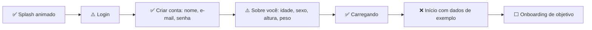
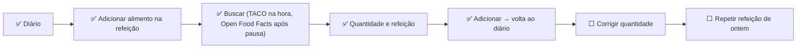
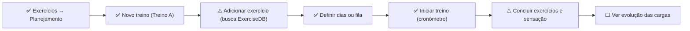
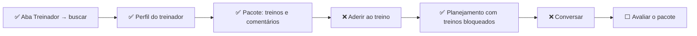
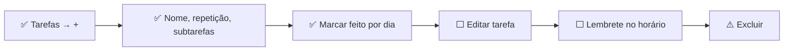
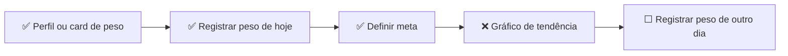
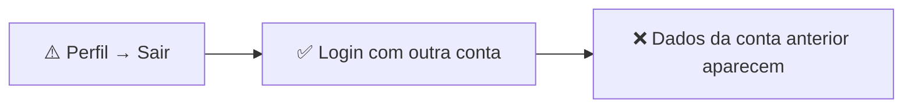
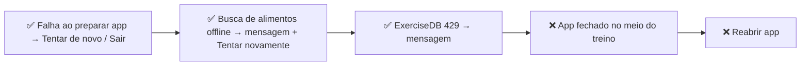

# Auditoria do Treina — análise técnica

Commit analisado: `5fd90b1` (branch `main`). 2026-11-02. 14.402 linhas em 123 arquivos de `src/`. 18 commits.

> **Contexto da fase.** Front-end primeiro: a aplicação está sendo construída com dados simulados e estado em memória antes da integração com o backend. A auditoria avalia o front para essa fase e, separadamente, a distância até a produção.

O relatório visual interativo está em [`index.html`](index.html). Este documento traz as mesmas conclusões em texto, com as evidências.

## Resumo

| Indicador | Valor |
|---|---|
| Nota geral (produção) | **5,2 / 10** |
| Nota do front para a fase atual | **6,6 / 10** |
| Maturidade | **MVP inicial** |
| Telas analisadas | 23 (+ 5 diálogos) |
| Features identificadas | 22 |
| Problemas comprovados | 33 (+ 3 hipóteses) |
| Tarefas de roadmap | 33 |
| Features ausentes recomendadas | 21 |

**Por que MVP inicial.** Os fluxos principais (cadastrar, registrar alimento, montar e executar treino, seguir pacote, tarefas) funcionam do início ao fim dentro de uma sessão, com interface consistente. Ainda não é um MVP funcional porque nada sobrevive ao fechamento do app, os dados de contas diferentes se misturam e parte do que a tela mostra (passos, histórico de peso, metas) é fictício. Para a fase de front-first, o nível é bom; a nota 6,6 avalia só o front para essa fase.

**Nota da fase.** Média de qualidade técnica, arquitetura de front, UX/UI, funcionalidades, completude do front, performance e manutenibilidade, sem contar segurança, escalabilidade e produção, que dependem do backend.

## O que foi verificado e o que não foi

- **TypeScript (tsc --noEmit):** Passa. Falha com 2 erros apenas quando expo-env.d.ts não existe; o arquivo é gerado por expo start e está no .gitignore. Com ele gerado, 0 erros.
- **ESLint (expo lint):** 1 erro. src/hooks/use-color-scheme.web.ts:11, setState síncrono dentro de useEffect (regra react-hooks/set-state-in-effect).
- **Testes automatizados:** Inexistentes. Nenhum arquivo de teste, nenhum test runner e nenhum script de teste em package.json.
- **CI de qualidade:** Inexistente. .eas/workflows/preview.yml só gera build ou atualização OTA Android; não roda lint, typecheck ou testes.

- Não verificado: O app não foi executado em dispositivo, emulador ou navegador durante a auditoria; tudo foi avaliado por leitura de código, lint e typecheck.
- Não verificado: O fluxo real do Google Sign-In não foi testado (depende de IDs de cliente em .env.local, que não estão no repositório).
- Não verificado: Desempenho em tempo de execução (FPS do arrastar do dashboard, troca de abas por gesto, tempo de abertura) não foi medido.
- Não verificado: Não há documento de produto, público-alvo ou métricas no repositório; posicionamento e público foram inferidos do código (idioma pt-BR, tabela TACO, treinadores com Instagram).

## 1. Mapeamento

### Stack

- **Plataforma:** Expo SDK 58 (expo ~58.0.21); React Native 0.88.1; React 19.3; TypeScript 6.0 (strict); React Compiler habilitado (app.json → experiments.reactCompiler); Typed routes (experiments.typedRoutes)
- **Navegação:** Expo Router 58 (rotas em src/app); Stack.Protected para separar área logada; Abas próprias com swipe (src/components/sliding-tabs) sobre react-native-gesture-handler
- **UI:** Design system Material 3 próprio gerado do ícone (scripts/generate-theme.mjs + @material/material-color-utilities); lucide-react-native (ícones importados por caminho); react-native-svg (gráficos do dashboard); react-native-reanimated 4 + worklets (arrastar do dashboard, teclado do chat); expo-image (GIFs de exercícios)
- **Estado e dados:** 9 React Contexts com useState (sem biblioteca de estado); Sem persistência: nenhum AsyncStorage, SQLite, MMKV ou SecureStore; Caches em memória por módulo (Map) nos clientes de API
- **Integrações:** ExerciseDB v1 (oss.exercisedb.dev) para catálogo de exercícios; Open Food Facts search-a-licious para produtos brasileiros; TACO 4ª ed. embarcada (597 alimentos, src/lib/taco-data.ts); Google Sign-In (@react-native-google-signin/google-signin); Fotos de treinadores em randomuser.me; Links para Instagram (Linking.openURL)
- **Entrega:** EAS Build (perfis development, preview APK, production); EAS Update com runtimeVersion por fingerprint; Workflow EAS: OTA ou build Android a cada push na main

### Telas e rotas

| Tela | Rota | Grupo | Importância | Arquivo principal |
|---|---|---|---|---|
| Login | `/login` | Autenticação | Alta | `src/app/login.tsx` |
| Criar conta: sua conta | `/signup` | Autenticação | Alta | `src/app/signup/index.tsx` |
| Criar conta: sobre você | `/signup/details` | Autenticação | Alta | `src/app/signup/details.tsx` |
| Carregando o app / erro de carregamento | `(tabs)/_layout` | Autenticação | Média | `src/app/(tabs)/_layout.tsx` |
| Início (dashboard) | `/(tabs)` | Abas | Alta | `src/app/(tabs)/index.tsx` |
| Diário alimentar | `/(tabs)/diary` | Abas | Alta | `src/app/(tabs)/diary.tsx` |
| Adicionar alimento (busca) | `/log-food` | Modais | Alta | `src/app/log-food/index.tsx` |
| Quantidade do alimento | `/log-food/[id]` | Modais | Alta | `src/app/log-food/[id].tsx` |
| Refeições | `/meals` | Modais | Baixa | `src/app/meals.tsx` |
| Exercícios | `/(tabs)/exercise` | Abas | Alta | `src/app/(tabs)/exercise.tsx` |
| Adicionar exercício (busca) | `/log-exercise` | Modais | Alta | `src/app/log-exercise/index.tsx` |
| Detalhes do exercício | `/log-exercise/[id]` | Modais | Alta | `src/app/log-exercise/[id].tsx` |
| Planejamento | `/workouts` | Modais | Alta | `src/app/workouts/index.tsx` |
| Treino (edição) | `/workouts/[id]` | Modais | Média | `src/app/workouts/[id].tsx` |
| Sessão de treino | `/workout-session` | Modais | Alta | `src/app/workout-session.tsx` |
| Treinador (lista) | `/(tabs)/trainers` | Abas | Média | `src/app/(tabs)/trainers.tsx` |
| Perfil do treinador | `/trainer/[id]` | Treinadores | Média | `src/app/trainer/[id].tsx` |
| Pacote de treinos | `/trainer/package/[id]` | Treinadores | Alta | `src/app/trainer/package/[id].tsx` |
| Treino do pacote | `/trainer/workout` | Treinadores | Baixa | `src/app/trainer/workout.tsx` |
| Chat com o treinador | `/chat/[trainerId]` | Treinadores | Média | `src/app/chat/[trainerId].tsx` |
| Tarefas | `/(tabs)/tasks` | Abas | Média | `src/app/(tabs)/tasks.tsx` |
| Nova tarefa / subtarefa | `/add-task` | Modais | Média | `src/app/add-task.tsx` |
| Perfil | `/(tabs)/profile` | Abas | Média | `src/app/(tabs)/profile.tsx` |

Diálogos: registrar peso, meta de peso (`components/weight/weight-dialog.tsx`), escolher treino do dia (`app/workouts/index.tsx`), substituir planejamento (`app/trainer/package/[id].tsx`), sair do treino (`app/workout-session.tsx`).

A documentação da arquitetura, dos domínios e das integrações está em [`architecture.md`](architecture.md).

## 2. Análise por tela

### Login — `/login`

**Objetivo:** Entrar com e-mail e senha ou com Google. **Contexto:** Primeira tela de quem não tem sessão. **Importância no fluxo principal:** Alta.

Arquivos: `src/app/login.tsx`, `src/context/session.tsx`, `src/lib/google-auth.ts`

**Funciona**

- Login simulado por e-mail entra com qualquer valor
- Google Sign-In em build nativo (web mostra indisponível)
- Mostrar/ocultar senha
- Estados de carregamento separados para e-mail e Google
- Link para criar conta

**Parcial**

- Validação de e-mail e senha existe, mas fica desligada por IS_AUTH_MOCKED

**Redundâncias e simplificações**

- EMAIL_PATTERN redefinido aqui e em src/lib/profile.ts

**UX/UI (+ positivo, − negativo)**

- − Textos em inglês: 'Sign in', 'Show', 'Your password', 'you@example.com' e mensagens de erro
- − 'Faca login' sem cedilha e 'Bem vindo' sem hífen
- − Sem 'Esqueci minha senha'
- + Erro anunciado com accessibilityRole='alert'
- + Botão Google segue a identidade visual do Google nos dois temas
- + KeyboardAvoidingView e retorno do teclado encadeando campos

Estados: carregando **sim** · vazio **n/a** · erro **sim** · sucesso **sim (guard troca a tela)**

**Técnica**

- Não normaliza o e-mail para minúsculas, ao contrário do cadastro (I-09)
- Estado de envio por booleanos separados; simples e correto
- Erro do Google tipado (GoogleSignInError) com mensagem própria

**Oportunidades**

- Traduzir e revisar todos os textos
- Adicionar recuperação de senha antes do backend, já com a tela pronta
- Usar um helper único de normalização e validação de e-mail

Problemas relacionados: I-08 (Login com textos em inglês e erros de grafia), I-09 (Login não normaliza o e-mail como o cadastro), I-10 (Autenticação simulada)

| Critério | Nota | Justificativa |
|---|---|---|
| Qualidade técnica | 6 | Estrutura limpa e estados corretos, mas validação duplicada e e-mail não normalizado. |
| UX/UI | 5 | Idioma misto e erros de grafia na primeira impressão do app. |
| Completude funcional | 4 | Falta recuperação de senha e a validação está desligada. |
| Maturidade | 3 | Depende inteiramente do mock de autenticação. |

### Criar conta: sua conta — `/signup`

**Objetivo:** Coletar nome, e-mail e senha (etapa 1 de 2). **Contexto:** Novo usuário vindo do login. **Importância no fluxo principal:** Alta.

Arquivos: `src/app/signup/index.tsx`, `src/components/signup/step-screen.tsx`, `src/context/signup.tsx`

**Funciona**

- Exige nome e sobrenome
- Valida e-mail e senha com pelo menos 6 caracteres
- Guarda os dados ao voltar da etapa 2 (SignupProvider)
- Indicador de etapa com rótulo de acessibilidade

**Parcial**

- A senha é coletada e descartada em session.signUp

**UX/UI (+ positivo, − negativo)**

- + Mensagens de erro claras em pt-BR
- + Foco passa automaticamente entre campos
- − Erro único no rodapé em vez de junto ao campo
- − Sem mostrar senha, ao contrário do login

Estados: carregando **n/a** · vazio **n/a** · erro **sim** · sucesso **sim**

**Técnica**

- Validação simples e correta
- StepScreen reaproveitado entre as duas etapas
- Exigir sobrenome pode barrar nomes de uma palavra (hipótese de produto, não erro de código)

**Oportunidades**

- Erros por campo
- Botão de mostrar senha
- Termos de uso e consentimento de dados de saúde nesta etapa

Problemas relacionados: I-10 (Autenticação simulada)

| Critério | Nota | Justificativa |
|---|---|---|
| Qualidade técnica | 7 | Código curto, reaproveita StepScreen e valida bem. |
| UX/UI | 7 | Fluxo claro e em português; erro centralizado no rodapé. |
| Completude funcional | 7 | Cumpre a etapa; faltam termos e consentimento. |
| Maturidade | 5 | A senha não tem destino até existir backend. |

### Criar conta: sobre você — `/signup/details`

**Objetivo:** Coletar idade, sexo, altura e peso (etapa 2 de 2) e criar a conta. **Contexto:** Continuação do cadastro. **Importância no fluxo principal:** Alta.

Arquivos: `src/app/signup/details.tsx`, `src/components/ui/picker-field.tsx`, `src/lib/profile.ts`

**Funciona**

- Seletores de idade (13 a 120) e altura (100 a 250 cm)
- Peso validado entre 30 e 400 kg com vírgula ou ponto
- Redireciona para a etapa 1 se aberta sem ela
- Cria a conta e entra direto

**Parcial**

- A descrição promete estimar calorias, mas os dados não são usados em nenhuma meta (I-04)

**UX/UI (+ positivo, − negativo)**

- + Seletores evitam digitação inválida
- + Opção 'Não informar' para sexo
- − Não pergunta objetivo (perder, manter, ganhar) nem nível de atividade, necessários para a promessa da própria tela
- − Guarda idade e não data de nascimento

Estados: carregando **sim** · vazio **n/a** · erro **sim** · sucesso **sim**

**Técnica**

- Redirect de proteção bem pensado para web
- Arredondamento do peso a 0,1 kg
- Profile.age fixo envelhece errado com o tempo (I-13)

**Oportunidades**

- Adicionar objetivo e nível de atividade
- Usar os dados para calcular metas
- Trocar idade por data de nascimento

Problemas relacionados: I-04 (Metas fixas apesar de o cadastro prometer cálculo), I-13 (Perfil não editável)

| Critério | Nota | Justificativa |
|---|---|---|
| Qualidade técnica | 7 | Validação e proteção de rota corretas. |
| UX/UI | 7 | Boa entrada de dados, mas a promessa da tela não se cumpre. |
| Completude funcional | 6 | Faltam objetivo e atividade para o cálculo de metas. |
| Maturidade | 5 | Dados ficam só na memória da sessão. |

### Carregando o app / erro de carregamento — `(tabs)/_layout`

**Objetivo:** Preparar os dados do usuário antes de mostrar as abas. **Contexto:** Logo após cada login. **Importância no fluxo principal:** Média.

Arquivos: `src/app/(tabs)/_layout.tsx`, `src/hooks/use-main-flow-bootstrap.ts`, `src/lib/prepare-main-flow.ts`, `src/components/main-flow-loading.tsx`

**Funciona**

- Estados loading, ready e error
- Tentar de novo e Sair na tela de erro
- Ignora respostas após logout (cancelled)

**Parcial**

- prepareMainFlow está vazio por enquanto, de propósito

**UX/UI (+ positivo, − negativo)**

- + Mensagem de erro útil em pt-BR
- + Sempre abre na primeira aba

Estados: carregando **sim** · vazio **n/a** · erro **sim** · sucesso **sim**

**Técnica**

- Padrão correto para o futuro carregamento do backend
- console.warn como único registro de erro

**Oportunidades**

- Ligar ao monitoramento de erros
- Carregar perfil e metas aqui quando houver API

| Critério | Nota | Justificativa |
|---|---|---|
| Qualidade técnica | 7 | Hook pequeno, cancelável e com retry. |
| UX/UI | 7 | Estados claros com saída para o usuário. |
| Completude funcional | 5 | Ainda não carrega nada. |
| Maturidade | 5 | Pronto para receber a integração. |

### Início (dashboard) — `/(tabs)`

**Objetivo:** Resumo do dia: calorias, macros, passos, exercício, tarefas e peso. **Contexto:** Tela de abertura do app. **Importância no fluxo principal:** Alta.

Arquivos: `src/app/(tabs)/index.tsx`, `src/components/dashboard/draggable-dashboard.tsx`, `src/components/dashboard/*.tsx`, `src/context/dashboard-layout.tsx`, `src/lib/dashboard-widgets.ts`, `src/lib/dashboard-data.ts`

**Funciona**

- Calorias consumidas e macros vêm do diário real
- Calorias e minutos de exercício vêm do registro real
- Progresso do treino do dia
- Tarefas do dia com marcação
- Modo edição: adicionar, remover e reordenar widgets por arrastar, com lixeira e ações de acessibilidade
- Dois widgets por linha em versão compacta, três ou mais viram carrossel

**Parcial**

- Card de peso usa histórico com dados de exemplo (I-03)
- Metas de calorias, macros e exercício são fixas (I-04)

**Apenas visual ou demonstrativo**

- Passos: 6.840 de 10.000 para qualquer usuário (I-05)

**Redundâncias e simplificações**

- Remover widget existe por arrastar à lixeira e pelo botão na barra de edição; aceitável como alternativa acessível

**UX/UI (+ positivo, − negativo)**

- + Hierarquia clara: 'Hoje' e cards por importância
- + Estado vazio com ação 'Adicionar itens'
- + Prévia não interativa no modo edição evita toques acidentais
- − Números fictícios ao lado de números reais, sem distinção
- − Sem navegação para outros dias no dashboard

Estados: carregando **n/a** · vazio **sim** · erro **n/a** · sucesso **sim**

**Técnica**

- Arrastar com Reanimated, auto-rolagem e trava do swipe de abas: implementação avançada
- draggable-dashboard.tsx com 714 linhas (I-29)
- moveWidget é função pura e testável
- Layout não persiste (I-01)

**Oportunidades**

- Esconder ou marcar widgets sem dado real
- Calcular metas do perfil
- Persistir o layout
- Tocar em um card leva à aba correspondente

Problemas relacionados: I-03 (Histórico de peso fictício para todo usuário), I-04 (Metas fixas apesar de o cadastro prometer cálculo), I-05 (Passos fictícios exibidos como reais), I-29 (Componente de dashboard com 714 linhas), I-01 (Nenhuma persistência local)

| Critério | Nota | Justificativa |
|---|---|---|
| Qualidade técnica | 7 | Engenharia sofisticada no arrastar, mas concentrada em um arquivo grande. |
| UX/UI | 7 | Visual organizado e personalizável; confunde ao misturar dado real e fictício. |
| Completude funcional | 5 | Metade dos números ainda não vem de dados do usuário. |
| Maturidade | 5 | Funciona na sessão, mas perde o layout ao reiniciar. |

### Diário alimentar — `/(tabs)/diary`

**Objetivo:** Ver e registrar alimentos por refeição em cada dia. **Contexto:** Uso diário, várias vezes ao dia. **Importância no fluxo principal:** Alta.

Arquivos: `src/app/(tabs)/diary.tsx`, `src/components/diary/meal-section.tsx`, `src/context/food-log.tsx`

**Funciona**

- Seletor de dia (Hoje, Ontem, Amanhã)
- Totais de kcal e macros do dia
- Seções por refeição com total e lista
- Remover alimento
- Refeições removidas continuam aparecendo nos dias em que têm alimentos

**Parcial**

- Sem editar quantidade ou mudar de refeição (I-12)

**UX/UI (+ positivo, − negativo)**

- + Rótulos encolhem em vez de quebrar em telas estreitas
- + Botão de adicionar por refeição já leva a refeição certa
- − Remover sem confirmação nem desfazer (I-11)
- − Totais sem comparação com a meta do dia
- − Aceita registro em datas futuras (I-27)

Estados: carregando **n/a** · vazio **sim** · erro **n/a** · sucesso **sim**

**Técnica**

- useFoodDay recalcula seções a cada render (H-01)
- sumNutrients descarta fibra no total do dia

**Oportunidades**

- Mostrar quanto falta para a meta
- Editar registro ao tocar
- Copiar refeição de outro dia
- Recentes e favoritos

Problemas relacionados: I-11 (Exclusões sem confirmação nem desfazer), I-12 (Registros não podem ser editados), I-27 (Registro em datas futuras inconsistente)

| Critério | Nota | Justificativa |
|---|---|---|
| Qualidade técnica | 7 | Modelagem cuidadosa (mealName guardado para refeições removidas). |
| UX/UI | 8 | Leitura rápida e ações bem posicionadas. |
| Completude funcional | 7 | Falta editar e comparar com a meta. |
| Maturidade | 6 | Fluxo completo dentro da sessão. |

### Adicionar alimento (busca) — `/log-food`

**Objetivo:** Encontrar um alimento genérico ou produto industrializado. **Contexto:** Aberto a partir de uma refeição do diário. **Importância no fluxo principal:** Alta.

Arquivos: `src/app/log-food/index.tsx`, `src/hooks/use-food-search.ts`, `src/lib/taco.ts`, `src/lib/openfoodfacts.ts`

**Funciona**

- TACO filtra a cada tecla, offline, com busca por prefixo sem acento
- Open Food Facts após 600 ms e 3 letras, só produtos do Brasil
- Respostas obsoletas ignoradas
- Erro com Tentar novamente
- Lista única das duas fontes

**UX/UI (+ positivo, − negativo)**

- + Estado vazio ilustrado e foco automático na busca
- + Indicador de carregamento só para a parte online
- − Não diferencia visualmente TACO e produto de marca além do detalhe
- − Sem recentes quando o campo está vazio

Estados: carregando **sim** · vazio **sim** · erro **sim** · sucesso **sim**

**Técnica**

- Hook bem resolvido com chave por tentativa e debounce
- Cache de promessas e descarte de falhas para permitir retry
- Filtro de valores impossíveis por 100 g

**Oportunidades**

- Recentes e favoritos no estado vazio
- Leitor de código de barras
- Selo da fonte do dado

| Critério | Nota | Justificativa |
|---|---|---|
| Qualidade técnica | 8 | Melhor código do projeto: debounce, cache, descarte e validação de dados externos. |
| UX/UI | 8 | Rápida e com todos os estados. |
| Completude funcional | 8 | Faltam atalhos de recorrência. |
| Maturidade | 6 | Produtos online somem da memória ao reiniciar. |

### Quantidade do alimento — `/log-food/[id]`

**Objetivo:** Definir gramas e refeição e ver os nutrientes antes de adicionar. **Contexto:** Após escolher o alimento. **Importância no fluxo principal:** Alta.

Arquivos: `src/app/log-food/[id].tsx`, `src/lib/foods.ts`

**Funciona**

- Porção do rótulo e 100 g como atalhos
- Troca de refeição por chips
- Nutrientes recalculados ao digitar, incluindo fibra quando existe
- Fecha o modal inteiro ao salvar

**Parcial**

- Sem limite superior de gramas (I-30)

**Redundâncias e simplificações**

- parseNumber local duplica parseDecimal de lib/profile (I-18)

**UX/UI (+ positivo, − negativo)**

- + Prévia imediata dos nutrientes
- + Botão desabilitado com valor inválido
- − Sem medidas caseiras (colher, unidade, xícara), comuns na TACO

Estados: carregando **n/a** · vazio **sim (alimento não encontrado)** · erro **parcial** · sucesso **sim**

**Técnica**

- Depende do cache em memória para produtos do Open Food Facts; após reload mostra 'não encontrado'
- Validação mínima de entrada

**Oportunidades**

- Medidas caseiras
- Modo edição para registros existentes
- Limite e aviso para quantidades altas

Problemas relacionados: I-18 (Helpers duplicados), I-30 (Quantidade de alimento sem limite)

| Critério | Nota | Justificativa |
|---|---|---|
| Qualidade técnica | 7 | Correto e simples; duplica helper. |
| UX/UI | 7 | Clara, mas só em gramas. |
| Completude funcional | 7 | Faltam medidas caseiras e edição. |
| Maturidade | 6 | Funciona de ponta a ponta na sessão. |

### Refeições — `/meals`

**Objetivo:** Escolher quais refeições aparecem no diário. **Contexto:** Configuração ocasional. **Importância no fluxo principal:** Baixa.

Arquivos: `src/app/meals.tsx`, `src/lib/foods.ts (insertMeal)`

**Funciona**

- Remover refeição (sempre mantém pelo menos uma)
- Adicionar refeições padrão na ordem do dia
- Refeição personalizada com detecção de nome duplicado
- Digitar o nome de uma refeição padrão adiciona a padrão

**UX/UI (+ positivo, − negativo)**

- + Explica que alimentos de refeições removidas continuam no diário
- − Não permite reordenar nem renomear refeições
- − Remoção sem confirmação

Estados: carregando **n/a** · vazio **n/a** · erro **sim (duplicado)** · sucesso **sim**

**Técnica**

- insertMeal mantém a ordem do dia: regra pura e testável

**Oportunidades**

- Reordenar e renomear
- Horário sugerido por refeição para lembretes

Problemas relacionados: I-11 (Exclusões sem confirmação nem desfazer)

| Critério | Nota | Justificativa |
|---|---|---|
| Qualidade técnica | 8 | Regras pequenas e bem pensadas. |
| UX/UI | 7 | Simples; faltam reordenar e renomear. |
| Completude funcional | 8 | Cumpre o objetivo. |
| Maturidade | 6 | Configuração perdida ao reiniciar. |

### Exercícios — `/(tabs)/exercise`

**Objetivo:** Ver o treino do dia e os exercícios registrados. **Contexto:** Dias de treino. **Importância no fluxo principal:** Alta.

Arquivos: `src/app/(tabs)/exercise.tsx`, `src/components/exercise/workout-card.tsx`, `src/components/exercise/exercise-section.tsx`, `src/context/exercise-log.tsx`

**Funciona**

- Seletor de dia e totais (kcal, minutos, quantidade)
- Treino do dia conforme plano semanal ou fila
- Marcar exercícios do treino individualmente
- Concluir sem cronômetro ou iniciar sessão
- Desfazer conclusão
- Seções cardio e musculação com registros avulsos
- Acesso ao planejamento

**Parcial**

- Futuro só mostra prévia do treino, mas exercícios avulsos podem ser registrados no futuro (I-27)

**Redundâncias e simplificações**

- Duas formas de concluir (cronometrado e sem cronômetro) é proposital e útil

**UX/UI (+ positivo, − negativo)**

- + Treino do dia em destaque acima dos registros
- + Resumo de sessão (duração e sensação) no card concluído
- − Total de 'Minutos' conta só cardio
- − Registros avulsos sem edição

Estados: carregando **n/a** · vazio **sim** · erro **n/a** · sucesso **sim**

**Técnica**

- getWorkoutForDate centraliza a regra do dia
- Desfazer em dia antigo desalinha a fila (I-07)
- Calorias 0 quando não há MET (I-28)

**Oportunidades**

- Mostrar histórico de cargas do exercício
- Minutos totais incluindo musculação via duração da sessão

Problemas relacionados: I-07 (Desfazer conclusão antiga desalinha a fila), I-12 (Registros não podem ser editados), I-27 (Registro em datas futuras inconsistente), I-28 (Calorias de exercício pouco confiáveis)

| Critério | Nota | Justificativa |
|---|---|---|
| Qualidade técnica | 7 | Regra do dia bem isolada; bug de fila e calorias zeradas. |
| UX/UI | 7 | Boa hierarquia; métricas incompletas. |
| Completude funcional | 7 | Faltam edição e histórico. |
| Maturidade | 6 | Funciona na sessão. |

### Adicionar exercício (busca) — `/log-exercise`

**Objetivo:** Escolher um exercício do catálogo ExerciseDB ou digitar um próprio. **Contexto:** Registro avulso ou montagem de treino. **Importância no fluxo principal:** Alta.

Arquivos: `src/app/log-exercise/index.tsx`, `src/lib/exercisedb.ts`

**Funciona**

- Catálogo paginado por categoria com carregamento ao rolar
- Busca remota ao enviar
- Adicionar manualmente com o nome digitado
- Miniatura sem animação para economizar
- Tratamento de 429 e falha de rede

**Parcial**

- Termos e nomes só em inglês (I-25)

**UX/UI (+ positivo, − negativo)**

- + Duas ações claras sob a busca (buscar ou adicionar manualmente)
- − Busca não acontece ao digitar, diferente da de alimentos
- − Ícone '+' em 'Tentar novamente' (I-26)
- − Nomes em inglês num app em pt-BR

Estados: carregando **sim** · vazio **sim** · erro **sim** · sucesso **sim**

**Técnica**

- useCatalog com eslint-disable de exhaustive-deps justificado
- Respostas obsoletas ignoradas com contador
- Dependência de API gratuita de terceiros sem SLA

**Oportunidades**

- Tradução de nomes e músculos
- Busca com debounce respeitando o limite
- Filtros por músculo e equipamento

Problemas relacionados: I-25 (Busca de exercícios inconsistente com a de alimentos), I-26 (Ícone errado no botão de tentar novamente)

| Critério | Nota | Justificativa |
|---|---|---|
| Qualidade técnica | 7 | Paginação e erros bem tratados. |
| UX/UI | 6 | Barreira de idioma e busca diferente do resto. |
| Completude funcional | 7 | Cobre catálogo, busca e manual. |
| Maturidade | 6 | Depende de serviço externo frágil. |

### Detalhes do exercício — `/log-exercise/[id]`

**Objetivo:** Definir duração e calorias (cardio) ou séries, repetições e carga (musculação). **Contexto:** Após escolher o exercício. **Importância no fluxo principal:** Alta.

Arquivos: `src/app/log-exercise/[id].tsx`, `src/lib/exercises.ts`

**Funciona**

- GIF de demonstração
- Estimativa de kcal por MET com o peso do perfil
- Calorias editáveis
- Modo 'adicionar ao treino' sem calorias

**Parcial**

- Exercício manual sem MET entra com 0 kcal (I-28)
- Sempre abre com 30 min ou 3 × 10, mesmo para exercício já feito antes

**Redundâncias e simplificações**

- Field local duplicado em workout-session (I-18)

**UX/UI (+ positivo, − negativo)**

- + Dica 'Estimativa para X kg' deixa claro de onde vem o número
- − Uma carga para todas as séries
- − Sem lembrar o último valor usado

Estados: carregando **n/a** · vazio **parcial** · erro **parcial** · sucesso **sim**

**Técnica**

- Validação inline em uma expressão longa de difícil leitura
- Dois destinos (diário ou treino) na mesma tela via workoutId: funciona, mas aumenta ramificações

**Oportunidades**

- Lembrar últimos valores
- Carga por série
- Intensidade para exercícios manuais

Problemas relacionados: I-18 (Helpers duplicados), I-28 (Calorias de exercício pouco confiáveis)

| Critério | Nota | Justificativa |
|---|---|---|
| Qualidade técnica | 6 | Funciona, mas concentra ramificações e duplica Field. |
| UX/UI | 6 | Clara, porém genérica demais para musculação. |
| Completude funcional | 7 | Cobre os dois tipos de exercício. |
| Maturidade | 5 | Calorias pouco confiáveis em casos comuns. |

### Planejamento — `/workouts`

**Objetivo:** Criar treinos e definir quando acontecem (semanal ou fila). **Contexto:** Configuração do plano de treino. **Importância no fluxo principal:** Alta.

Arquivos: `src/app/workouts/index.tsx`, `src/context/workout-plan.tsx`, `src/lib/workouts.ts`

**Funciona**

- Criar treino com nome automático (Treino A, B…)
- Modo semanal com diálogo por dia
- Modo fila: adicionar, mover, remover e escolher o próximo
- Treinos de treinador identificados com avatar

**Parcial**

- Botão Confirmar só volta (o plano já salva ao mudar); pode sugerir que algo não salvo se perde

**Redundâncias e simplificações**

- 'Confirmar' é redundante com salvar automático

**UX/UI (+ positivo, − negativo)**

- + Explicação de cada modo em uma frase
- + Acessibilidade boa na fila (dicas e rótulos)
- − Reordenar só por setas, sem arrastar
- − Dias da semana ficam desabilitados até existir um treino; a dica fica em outra seção

Estados: carregando **n/a** · vazio **sim** · erro **n/a** · sucesso **sim**

**Técnica**

- Lógica de fila com casos de borda cuidados (removeFromQueue, moveInQueue)
- Ponteiro único da fila é frágil (I-07)

**Oportunidades**

- Renomear 'Confirmar' para 'Concluir' ou remover
- Arrastar para reordenar como no dashboard

Problemas relacionados: I-07 (Desfazer conclusão antiga desalinha a fila)

| Critério | Nota | Justificativa |
|---|---|---|
| Qualidade técnica | 7 | Regras de fila bem pensadas, mas sem testes. |
| UX/UI | 7 | Flexível e explicada. |
| Completude funcional | 7 | Cobre os dois modos. |
| Maturidade | 6 | Plano perdido ao reiniciar. |

### Treino (edição) — `/workouts/[id]`

**Objetivo:** Renomear o treino e gerenciar seus exercícios. **Contexto:** Dentro do planejamento. **Importância no fluxo principal:** Média.

Arquivos: `src/app/workouts/[id].tsx`, `src/components/trainers/workout-source.tsx`

**Funciona**

- Renomear com salvamento imediato
- Adicionar musculação ou cardio
- Remover exercício
- Excluir treino
- Treino de treinador bloqueado com explicação

**Parcial**

- Não edita séries, repetições ou carga de um exercício já adicionado (I-12)
- Não reordena exercícios

**UX/UI (+ positivo, − negativo)**

- − Excluir treino sem confirmação (I-11)
- − Nome pode ficar vazio
- + Notas do treinador aparecem junto ao exercício

Estados: carregando **n/a** · vazio **sim** · erro **sim (não encontrado)** · sucesso **sim**

**Técnica**

- updateWorkout ignora silenciosamente treinos de treinador: correto, mas sem feedback se chamado

**Oportunidades**

- Editar e reordenar exercícios
- Duplicar treino
- Confirmação ao excluir

Problemas relacionados: I-11 (Exclusões sem confirmação nem desfazer), I-12 (Registros não podem ser editados)

| Critério | Nota | Justificativa |
|---|---|---|
| Qualidade técnica | 6 | Simples, mas falta updateExercise no contexto. |
| UX/UI | 6 | Ações destrutivas sem proteção. |
| Completude funcional | 5 | Edição parcial do treino. |
| Maturidade | 5 | Depende de apagar e recriar. |

### Sessão de treino — `/workout-session`

**Objetivo:** Executar o treino com cronômetro e registrar o que foi feito. **Contexto:** Durante o treino, com o celular na mão. **Importância no fluxo principal:** Alta.

Arquivos: `src/app/workout-session.tsx`, `src/components/ui/feeling-picker.tsx`

**Funciona**

- Cronômetro desde a abertura, baseado em timestamps
- Valores planejados pré-preenchidos e editáveis
- Concluir ou desfazer cada exercício
- Revisão com escala de sensação 0 a 5
- Confirmação ao sair no meio, inclusive gesto de voltar (usePreventRemove)
- Substitui registros rápidos anteriores do mesmo exercício

**Parcial**

- Sessão perdida se o app for encerrado (I-32)

**UX/UI (+ positivo, − negativo)**

- + Diálogo de saída explica o que será descartado
- + Cronômetro com rótulo de acessibilidade
- − Sem timer de descanso
- − Uma linha por exercício, sem séries individuais
- − Tela não fica ligada (sem keep-awake)

Estados: carregando **n/a** · vazio **sim (treino não encontrado)** · erro **parcial** · sucesso **sim**

**Técnica**

- Uso correto de usePreventRemove e ref para ação pendente
- Validação de inteiros e decimais separada
- Field duplicado (I-18)

**Oportunidades**

- Timer de descanso entre séries
- Registro por série com última carga
- Manter a tela ligada (expo-keep-awake)
- Retomar sessão interrompida

Problemas relacionados: I-18 (Helpers duplicados), I-32 (Sessão de treino perdida ao sair do app)

| Critério | Nota | Justificativa |
|---|---|---|
| Qualidade técnica | 7 | Fluxo de saída e tempo bem resolvidos. |
| UX/UI | 7 | Boa base; falta o que se usa durante a série. |
| Completude funcional | 6 | Sem descanso nem séries. |
| Maturidade | 5 | Estado só na tela. |

### Treinador (lista) — `/(tabs)/trainers`

**Objetivo:** Encontrar treinadores e seus programas. **Contexto:** Descoberta de conteúdo. **Importância no fluxo principal:** Média.

Arquivos: `src/app/(tabs)/trainers.tsx`, `src/components/trainers/trainer-card.tsx`, `src/lib/trainers.ts`

**Funciona**

- Busca por nome sem acento
- Estado vazio com o termo buscado
- Abrir perfil

**Apenas visual ou demonstrativo**

- Lista fixa de 4 treinadores com fotos de randomuser.me e números inventados (I-22)

**UX/UI (+ positivo, − negativo)**

- + Busca simples e imediata
- − Sem filtros por especialidade, nível ou objetivo
- − Rótulo da aba no singular ('Treinador') para uma lista

Estados: carregando **n/a** · vazio **sim** · erro **n/a** · sucesso **sim**

**Técnica**

- searchTrainers busca só no nome
- Dados de fixture dentro do código

**Oportunidades**

- Filtros por objetivo e nível
- Destacar o treinador que o usuário segue

Problemas relacionados: I-22 (Catálogo de treinadores fixo no código)

| Critério | Nota | Justificativa |
|---|---|---|
| Qualidade técnica | 6 | Simples e correto para fixture. |
| UX/UI | 7 | Limpa, mas sem filtros. |
| Completude funcional | 4 | Catálogo estático. |
| Maturidade | 3 | Totalmente dependente de dados de exemplo. |

### Perfil do treinador — `/trainer/[id]`

**Objetivo:** Apresentar o treinador e seus pacotes. **Contexto:** Decisão de seguir um programa. **Importância no fluxo principal:** Média.

Arquivos: `src/app/trainer/[id].tsx`, `src/components/trainers/trainer-avatar.tsx`

**Funciona**

- Foto, especialidade, números e bio
- Abrir Instagram
- Conversar (abre o chat)
- Lista de pacotes com 'Você aderiu'

**Apenas visual ou demonstrativo**

- Seguidores, alunos e nota são valores fixos

**UX/UI (+ positivo, − negativo)**

- + Rótulos de acessibilidade descritivos nos números
- + CTA principal claro
- − 'Conversar' leva a um chat que não responde (I-14)

Estados: carregando **n/a** · vazio **sim (não encontrado)** · erro **n/a** · sucesso **sim**

**Técnica**

- Linking.openURL sem tratar falha
- Formatação compacta pt-BR (254,9 mil)

**Oportunidades**

- Esconder 'Conversar' até haver resposta real ou marcar como prévia

Problemas relacionados: I-14 (Chat sem resposta e sem aviso), I-22 (Catálogo de treinadores fixo no código)

| Critério | Nota | Justificativa |
|---|---|---|
| Qualidade técnica | 6 | Correto; pequenos pontos sem tratamento de erro. |
| UX/UI | 7 | Bem apresentado. |
| Completude funcional | 4 | Conteúdo e chat ainda simulados. |
| Maturidade | 3 | Depende do backend para ter sentido. |

### Pacote de treinos — `/trainer/package/[id]`

**Objetivo:** Mostrar treinos, comentários e permitir aderir ao programa. **Contexto:** Decisão de compra ou adesão. **Importância no fluxo principal:** Alta.

Arquivos: `src/app/trainer/package/[id].tsx`, `src/context/coaching.tsx`

**Funciona**

- Detalhes de nível, semanas e treinos
- Comentários com estrelas e média
- Aderir copia treinos para o plano e distribui na semana
- Diálogo ao trocar de pacote
- Sair do pacote e ver planejamento

**Parcial**

- Aderir sem pacote anterior apaga os dias do plano próprio sem aviso (I-06)
- Sair do pacote apaga o histórico ligado a ele (I-33)
- Duração em semanas não é acompanhada

**Apenas visual ou demonstrativo**

- Comentários fixos; não é possível avaliar

**UX/UI (+ positivo, − negativo)**

- + Diálogo de substituição bem escrito
- + Rodapé fixo com a ação principal
- − 'Sair do pacote' sem confirmação
- − Nenhuma informação de preço, acesso ou vigência

Estados: carregando **n/a** · vazio **sim** · erro **sim (não encontrado)** · sucesso **sim**

**Técnica**

- joinPackage chama leavePackage e importWorkouts em sequência com updates funcionais: correto
- Regra de distribuição na semana isolada em packageWeek

**Oportunidades**

- Confirmar quando houver plano próprio
- Progresso no programa (semana 3 de 8)
- Avaliação pelo aluno

Problemas relacionados: I-06 (Aderir a um pacote apaga o plano semanal sem aviso), I-11 (Exclusões sem confirmação nem desfazer), I-33 (Sair do pacote apaga o histórico ligado a ele)

| Critério | Nota | Justificativa |
|---|---|---|
| Qualidade técnica | 6 | Boa composição de contextos, mas com perda de dados em dois caminhos. |
| UX/UI | 7 | Clara, com uma ação destrutiva desprotegida. |
| Completude funcional | 5 | Sem acompanhamento do programa nem avaliação. |
| Maturidade | 4 | Diferencial ainda unilateral. |

### Treino do pacote — `/trainer/workout`

**Objetivo:** Ver descrição e exercícios de um treino antes de aderir. **Contexto:** Avaliação do pacote. **Importância no fluxo principal:** Baixa.

Arquivos: `src/app/trainer/workout.tsx`, `src/components/trainers/workout-exercise-list.tsx`

**Funciona**

- Descrição, exercícios e notas do treinador

**UX/UI (+ positivo, − negativo)**

- + Leitura simples
- − Sem GIF ou demonstração dos exercícios do pacote

Estados: carregando **n/a** · vazio **sim (não encontrado)** · erro **n/a** · sucesso **sim**

**Técnica**

- Identifica o treino por índice no array (index=String(i)); frágil se o pacote mudar no backend

**Oportunidades**

- Usar id estável do treino
- Demonstração dos exercícios

| Critério | Nota | Justificativa |
|---|---|---|
| Qualidade técnica | 7 | Pequena e reaproveita a lista. |
| UX/UI | 7 | Objetiva. |
| Completude funcional | 6 | Sem demonstração. |
| Maturidade | 4 | Rota por índice precisa mudar com API. |

### Chat com o treinador — `/chat/[trainerId]`

**Objetivo:** Tirar dúvidas com o treinador. **Contexto:** Durante o programa. **Importância no fluxo principal:** Média.

Arquivos: `src/app/chat/[trainerId].tsx`, `src/context/chat.tsx`

**Funciona**

- Enviar mensagens com horário
- Campo que cresce até 5 linhas
- Composer acompanha o teclado (useAnimatedKeyboard)
- Lista invertida com estado vazio

**Apenas visual ou demonstrativo**

- Conversa só de ida: o treinador nunca responde (I-14)

**UX/UI (+ positivo, − negativo)**

- + Detalhe de campo que cresce e encolhe como no Instagram
- − Nenhum aviso de que é prévia
- − Sem status de envio ou leitura

Estados: carregando **n/a** · vazio **sim** · erro **n/a** · sucesso **parcial**

**Técnica**

- Medição do texto com cópia oculta para contornar limitação do Android: solução engenhosa e comentada
- Limite de 1.000 caracteres

**Oportunidades**

- Marcar como prévia ou resposta automática no modo demo
- Contrato de mensagens pronto para tempo real

Problemas relacionados: I-14 (Chat sem resposta e sem aviso)

| Critério | Nota | Justificativa |
|---|---|---|
| Qualidade técnica | 7 | Composer bem feito e comentado. |
| UX/UI | 7 | Boa interface, sem expectativa ajustada. |
| Completude funcional | 2 | Sem a outra ponta da conversa. |
| Maturidade | 2 | Não cumpre o objetivo sem backend. |

### Tarefas — `/(tabs)/tasks`

**Objetivo:** Checklist diário com tarefas repetidas e avulsas. **Contexto:** Rotina diária. **Importância no fluxo principal:** Média.

Arquivos: `src/app/(tabs)/tasks.tsx`, `src/components/tasks/task-section.tsx`, `src/context/tasks.tsx`, `src/lib/tasks.ts`

**Funciona**

- Tarefas que repetem a cada N dias ou semanas
- Tarefas avulsas ficam até serem feitas
- Subtarefas sincronizadas com a tarefa
- Contador feito/total
- Adicionar subtarefa pela linha

**Parcial**

- Sem editar tarefa (I-12)

**Redundâncias e simplificações**

- Widget Tarefas no Início repete esta aba

**UX/UI (+ positivo, − negativo)**

- + Checkbox com role e estado de acessibilidade
- − Excluir sem confirmação (I-11)
- − Sem horário ou lembrete
- − Não se conecta a metas de saúde: é um gerenciador de tarefas genérico dentro de um app de treino

Estados: carregando **n/a** · vazio **sim** · erro **n/a** · sucesso **sim**

**Técnica**

- Regras de repetição puras, com cuidado com horário de verão (daysBetween arredondado)
- Lógica de subtarefas espelhada em contexto e lib

**Oportunidades**

- Reposicionar como hábitos (água, sono, suplementos, alongamento)
- Lembretes
- Data de término

Problemas relacionados: I-11 (Exclusões sem confirmação nem desfazer), I-12 (Registros não podem ser editados), I-24 (Seis destinos na barra de navegação)

| Critério | Nota | Justificativa |
|---|---|---|
| Qualidade técnica | 7 | Domínio bem modelado. |
| UX/UI | 7 | Funciona, mas sem lembretes e com exclusão desprotegida. |
| Completude funcional | 6 | Sem edição e horário. |
| Maturidade | 5 | Valor de produto ainda indefinido. |

### Nova tarefa / subtarefa — `/add-task`

**Objetivo:** Criar tarefa com repetição e subtarefas, ou uma subtarefa. **Contexto:** A partir da aba Tarefas. **Importância no fluxo principal:** Média.

Arquivos: `src/app/add-task.tsx`

**Funciona**

- Repetição: não repete, todo dia, toda semana, personalizada
- Data de início = dia selecionado
- Subtarefas adicionadas na criação, incluindo a digitada e não confirmada
- Modo subtarefa com explicação

**UX/UI (+ positivo, − negativo)**

- + Radio group acessível
- + Mostra 'Começa em quinta-feira, 6 de novembro'
- − Intervalo personalizado inválido só desabilita o botão, sem mensagem

Estados: carregando **n/a** · vazio **n/a** · erro **parcial** · sucesso **sim**

**Técnica**

- Uma tela atende dois casos via parentId; ok neste tamanho
- key={index} na lista de subtarefas do rascunho

**Oportunidades**

- Mensagem para intervalo inválido
- Dias específicos da semana (seg, qua, sex)

| Critério | Nota | Justificativa |
|---|---|---|
| Qualidade técnica | 7 | Clara e enxuta. |
| UX/UI | 7 | Bom formulário; feedback de erro silencioso. |
| Completude funcional | 6 | Falta repetição por dias da semana e horário. |
| Maturidade | 5 | Sem modo edição. |

### Perfil — `/(tabs)/profile`

**Objetivo:** Dados pessoais, peso, meta e sair. **Contexto:** Consulta ocasional. **Importância no fluxo principal:** Média.

Arquivos: `src/app/(tabs)/profile.tsx`, `src/components/weight/weight-dialog.tsx`, `src/context/weight-log.tsx`

**Funciona**

- Iniciais, nome, e-mail e sexo
- Idade, peso e altura
- Registrar peso de hoje e definir/remover meta (diálogo validado)
- Progresso até a meta
- Sair

**Parcial**

- Nada além do peso pode ser editado (I-13)

**Redundâncias e simplificações**

- Registrar peso também existe no card do Início; aceitável

**UX/UI (+ positivo, − negativo)**

- + Diálogo de peso com validação 30 a 400 kg e erro anunciado
- − Sem configurações, privacidade, notificações ou excluir conta
- − 'Sair' sem confirmação
- − Usa MOCK_PROFILE como fallback de tela

Estados: carregando **n/a** · vazio **sim (sem meta)** · erro **sim (diálogo)** · sucesso **sim**

**Técnica**

- Fallback para MOCK_PROFILE em vez de estado de erro
- Peso duplicado entre perfil e histórico (I-15)

**Oportunidades**

- Editar perfil
- Tela de configurações
- Exportar dados e excluir conta

Problemas relacionados: I-13 (Perfil não editável), I-15 (Duas fontes de verdade para o peso), I-03 (Histórico de peso fictício para todo usuário)

| Critério | Nota | Justificativa |
|---|---|---|
| Qualidade técnica | 6 | Diálogo bom; modelo de peso duplicado. |
| UX/UI | 6 | Informativo, sem área de conta. |
| Completude funcional | 4 | Faltam edição e configurações. |
| Maturidade | 4 | Depende de perfil mock. |

## 3. Features

| ID | Feature | Importância | Estado | Qualidade | Prioridade |
|---|---|---|---|---|---|
| F-01 | Login por e-mail e Google | ESSENCIAL | Com problemas identificados | 5/10 | P1 |
| F-02 | Cadastro em duas etapas com dados corporais | ESSENCIAL | Parcialmente implementada | 7/10 | P1 |
| F-03 | Preparação pós-login com erro e retry | COMPLEMENTAR | Completa | 7/10 | P3 |
| F-04 | Dashboard do dia | ESSENCIAL | Parcialmente implementada | 6/10 | P0 |
| F-05 | Personalização do dashboard por arrastar | COMPLEMENTAR | Completa | 7/10 | P3 |
| F-06 | Diário alimentar por refeição | ESSENCIAL | Parcialmente implementada | 8/10 | P1 |
| F-07 | Busca de alimentos TACO + Open Food Facts | ESSENCIAL | Completa | 8/10 | P2 |
| F-08 | Refeições configuráveis | COMPLEMENTAR | Completa | 8/10 | P3 |
| F-09 | Registro de exercício avulso (ExerciseDB) | IMPORTANTE | Com problemas identificados | 6/10 | P2 |
| F-10 | Plano de treino semanal ou em fila | ESSENCIAL | Com problemas identificados | 7/10 | P1 |
| F-11 | Sessão de treino cronometrada | IMPORTANTE | Parcialmente implementada | 7/10 | P2 |
| F-12 | Treino do dia no card de Exercícios | IMPORTANTE | Com problemas identificados | 7/10 | P2 |
| F-13 | Catálogo e busca de treinadores | IMPORTANTE | Apenas visual | 5/10 | P2 |
| F-14 | Aderir a pacote de treinos | IMPORTANTE | Com problemas identificados | 6/10 | P1 |
| F-15 | Comentários e notas de pacotes | COMPLEMENTAR | Apenas visual | 5/10 | P3 |
| F-16 | Chat com o treinador | QUESTIONÁVEL | Não funcional | 3/10 | P1 |
| F-17 | Tarefas com repetição e subtarefas | QUESTIONÁVEL | Parcialmente implementada | 7/10 | P2 |
| F-18 | Registro de peso e meta | ESSENCIAL | Com problemas identificados | 6/10 | P0 |
| F-19 | Perfil do usuário | IMPORTANTE | Parcialmente implementada | 5/10 | P1 |
| F-20 | Design system Material 3 gerado do ícone | IMPORTANTE | Completa | 8/10 | P3 |
| F-21 | Abas com swipe (6 destinos) | COMPLEMENTAR | Com problemas identificados | 7/10 | P2 |
| F-22 | Entrega contínua EAS (OTA por fingerprint) | IMPORTANTE | Parcialmente implementada | 7/10 | P2 |

#### F-01 · Login por e-mail e Google

- **Problema que resolve:** Identificar o usuário e proteger seus dados.
- **Faz sentido para o produto:** Sim, todo app com dados pessoais precisa.
- **Implementação:** Mock por e-mail; Google real no Android; textos em inglês; e-mail não normalizado.
- **Intuitiva:** Sim, padrão conhecido.
- **Etapa faltando:** Recuperar senha.
- **Impacto da ausência:** Sem conta não há como sincronizar dados entre aparelhos.
- **Problemas:** I-08, I-09, I-10

#### F-02 · Cadastro em duas etapas com dados corporais

- **Problema que resolve:** Criar conta e coletar dados para personalização.
- **Faz sentido para o produto:** Sim.
- **Implementação:** Bem validado, mas os dados corporais não alimentam nenhum cálculo.
- **Intuitiva:** Sim.
- **Etapa faltando:** Objetivo e nível de atividade; termos e consentimento.
- **Impacto da ausência:** Sem os dados corporais não há metas pessoais.
- **Problemas:** I-04

#### F-03 · Preparação pós-login com erro e retry

- **Problema que resolve:** Evitar abas vazias enquanto os dados carregam.
- **Faz sentido para o produto:** Sim, já prepara a integração.
- **Implementação:** Correta; hoje não carrega nada.
- **Intuitiva:** Sim.
- **Etapa faltando:** Nenhuma na fase.
- **Impacto da ausência:** Telas piscariam vazias após o login.

#### F-04 · Dashboard do dia

- **Problema que resolve:** Mostrar em uma tela como está o dia.
- **Faz sentido para o produto:** Sim, é a tela de abertura.
- **Implementação:** Calorias e exercício reais; passos, metas e histórico de peso fictícios.
- **Intuitiva:** Sim.
- **Etapa faltando:** Metas pessoais; ver outros dias.
- **Impacto da ausência:** O usuário teria de abrir cada aba para saber como está.
- **Problemas:** I-03, I-04, I-05

#### F-05 · Personalização do dashboard por arrastar

- **Problema que resolve:** Deixar o usuário escolher o que vê primeiro.
- **Faz sentido para o produto:** Útil, mas não central nesta fase.
- **Implementação:** Avançada, acessível e sem persistência; 714 linhas.
- **Intuitiva:** Sim, com modo edição explícito.
- **Etapa faltando:** Persistir o layout.
- **Impacto da ausência:** Baixo: um layout padrão bem escolhido atenderia a maioria.
- **Problemas:** I-29, I-01

#### F-06 · Diário alimentar por refeição

- **Problema que resolve:** Registrar o que foi comido e acompanhar calorias e macros.
- **Faz sentido para o produto:** Sim, pilar do produto.
- **Implementação:** Fluxo completo de adicionar e remover; sem edição.
- **Intuitiva:** Sim.
- **Etapa faltando:** Editar, copiar refeição, recentes.
- **Impacto da ausência:** O app perde metade da proposta.
- **Problemas:** I-12, I-11

#### F-07 · Busca de alimentos TACO + Open Food Facts

- **Problema que resolve:** Encontrar rápido alimentos brasileiros e produtos de marca.
- **Faz sentido para o produto:** Sim, combinação muito adequada ao público.
- **Implementação:** Melhor implementação do projeto.
- **Intuitiva:** Sim.
- **Etapa faltando:** Código de barras.
- **Impacto da ausência:** Registro manual de nutrientes, inviável no dia a dia.

#### F-08 · Refeições configuráveis

- **Problema que resolve:** Adaptar o diário à rotina (pré e pós-treino, ceia).
- **Faz sentido para o produto:** Sim, combina com quem treina.
- **Implementação:** Correta.
- **Intuitiva:** Sim.
- **Etapa faltando:** Reordenar e renomear.
- **Impacto da ausência:** Baixo.

#### F-09 · Registro de exercício avulso (ExerciseDB)

- **Problema que resolve:** Registrar atividade fora do plano.
- **Faz sentido para o produto:** Sim.
- **Implementação:** Catálogo e busca funcionam; inglês e calorias pouco confiáveis.
- **Intuitiva:** Parcial, pela barreira de idioma.
- **Etapa faltando:** Edição; busca em português.
- **Impacto da ausência:** Atividades fora do plano não entrariam no saldo calórico.
- **Problemas:** I-25, I-28

#### F-10 · Plano de treino semanal ou em fila

- **Problema que resolve:** Saber qual treino fazer hoje.
- **Faz sentido para o produto:** Sim; o modo fila é um diferencial real.
- **Implementação:** Boa, com bug de ponteiro ao desfazer e sem editar exercícios.
- **Intuitiva:** Sim, com explicação de cada modo.
- **Etapa faltando:** Editar e reordenar exercícios.
- **Impacto da ausência:** O app vira só um registro, sem orientação.
- **Problemas:** I-07, I-12

#### F-11 · Sessão de treino cronometrada

- **Problema que resolve:** Guiar e registrar o treino em execução.
- **Faz sentido para o produto:** Sim.
- **Implementação:** Cronômetro e saída protegida bons; sem descanso, séries ou retomada.
- **Intuitiva:** Sim.
- **Etapa faltando:** Timer de descanso, séries individuais, tela ligada.
- **Impacto da ausência:** O registro voltaria a ser manual e depois do treino.
- **Problemas:** I-32

#### F-12 · Treino do dia no card de Exercícios

- **Problema que resolve:** Marcar exercícios feitos sem abrir a sessão.
- **Faz sentido para o produto:** Sim.
- **Implementação:** Correta, salvo o desfazer em dia antigo.
- **Intuitiva:** Sim.
- **Etapa faltando:** Nenhuma relevante.
- **Impacto da ausência:** Quem não quer cronômetro teria de registrar avulso.
- **Problemas:** I-07

#### F-13 · Catálogo e busca de treinadores

- **Problema que resolve:** Descobrir programas de profissionais.
- **Faz sentido para o produto:** Sim, é o diferencial aparente do produto.
- **Implementação:** Dados fixos no código.
- **Intuitiva:** Sim.
- **Etapa faltando:** Filtros e dados reais.
- **Impacto da ausência:** O produto vira um diário comum.
- **Problemas:** I-22

#### F-14 · Aderir a pacote de treinos

- **Problema que resolve:** Transformar o programa do treinador no plano do aluno.
- **Faz sentido para o produto:** Sim, é o elo entre catálogo e treino.
- **Implementação:** Copia e distribui bem; apaga o plano próprio sem aviso e perde histórico ao sair.
- **Intuitiva:** Sim.
- **Etapa faltando:** Progresso no programa; confirmação.
- **Impacto da ausência:** O catálogo seria só leitura.
- **Problemas:** I-06, I-33

#### F-15 · Comentários e notas de pacotes

- **Problema que resolve:** Dar prova social ao programa.
- **Faz sentido para o produto:** Sim, quando forem reais.
- **Implementação:** Leitura de dados fixos.
- **Intuitiva:** Sim.
- **Etapa faltando:** O aluno avaliar.
- **Impacto da ausência:** Baixo nesta fase.

#### F-16 · Chat com o treinador

- **Problema que resolve:** Tirar dúvidas sobre o programa.
- **Faz sentido para o produto:** Sim no futuro; hoje cria expectativa que não se cumpre.
- **Implementação:** Interface boa, sem a outra ponta.
- **Intuitiva:** Sim.
- **Etapa faltando:** Respostas, notificações, status.
- **Impacto da ausência:** Nenhum impacto hoje; ausência é melhor que mensagens sem resposta.
- **Problemas:** I-14

#### F-17 · Tarefas com repetição e subtarefas

- **Problema que resolve:** Organizar uma rotina diária.
- **Faz sentido para o produto:** Pouco: é genérica e não conversa com dieta, treino ou peso.
- **Implementação:** Lógica de repetição sólida, sem edição nem lembrete.
- **Intuitiva:** Sim.
- **Etapa faltando:** Lembretes, edição, ligação com metas.
- **Impacto da ausência:** Baixo para a proposta; ocupa uma aba inteira.
- **Problemas:** I-11, I-12, I-24

#### F-18 · Registro de peso e meta

- **Problema que resolve:** Acompanhar a principal métrica de resultado.
- **Faz sentido para o produto:** Sim.
- **Implementação:** Diálogo bom; histórico começa fictício e o peso tem duas fontes.
- **Intuitiva:** Sim.
- **Etapa faltando:** Registrar outra data, editar pesagem.
- **Impacto da ausência:** Sem medida de progresso.
- **Problemas:** I-03, I-15

#### F-19 · Perfil do usuário

- **Problema que resolve:** Ver e manter dados pessoais.
- **Faz sentido para o produto:** Sim.
- **Implementação:** Somente leitura, exceto peso.
- **Intuitiva:** Sim.
- **Etapa faltando:** Editar, configurações, excluir conta.
- **Impacto da ausência:** Dados errados no cadastro ficariam para sempre.
- **Problemas:** I-13

#### F-20 · Design system Material 3 gerado do ícone

- **Problema que resolve:** Consistência visual e tema escuro.
- **Faz sentido para o produto:** Sim.
- **Implementação:** Tokens gerados, relatório de contraste, 17 componentes base.
- **Intuitiva:** n/a
- **Etapa faltando:** Documentar os componentes.
- **Impacto da ausência:** Telas inconsistentes.

#### F-21 · Abas com swipe (6 destinos)

- **Problema que resolve:** Navegar entre áreas principais.
- **Faz sentido para o produto:** Sim, mas com destinos demais.
- **Implementação:** Pager próprio com trava de swipe.
- **Intuitiva:** Sim.
- **Etapa faltando:** Reduzir para 5.
- **Impacto da ausência:** n/a
- **Problemas:** I-24

#### F-22 · Entrega contínua EAS (OTA por fingerprint)

- **Problema que resolve:** Colocar versões de teste no celular sem loja.
- **Faz sentido para o produto:** Sim, ideal para a fase front-first.
- **Implementação:** Android pronto; iOS não configurado.
- **Intuitiva:** n/a
- **Etapa faltando:** Lint, typecheck e testes antes do OTA; iOS.
- **Impacto da ausência:** Testes só locais.
- **Problemas:** I-23, I-31

## 4. Features ausentes

### P0

- **Persistência local dos dados** (Gestão de dados): Sem ela o front não pode ser testado por usuários reais nem demonstrado de um dia para o outro; é pré-requisito para histórico, progresso e qualquer métrica de retenção.
- **Isolamento de dados por conta** (Privacidade): Dados de saúde de uma pessoa aparecem para a próxima que entrar no mesmo aparelho (I-02).
- **Camada de repositório e contratos de API** (Escalabilidade): É o que permite à estratégia front-first terminar em integração, e não em reescrita (I-20).
- **Backend com autenticação real e sessão segura** (Segurança): Bloqueia o lançamento: hoje qualquer pessoa entra com qualquer e-mail.
- **Consentimento, política de privacidade, exportar e excluir conta** (Segurança e privacidade): O app coleta peso, alimentação e dados corporais, que a LGPD trata como dados sensíveis de saúde; as lojas exigem exclusão de conta dentro do app.

### P1

- **Metas calculadas a partir do perfil** (Personalização): O cadastro promete estimar calorias e não estima; sem isso o anel de calorias e os macros não têm significado para o usuário (I-04).
- **Edição de registros, treinos, tarefas e perfil** (Fluxos incompletos): Corrigir erro de digitação é a ação mais comum em um diário; hoje exige apagar e recriar (I-12, I-13).
- **Tela de configurações** (Personalização): Não há lugar para metas, unidades, notificações, conta, privacidade e sair; 'Sair' fica solto no perfil.
- **Recuperação de senha** (Autenticação): Fluxo obrigatório de qualquer login por e-mail e senha; ausente na tela de login.
- **Histórico e progressão de treinos** (Relatórios): O app já registra séries, cargas e sensação, mas não mostra a evolução; é o principal motivo para quem treina voltar ao app.
- **Testes automatizados e CI** (Qualidade): As regras de repetição, fila e sincronização já têm casos de borda reais (I-07); sem testes, a integração com backend vai regredir sem ninguém ver.
- **Monitoramento de erros** (Operação): Com OTA ativa, um erro publicado chega a todos os usuários; hoje só há console.warn.

### P2

- **Timer de descanso e registro por série** (Treino): A sessão registra um único número de séries, repetições e carga por exercício; quem treina varia carga por série e cronometra descanso.
- **Recentes, favoritos e copiar refeição** (Retenção): Reduz o atrito diário do registro de alimentos, que é repetitivo.
- **Leitura de código de barras** (Integrações): O Open Food Facts já é indexado por código de barras (id off:<barcode>); a câmera completaria o fluxo para produtos industrializados.
- **Lembretes e notificações locais** (Notificações): Tarefas repetitivas e treinos do dia sem lembrete dependem de o usuário abrir o app sozinho.
- **Passos via Health Connect / HealthKit** (Integrações): O widget de passos já existe com dado fictício; precisa de fonte real ou deve sair.
- **Relatório semanal de progresso** (Relatórios): Junta peso, calorias médias e aderência ao plano, que hoje só aparecem dia a dia.

### P3

- **Avaliar e comentar pacotes** (Engajamento): Os comentários exibidos são fixos; deixar o aluno avaliar após concluir o programa dá credibilidade ao catálogo.
- **Painel e onboarding do treinador** (Marketplace): Para o catálogo deixar de ser fixo, treinadores precisam publicar pacotes e responder alunos.
- **Pagamento de pacotes** (Monetização): Só se o modelo de negócio prever pacotes pagos; não há indício no código, então depende de decisão de produto.

## 5. Problemas comprovados

Cada item foi confirmado no código. Severidade considera a fase de front-first.

| ID | Severidade | Área | Problema | Evidência |
|---|---|---|---|---|
| I-01 | crítico | Dados | Nenhuma persistência local | src/context/*.tsx (todos com comentário TEMPORARY: in-memory); nenhuma dependência de armazenamento em package.json |
| I-02 | alto | Dados | Dados não isolados por conta | src/app/_layout.tsx:22-45 (providers acima do Stack.Protected); src/context/session.tsx signOut só limpa session e profile |
| I-03 | alto | Peso | Histórico de peso fictício para todo usuário | src/context/weight-log.tsx: useState(MOCK_DASHBOARD.weight) |
| I-04 | alto | Metas | Metas fixas apesar de o cadastro prometer cálculo | src/lib/dashboard-data.ts (goal 2200 kcal, macros, 400 kcal de exercício, 10.000 passos); src/app/signup/details.tsx descrição 'Usamos esses dados para estimar suas calorias' |
| I-06 | alto | Treinadores | Aderir a um pacote apaga o plano semanal sem aviso | src/context/coaching.tsx joinPackage (setWeekday em todos os WEEKDAYS); src/app/trainer/package/[id].tsx join() só confirma se já houver pacote |
| I-12 | alto | Funcionalidade | Registros não podem ser editados | src/context/food-log.tsx, exercise-log.tsx, tasks.tsx expõem só add/remove; workout-plan.tsx sem updateExercise |
| I-16 | alto | Qualidade | Nenhum teste automatizado | package.json sem jest nem script de teste; nenhum *.test.* no repositório |
| I-20 | alto | Arquitetura | Sem camada de acesso a dados | Todos os contextos criam e alteram arrays com setState diretamente (ex.: food-log.tsx addEntry, workout-plan.tsx importWorkouts) |
| I-05 | médio | Dashboard | Passos fictícios exibidos como reais | src/app/(tabs)/index.tsx:37 TODO; components/dashboard/activity-tiles.tsx StepsTile recebe MOCK_DASHBOARD.steps |
| I-07 | médio | Treinos | Desfazer conclusão antiga desalinha a fila | src/context/workout-plan.tsx undoCompletion; components/exercise/workout-card.tsx canLog = date <= today |
| I-08 | médio | UX | Login com textos em inglês e erros de grafia | src/app/login.tsx: 'Sign in', 'Show/Hide', 'Your password', 'you@example.com', 'Enter a valid email address.', 'Faca login', 'Bem vindo' |
| I-09 | médio | Conta | Login não normaliza o e-mail como o cadastro | src/app/signup/index.tsx (toLowerCase); src/app/login.tsx (só trim); src/context/session.tsx accounts[email] |
| I-11 | médio | UX | Exclusões sem confirmação nem desfazer | src/app/workouts/[id].tsx deleteWorkout; components/tasks/task-section.tsx onRemove; components/diary/meal-section.tsx removeEntry; src/app/trainer/package/[id].tsx Sair do pacote |
| I-13 | médio | Conta | Perfil não editável | src/context/session.tsx (só setWeight); src/app/(tabs)/profile.tsx |
| I-14 | médio | Treinadores | Chat sem resposta e sem aviso | src/context/chat.tsx ('trainers never answer'); src/app/chat/[trainerId].tsx texto vazio 'tire suas dúvidas' |
| I-15 | médio | Peso | Duas fontes de verdade para o peso | src/context/weight-log.tsx logWeight → session.setWeight; src/lib/profile.ts MOCK_PROFILE.weightKg |
| I-22 | médio | Treinadores | Catálogo de treinadores fixo no código | src/lib/trainers.ts (677 linhas, 4 treinadores, fotos de randomuser.me, números de seguidores e notas inventados) |
| I-23 | médio | Entrega | Configuração iOS incompleta | app.json:40 iosUrlScheme 'com.googleusercontent.apps.YOUR_IOS_CLIENT_ID'; sem ios.bundleIdentifier; .eas/workflows/preview.yml só Android |
| I-24 | médio | UX | Seis destinos na barra de navegação | src/constants/tabs.ts (Início, Diário, Exercícios, Treinador, Tarefas, Perfil) |
| I-25 | médio | UX | Busca de exercícios inconsistente com a de alimentos | src/app/log-exercise/index.tsx (busca só ao enviar, 'Tente um termo em inglês'); src/hooks/use-food-search.ts (ao digitar com debounce) |
| I-28 | médio | Regras | Calorias de exercício pouco confiáveis | src/lib/exercisedb.ts estimateMet (regex sobre o nome); workout-session.tsx e workout-card.tsx registram 0 kcal quando não há MET |
| I-32 | médio | Treinos | Sessão de treino perdida ao sair do app | src/app/workout-session.tsx (startedAt e performed em useState da tela) |
| I-33 | médio | Treinadores | Sair do pacote apaga o histórico ligado a ele | src/context/coaching.tsx leavePackage → removeWorkout; src/lib/workouts.ts getWorkoutForDate procura o treino concluído pelo id |
| I-10 | baixo | Segurança | Autenticação simulada | src/context/session.tsx IS_AUTH_MOCKED = true; TODOs nas linhas 57, 66 e 78 |
| I-17 | baixo | Qualidade | Erro de lint | src/hooks/use-color-scheme.web.ts:11 |
| I-18 | baixo | Código | Helpers duplicados | parseNumber em log-food/[id].tsx e log-exercise/[id].tsx + parseDecimal em lib/profile.ts; EMAIL_PATTERN em login.tsx e lib/profile.ts; createId em 6 contextos; initials (trainers.ts) e getInitials (profile.ts); componente Field em log-exercise/[id].tsx e workout-session.tsx |
| I-19 | baixo | Código | Código e dependências sem uso | Sem import: components/coming-soon.tsx, external-link.tsx, hint-row.tsx, web-badge.tsx, ui/collapsible.tsx; pacotes @expo/ui, expo-glass-effect, expo-symbols, expo-device; scripts/reset-project.js; README do template |
| I-21 | baixo | Arquitetura | Dependência implícita entre providers | weight-log.tsx e coaching.tsx ('Must sit inside ...'); _layout.tsx com 9 níveis de aninhamento |
| I-26 | baixo | UX | Ícone errado no botão de tentar novamente | src/app/log-exercise/index.tsx ListFooterComponent: icon={Plus} |
| I-27 | baixo | Regras | Registro em datas futuras inconsistente | components/exercise/day-selector.tsx sem limite; exercise-section.tsx e meal-section.tsx permitem adicionar; workout-card.tsx bloqueia (canLog) |
| I-29 | baixo | Código | Componente de dashboard com 714 linhas | src/components/dashboard/draggable-dashboard.tsx |
| I-30 | baixo | Validação | Quantidade de alimento sem limite | src/app/log-food/[id].tsx valid = gramsValue > 0 |
| I-31 | baixo | Qualidade | Typecheck depende de arquivo gerado | tsconfig.json inclui expo-env.d.ts, que está no .gitignore |

**I-01 · Nenhuma persistência local** (crítico). Diário, treinos, plano, tarefas, peso, chat, layout do dashboard e a própria sessão vivem em useState. Fechar o app apaga tudo. Mesmo na fase de front isso impede testes reais com o APK de preview, porque cada reabertura volta ao zero. *Correção sugerida:* Persistir os contextos localmente (expo-sqlite ou seu kv-store, conforme a documentação do SDK 58) atrás de uma interface de repositório que depois aponte para a API.

**I-02 · Dados não isolados por conta** (alto). Sair e entrar com outra conta mantém diário, treinos, tarefas, peso, pacote e conversas da conta anterior. *Correção sugerida:* Chavear os dados pelo id da conta ou remontar os providers ao trocar de sessão (ex.: key={session}).

**I-03 · Histórico de peso fictício para todo usuário** (alto). Uma conta nova com 60 kg vê no gráfico pesagens de 84,6 a 82,1 kg de julho a outubro, que nunca aconteceram, e a variação calculada a partir delas. *Correção sugerida:* Começar o histórico vazio ou só com o peso do cadastro; manter os dados de exemplo apenas em um modo demo explícito.

**I-04 · Metas fixas apesar de o cadastro prometer cálculo** (alto). Idade, sexo, altura e peso coletados no cadastro não são usados em nenhuma conta. Todo usuário recebe 2.200 kcal. *Correção sugerida:* Calcular TMB (Mifflin-St Jeor) × fator de atividade ± objetivo e permitir ajuste manual.

**I-05 · Passos fictícios exibidos como reais** (médio). O card mostra 6.840 passos para qualquer pessoa, sem indicação de exemplo. *Correção sugerida:* Esconder o widget até haver fonte real ou mostrá-lo como 'Conectar passos'.

**I-06 · Aderir a um pacote apaga o plano semanal sem aviso** (alto). Quem montou o próprio Treino A na segunda e adere ao primeiro pacote perde a atribuição de todos os dias da semana sem diálogo de confirmação. *Correção sugerida:* Mostrar o diálogo de substituição também quando houver dias definidos pelo usuário, ou só preencher dias livres.

**I-07 · Desfazer conclusão antiga desalinha a fila** (médio). No modo fila, desfazer a conclusão de um dia anterior volta o ponteiro uma posição, mesmo que treinos posteriores já tenham sido feitos. O ponteiro é um índice único, não derivado do histórico. *Correção sugerida:* Derivar o próximo treino da última conclusão registrada ou só permitir desfazer a mais recente.

**I-08 · Login com textos em inglês e erros de grafia** (médio). Primeira tela do app em idioma misto; o resto do app está em pt-BR. *Correção sugerida:* Revisar e traduzir todos os textos ('Entrar', 'Mostrar', 'Faça login', 'Bem-vindo').

**I-09 · Login não normaliza o e-mail como o cadastro** (médio). Quem se cadastrou como maria@x.com e entra como Maria@x.com recebe o perfil genérico 'Usuário Treina'. *Correção sugerida:* Normalizar o e-mail em um único helper usado por login e cadastro.

**I-10 · Autenticação simulada** (baixo). Esperado na fase de front: qualquer e-mail entra, a senha do cadastro é descartada e o idToken do Google não é verificado. Vira crítico no lançamento. *Correção sugerida:* Fase 5 do roadmap; até lá, manter a flag e esconder o que depende de servidor.

**I-11 · Exclusões sem confirmação nem desfazer** (médio). Um toque na lixeira apaga treino, tarefa com subtarefas ou alimento. Sair do pacote remove todos os treinos dele. *Correção sugerida:* Snackbar com 'Desfazer' para itens simples e diálogo para ações de alto impacto (excluir treino, sair do pacote).

**I-12 · Registros não podem ser editados** (alto). Corrigir a quantidade de um alimento, o peso de uma série, o nome de uma tarefa ou o exercício de um treino exige apagar e recriar. *Correção sugerida:* Adicionar update em cada contexto e reaproveitar as telas de criação no modo edição.

**I-13 · Perfil não editável** (médio). Nome, idade, sexo e altura ficam como no cadastro. A idade é um número fixo e não envelhece (Profile.age). *Correção sugerida:* Tela de edição de perfil; guardar data de nascimento em vez da idade.

**I-14 · Chat sem resposta e sem aviso** (médio). O usuário envia mensagens a um treinador que nunca responde; a tela não informa que é uma prévia. *Correção sugerida:* Marcar como prévia ou simular respostas no modo demo até existir backend em tempo real.

**I-15 · Duas fontes de verdade para o peso** (médio). O peso atual existe no perfil e no histórico. Hoje são sincronizados à mão; ao persistir ou editar uma pesagem antiga, divergem. *Correção sugerida:* Peso atual = última pesagem; perfil não guarda peso.

**I-16 · Nenhum teste automatizado** (alto). Regras com casos de borda (repetição de tarefas, fila de treinos, mover widgets, sincronização de subtarefas) não têm rede de segurança. *Correção sugerida:* jest-expo + testes de src/lib primeiro, depois de contextos com @testing-library/react-native.

**I-17 · Erro de lint** (baixo). setState síncrono em useEffect (código herdado do template). *Correção sugerida:* Usar useSyncExternalStore ou o padrão recomendado pela regra.

**I-18 · Helpers duplicados** (baixo). Mesmas regras escritas mais de uma vez com pequenas diferenças (parseNumber não faz trim antes do replace). *Correção sugerida:* Mover para src/lib/format e src/lib/ids; um Field compartilhado em components/ui.

**I-19 · Código e dependências sem uso** (baixo). Aumenta o tempo de instalação, a superfície de atualização do SDK e confunde quem chega ao projeto. *Correção sugerida:* Remover e reescrever o README com instruções do projeto.

**I-20 · Sem camada de acesso a dados** (alto). Para a estratégia front-first este é o ponto mais importante: o contrato com o backend não existe, então cada tela depende do formato interno do contexto e a integração exigirá reescrita. *Correção sugerida:* Interfaces de repositório por domínio (ex.: FoodLogRepository.list/add/update/remove) com implementação local agora e HTTP depois; considerar TanStack Query para cache e estados de carregamento.

**I-21 · Dependência implícita entre providers** (baixo). Reordenar providers quebra em tempo de execução, não de compilação. *Correção sugerida:* Um provider de composição ou um store único com fatias por domínio.

**I-22 · Catálogo de treinadores fixo no código** (médio). Esperado na fase, mas os números (seguidores, alunos, nota) aparecem como reais e as fotos são de pessoas fictícias de um serviço externo. *Correção sugerida:* Mover para JSON de fixture servido pelo repositório mock; marcar como exemplo no modo demo.

**I-23 · Configuração iOS incompleta** (médio). Build iOS não está pronto e o Google Sign-In no iOS não funcionaria com o valor de exemplo. *Correção sugerida:* Definir bundleIdentifier, URL scheme real e um job iOS no workflow quando houver conta Apple.

**I-24 · Seis destinos na barra de navegação** (médio). A barra de navegação do Material 3 prevê de 3 a 5 destinos; com 6, os rótulos ficam apertados em telas pequenas e o peso de cada aba diminui. *Correção sugerida:* Levar Tarefas para a tela inicial (já existe o widget) ou Perfil para o cabeçalho.

**I-25 · Busca de exercícios inconsistente com a de alimentos** (médio). Duas buscas parecidas com comportamentos diferentes, e a de exercícios exige inglês num app em português. *Correção sugerida:* Dicionário pt→en de termos comuns e busca com debounce respeitando o limite da API.

**I-26 · Ícone errado no botão de tentar novamente** (baixo). O mesmo botão na busca de alimentos usa RotateCw. *Correção sugerida:* Trocar por RotateCw.

**I-27 · Registro em datas futuras inconsistente** (baixo). Dá para registrar alimento e exercício avulso em dias futuros, mas não concluir um treino. *Correção sugerida:* Decidir a regra (planejar refeições pode fazer sentido) e aplicá-la igual em todos os diários.

**I-28 · Calorias de exercício pouco confiáveis** (médio). Exercícios digitados à mão ou sem correspondência na tabela entram com 0 kcal no treino, e o saldo calórico da tela inicial fica errado. *Correção sugerida:* Pedir MET ou intensidade ao criar exercício manual; usar um MET padrão por categoria.

**I-29 · Componente de dashboard com 714 linhas** (baixo). Gestos, geometria, auto-rolagem, lixeira e acessibilidade no mesmo arquivo. *Correção sugerida:* Extrair o cálculo de alvo de soltura (função pura, testável) e a lixeira.

**I-30 · Quantidade de alimento sem limite** (baixo). Aceita 99.999 g; um erro de digitação distorce o dia inteiro. *Correção sugerida:* Limite razoável (ex.: 5.000 g) com mensagem.

**I-31 · Typecheck depende de arquivo gerado** (baixo). Em um clone novo, tsc falha até rodar expo start. Um CI precisaria gerar o arquivo. *Correção sugerida:* Gerar o arquivo no passo de CI ou declarar os tipos de CSS em um .d.ts versionado.

**I-32 · Sessão de treino perdida ao sair do app** (médio). Se o sistema encerrar o app no meio do treino (comum ao trocar para música ou câmera), o tempo e as séries somem. *Correção sugerida:* Persistir a sessão em andamento e oferecer retomar.

**I-33 · Sair do pacote apaga o histórico ligado a ele** (médio). As conclusões continuam apontando para treinos removidos; o dia concluído deixa de mostrar o treino e o resumo da sessão. *Correção sugerida:* Arquivar treinos de pacotes em vez de apagá-los ou guardar um snapshot na conclusão.

### Hipóteses (não comprovadas)

- **H-01 · Filtros por render vão pesar com histórico:** useFoodDay, useExerciseDay e ExerciseTile filtram todos os registros a cada render (ExerciseTile faz filter com some dentro, O(n·m)). Irrelevante hoje com dados de uma sessão; com meses persistidos pode afetar a troca de dia. Não medido.
- **H-02 · Valores de contexto recriados a cada render:** Os providers passam objetos novos em value. Com o React Compiler ativo isso pode ser memoizado automaticamente; não foi verificado em execução.
- **H-03 · Conflito entre arrastar widgets e swipe de abas:** Existe swipe-lock para isso (sliding-tabs/swipe-lock.tsx), mas a interação não foi testada em dispositivo.

## 6. Fluxos de usuário

Legenda: ✅ funciona · ⚠️ fricção · ❌ quebra · ⬜ etapa inexistente

### Primeiro acesso e cadastro

- ⚠️ **Login:** Textos em inglês; sem recuperar senha
- ⚠️ **Sobre você: idade, sexo, altura, peso:** Dados não usados para metas
- ❌ **Início com dados de exemplo:** Passos e histórico de peso fictícios
- ⬜ **Onboarding de objetivo:** Não existe

O cadastro é curto e bem validado, mas termina em uma tela inicial que mostra números que o usuário não registrou e metas que não são dele.

### Registrar uma refeição

- ⬜ **Corrigir quantidade:** Só apagar e recriar

Fluxo mais maduro do app. Faltam edição e atalhos para registros repetidos.

### Montar e executar um treino

- ⚠️ **Adicionar exercício (busca ExerciseDB):** Busca só ao enviar, termos em inglês
- ⚠️ **Concluir exercícios e sensação:** Sem descanso nem carga por série

Planejamento flexível (semanal ou fila) e sessão cronometrada bem feitos; falta o retorno de progresso que justifica registrar.

### Seguir um treinador

- ❌ **Aderir ao treino:** Sobrescreve dias do plano próprio sem aviso
- ❌ **Conversar:** Treinador nunca responde

É o diferencial do produto, mas ainda sem a outra ponta (treinador real, respostas, avaliações).

### Tarefas do dia

- ⚠️ **Excluir:** Sem confirmação

Lógica de repetição sólida, mas a feature é genérica e não se liga a metas de saúde.

### Peso e meta

- ❌ **Gráfico de tendência:** Começa com histórico fictício

Dialog bem validado (30 a 400 kg), mas só registra a data de hoje e mistura histórico de exemplo.

### Sair e trocar de conta

- ⚠️ **Perfil → Sair:** Sem confirmação
- ❌ **Dados da conta anterior aparecem:** Providers não são limpos

Falha de privacidade comprovada no código (I-02).

### Recuperação de erros

- ❌ **App fechado no meio do treino:** Sessão perdida
- ❌ **Reabrir app:** Todos os dados perdidos

Erros de rede são bem tratados; perda de estado não.

## 7. Benchmark

> Não há documento de posicionamento no repositório. O público foi inferido do código: brasileiros (pt-BR, tabela TACO, produtos filtrados por Brasil) que treinam com acompanhamento de personal trainers que divulgam programas no Instagram. As referências abaixo vêm de conhecimento público sobre esses apps e não foram verificadas nesta auditoria; preços e recursos premium mudam com frequência.

| App | Segmento | Pontos fortes | Treina hoje | Oportunidade |
|---|---|---|---|---|
| MyFitnessPal | Diário alimentar | Base de alimentos enorme, leitor de código de barras, metas calculadas, refeições salvas, integrações com wearables. | Treina tem TACO offline, mais confiável para comida brasileira genérica; falta código de barras, recentes, metas calculadas e edição. | Diário rápido com TACO + produtos BR, sem anúncios e ligado ao treino. |
| FatSecret / Tecnonutri | Contagem de calorias no Brasil | Base brasileira, comunidade, diário fotográfico. | Mesmo público; Treina ainda não tem histórico nem relatórios. | Unir dieta e treino em um único painel, o que esses apps fazem pouco. |
| Hevy / Strong | Registro de musculação | Registro por série, timer de descanso, histórico e recordes pessoais, rotinas compartilháveis. | Treina tem plano semanal ou fila e sessão cronometrada, mas registra um único valor por exercício e não mostra evolução. | Progressão de carga por exercício e relatório de volume semanal. |
| MFIT Personal / Tecnofit / Trainerize | Plataforma personal ↔ aluno | Prescrição pelo treinador, chat, cobrança recorrente, avaliação física. | Treina tem o lado do aluno (pacotes, adesão, chat) mas não o lado do treinador. | Marketplace de programas de influenciadores com execução guiada dentro do app; o diferencial mais claro do Treina. |
| Samsung Health / Google Fit / Apple Saúde | Atividade e passos | Passos e sono automáticos. | Treina mostra passos fictícios. | Integrar em vez de competir: ler passos e gasto via Health Connect / HealthKit. |

**Diferenciais a reforçar**

- Diário, treino e treinador no mesmo app, com o treino do pacote virando o 'treino do dia' automaticamente.
- TACO embarcada: busca instantânea e offline de alimentos brasileiros.
- Plano em fila, para quem não treina em dias fixos.
- Tela inicial personalizável por arrastar.

**O que não copiar**

- Feed social e desafios públicos: não há sinal no produto de que seja o objetivo, e custa moderação.
- Base própria de alimentos colaborativa: TACO + Open Food Facts já cobrem bem o caso brasileiro.
- Tarefas genéricas como app de produtividade: é melhor transformar em hábitos de saúde do que competir com apps de tarefas.

## 8. Scorecard

| Indicador | Nota | Justificativa |
|---|---|---|
| Qualidade técnica | 6,5 | TypeScript estrito sem any, regras de domínio puras e bem comentadas em src/lib (tasks.ts, workouts.ts, dashboard-widgets.ts), tratamento de 429 e cache nos clientes de API. Perde pontos por zero testes, um erro de lint e helpers duplicados. |
| Arquitetura | 6 | Camadas claras (rotas → componentes → contextos → lib), domínio separado da UI. Mas cada contexto guarda os dados em useState sem uma camada de acesso a dados, os providers ficam acima do controle de sessão e dependem da ordem de aninhamento. |
| UX/UI | 7 | Material 3 aplicado de forma consistente, tema claro e escuro, estados de vazio, carregando e erro na maioria das listas e acessibilidade acima da média (labels, roles, ações de acessibilidade no arrastar). Perde por login em inglês, exclusões sem confirmação, 6 abas e números fictícios exibidos como reais. |
| Funcionalidades | 6,5 | Cobre os três pilares de um app de saúde (alimentação, treino, peso) e um diferencial (pacotes de treinadores). Várias features param no primeiro passo: não há edição de registros nem histórico, e as metas não são calculadas. |
| Completude | 4,5 | Os fluxos de criação funcionam de ponta a ponta no front, mas edição, configurações, recuperação de senha, histórico e persistência faltam. O usuário perde tudo ao fechar o app. |
| Segurança | 2,5 | Para produção não há autenticação real: o login por e-mail aceita qualquer valor, o idToken do Google não é verificado, a senha do cadastro não vai a lugar nenhum e não há armazenamento seguro de sessão. Na fase atual isso é esperado; a nota mede a distância até a produção. |
| Performance | 7 | Boas decisões visíveis no código: índice TACO criado sob demanda, buscas com debounce e cache, GIFs sem autoplay na lista, ícones importados um a um, React Compiler ativo. Nada foi medido em execução, e os filtros de arrays inteiros a cada render vão pesar quando houver histórico persistido. |
| Escalabilidade | 3,5 | Estado em memória, catálogo de treinadores no código e chat local não escalam além de um usuário em uma sessão. A modelagem de tipos de domínio é boa base, mas falta contrato de API, paginação e sincronização. |
| Manutenibilidade | 6,5 | Nomes claros, comentários que explicam o porquê e arquivos curtos na maioria. Há código morto do template, um componente de 714 linhas e duplicações, e sem testes cada mudança é verificada à mão. |
| Prontidão para produção | 2 | Sem backend, persistência, autenticação real, testes, monitoramento de erros, configuração iOS ou política de privacidade. Coerente com a fase atual, mas longe de um lançamento. |

**Qualidade técnica (6,5)** — Problemas: Nenhum teste automatizado (I-16); parseNumber, EMAIL_PATTERN, createId e initials duplicados (I-18); Erro de lint em use-color-scheme.web.ts (I-17). Como melhorar: Adicionar jest-expo e cobrir src/lib primeiro; Extrair helpers de parsing e validação para src/lib; Rodar lint e tsc em CI.

**Arquitetura (6)** — Problemas: Sem camada de repositório para trocar mock por API (I-20); Dados não isolados por conta (I-02); Dependência implícita pela ordem dos providers (I-21). Como melhorar: Definir interfaces de repositório por domínio com implementação local; Escopar os dados pela conta e limpar no logout; Agrupar providers ou usar um store com seletores.

**UX/UI (7)** — Problemas: Login com textos em inglês e erros de grafia (I-08); Exclusões sem confirmação ou desfazer (I-11); 6 destinos na barra inferior (I-24); Passos e histórico de peso fictícios sem aviso (I-03, I-05). Como melhorar: Revisão de textos pt-BR; Snackbar com Desfazer em toda exclusão; Reduzir para 5 abas; Estados vazios no lugar de dados simulados.

**Funcionalidades (6,5)** — Problemas: Sem edição de registros (I-12); Metas fixas apesar do cadastro (I-04); Chat sem resposta (I-14). Como melhorar: Edição em todos os registros; Metas calculadas do perfil; Histórico de treinos e de peso real.

**Completude (4,5)** — Problemas: Nenhuma persistência local (I-01); Perfil não editável (I-13); Sem tela de configurações ou recuperação de senha. Como melhorar: Persistência local já na fase de front; Fechar o ciclo criar → editar → excluir em todos os domínios.

**Segurança (2,5)** — Problemas: IS_AUTH_MOCKED = true (I-10); Sem armazenamento seguro de token; Dados de saúde sem consentimento ou política de privacidade. Como melhorar: Backend de autenticação com verificação do idToken; Sessão em expo-secure-store; Consentimento e exclusão de conta (LGPD).

**Performance (7)** — Problemas: Filtros O(n) por render em useFoodDay, useExerciseDay e ExerciseTile (H-01); Sem medição em dispositivo. Como melhorar: Indexar registros por data ao introduzir persistência; Medir com o React Native DevTools / Perf Monitor.

**Escalabilidade (3,5)** — Problemas: Catálogo e comentários fixos em trainers.ts (I-22); Sem contrato de dados com o backend (I-20). Como melhorar: Contratos de API tipados por domínio; Estratégia offline-first com sincronização.

**Manutenibilidade (6,5)** — Problemas: Código e dependências não usados (I-19); draggable-dashboard.tsx com 714 linhas (I-29); Sem testes (I-16). Como melhorar: Remover sobras do template; Dividir o dashboard em gesto, geometria e renderização; Testes nos módulos de domínio.

**Prontidão para produção (2)** — Problemas: Itens P0 de lançamento abertos (backend, auth, LGPD, persistência); iOS sem bundleIdentifier (I-23). Como melhorar: Seguir as fases 1, 2 e 5 do roadmap.

## 9. Roadmap

Plano completo em [`roadmap.md`](roadmap.md).
