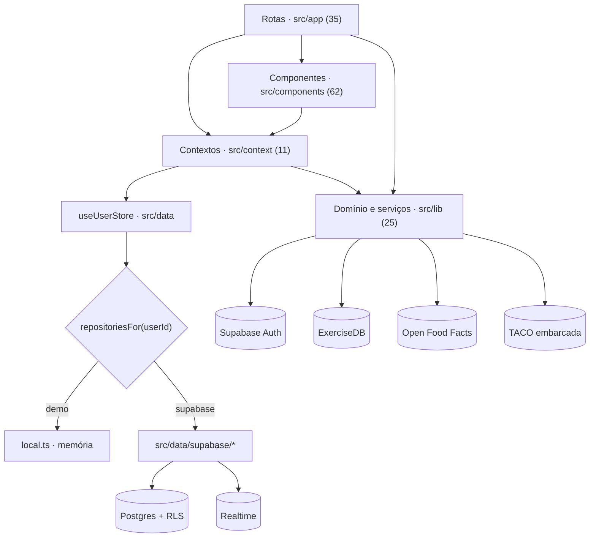
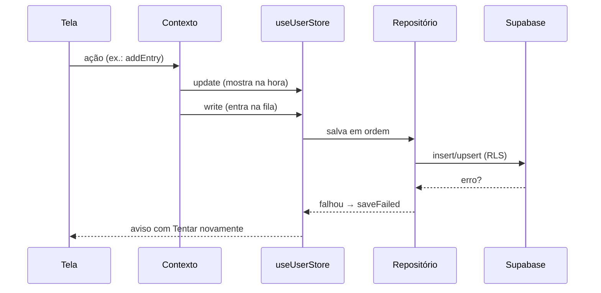
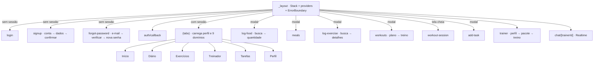

# Treina — arquitetura identificada

Estado no commit `f21319a`.

## Stack

- **Plataforma:** Expo SDK 58 (expo ~58.0.23); React Native 0.88; React 19.3 com React Compiler; TypeScript 6 strict; Typed routes
- **Navegação:** Expo Router 58; Stack.Protected para área logada; Abas próprias com swipe (sliding-tabs)
- **UI:** Design system Material 3 gerado do ícone; lucide-react-native; react-native-svg; Reanimated 4 + Worklets; expo-image
- **Backend:** Supabase: Auth (e-mail, Google por idToken, PKCE), Postgres com 18 tabelas e RLS, Realtime no chat; @supabase/supabase-js 2; Migrações e seed versionados em supabase/; Testes de RLS em SQL
- **Estado e dados:** 10 contexts React + UndoProvider; useUserStore: carga por conta, atualização otimista, fila de salvamento; Repositórios por domínio (local para demo, Supabase); expo-sqlite para a sessão; expo-crypto para ids
- **Integrações:** ExerciseDB (oss.exercisedb.dev); Open Food Facts; TACO embarcada; Google Sign-In; Instagram (links)
- **Qualidade e entrega:** jest-expo (28 testes); ESLint; EAS Build/Update com fingerprint; Workflow: check-env, lint, typecheck, testes → OTA ou build

## Camadas

| Camada | Papel | Arquivos |
|---|---|---|
| Rotas (src/app) | 35 arquivos de rota do Expo Router: telas e navegadores. | 35 |
| Componentes (src/components) | UI reutilizável: ui/ (primitivos M3, confirm-dialog), dashboard/, diary/, exercise/, trainers/, tasks/, auth/, signup/, undo-snackbar, save-error-banner, app-error-boundary. | 62 |
| Contextos (src/context) | Estado e ações por domínio; cada um usa useUserStore para carregar e salvar. | 11 |
| Dados (src/data) | Interfaces de repositório, useUserStore, implementação local (demo) e Supabase, tipos gerados do banco, perfil. | 18 |
| Domínio e serviços (src/lib) | Regras puras testadas, clientes de ExerciseDB e Open Food Facts, TACO, cliente Supabase, auth. | 25 |
| Supabase (supabase/) | 5 migrações, seed do catálogo, testes de RLS, config. | 9 |

## Estado global

Onze providers aninhados em `src/app/_layout.tsx`, de fora para dentro. Os de dados usam `useUserStore`, que descarta os dados quando a conta muda.

```mermaid
flowchart LR
  p0["SessionProvider"]
  p1["CatalogProvider"]
  p0 -.contém.-> p1
  p2["WeightLogProvider"]
  p1 -.contém.-> p2
  p3["FoodLogProvider"]
  p2 -.contém.-> p3
  p4["ExerciseLogProvider"]
  p3 -.contém.-> p4
  p5["WorkoutPlanProvider"]
  p4 -.contém.-> p5
  p6["CoachingProvider"]
  p5 -.contém.-> p6
  p7["ChatProvider"]
  p6 -.contém.-> p7
  p8["TasksProvider"]
  p7 -.contém.-> p8
  p9["DashboardLayoutProvider"]
  p8 -.contém.-> p9
  p10["UndoProvider"]
  p9 -.contém.-> p10
  p2 ==>|"setWeight"| p0
  p6 ==>|"importWorkouts / setWeekday"| p5
  p6 ==>|"getPackage"| p1
```

Dependências entre providers:

- `CatalogProvider … DashboardLayoutProvider` → `SessionProvider`: useUserStore carrega e descarta os dados pela conta da sessão
- `CoachingProvider` → `WorkoutPlanProvider`: aderir importa treinos e define os dias
- `CoachingProvider` → `CatalogProvider`: busca o pacote e o treinador
- `WeightLogProvider` → `SessionProvider`: atualiza o peso do perfil

## Fluxo de dados

## Domínios

| Domínio | Contexto | Lib e dados | Telas |
|---|---|---|---|
| Conta e perfil | `session.tsx, signup.tsx` | `auth.ts, profile.ts, supabase.ts, data/profile.ts` | `login`, `signup`, `signup/details`, `signup/confirm`, `forgot-password/*`, `auth/callback`, `(tabs)/profile` |
| Alimentação | `food-log.tsx` | `foods.ts, taco.ts, openfoodfacts.ts, data/supabase/food-log.ts` | `(tabs)/diary`, `log-food`, `log-food/[id]`, `meals` |
| Exercício avulso | `exercise-log.tsx` | `exercises.ts, exercisedb.ts, data/supabase/exercise-log.ts` | `(tabs)/exercise`, `log-exercise`, `log-exercise/[id]` |
| Plano de treino | `workout-plan.tsx` | `workouts.ts, data/supabase/workout-plan.ts` | `workouts`, `workouts/[id]`, `workout-session` |
| Treinadores | `catalog.tsx, coaching.tsx, chat.tsx` | `trainers.ts, chat.ts, data/supabase/catalog.ts, coaching.ts, chat.ts` | `(tabs)/trainers`, `trainer/[id]`, `trainer/package/[id]`, `trainer/workout`, `chat/[trainerId]` |
| Tarefas | `tasks.tsx` | `tasks.ts, data/supabase/tasks.ts` | `(tabs)/tasks`, `add-task` |
| Peso | `weight-log.tsx` | `weight.ts, data/supabase/weight.ts` | `(tabs)/index`, `(tabs)/profile` |
| Tela inicial | `dashboard-layout.tsx` | `dashboard-widgets.ts, dashboard-data.ts` | `(tabs)/index` |

## Banco de dados

Migrações em `supabase/migrations`: 18 tabelas (catálogo: trainers, training_packages, package_workouts, package_comments; usuário: profiles, weigh_ins, meals, food_entries, workouts, planned_exercises, workout_plans, workout_completions, exercise_entries, tasks, subtasks, dashboard_layouts, coaching_memberships, chat_messages).

- RLS "Own rows" (select/insert/update/delete por `auth.uid()`) em todas as tabelas do usuário.
- Catálogo com leitura pública e gravação bloqueada.
- Chat: aluno lê as próprias conversas e só insere com `sender = 'student'`.
- Trigger `on_auth_user_created` cria o perfil, a primeira pesagem e as refeições padrão.
- `supabase/tests/rls.sql` verifica as políticas (fora do CI).

## Navegação

## Integrações externas

| Serviço | Onde | Observações |
|---|---|---|
| Supabase | `src/lib/supabase.ts, src/data/supabase/*` | Auth, Postgres com RLS e Realtime. Cliente com chave publicável; sem chaves, mostra aviso em vez de travar. |
| ExerciseDB | `src/lib/exercisedb.ts` | API gratuita sem SLA, nomes em inglês, limita rajadas. EXPO_PUBLIC_FITEXERCISEDB_API_KEY está no .env.example, mas o código não usa. |
| Open Food Facts | `src/lib/openfoodfacts.ts` | Produtos do Brasil, valores impossíveis descartados. |
| TACO embarcada | `src/lib/taco.ts` | 597 alimentos offline. |
| Google Sign-In | `src/lib/google-auth.ts` | Android com idToken; iOS com URL scheme de exemplo. |

## Pontos positivos

- Camada de repositório com uma interface por domínio e duas implementações (demo e Supabase): o front evolui sem depender do backend, e as telas não importam o Supabase.
- useUserStore isola os dados por conta, mostra mudanças na hora e salva em ordem, com aviso e nova tentativa quando um salvamento falha.
- RLS em todas as tabelas do usuário, testado em supabase/tests/rls.sql; o perfil e as refeições padrão são criados por trigger no cadastro.
- Fluxos de autenticação completos e robustos: PKCE, link expirado, link aberto em outro aparelho, reenvio com espera, recuperação que não entra no app antes da nova senha.
- Regras de negócio puras em src/lib com testes no CI; erros do Supabase traduzidos para mensagens em pt-BR.
- Workflow do EAS bloqueia OTA se variáveis, lint, typecheck ou testes falharem.

## Pontos negativos

- Abertura tudo ou nada: se qualquer um dos 9 domínios falhar ao carregar, o app inteiro mostra erro (src/app/(tabs)/_layout.tsx, use-user-data-status.ts).
- Cada domínio carrega o histórico completo da conta na abertura (selectAll), o que cresce sem limite.
- A fila de salvamento vive em memória: mudanças mostradas e não salvas somem se o app fechar sem conexão.
- Telas reais ainda usam dados de exemplo: metas e passos de MOCK_DASHBOARD, peso de MOCK_PROFILE como reserva.
- Nenhuma verificação de compatibilidade nativa no CI; o crash do ExpoSQLite chegou ao aparelho por isso.
- 11 providers aninhados no layout raiz, com dependências implícitas pela ordem.

## Evoluções recomendadas

- Abrir as abas com sessão e perfil e tratar carregamento e erro por domínio (N-09).
- Repositórios com consulta por período em vez de `selectAll` (N-10).
- Fila de salvamento persistida no expo-sqlite, reenviada ao abrir e ao reconectar (N-11).
- Perfil atrás de um repositório, como os demais domínios (`src/data/profile.ts` acessa o Supabase direto).
- `updated_at` com checagem nas gravações que substituem o registro inteiro (H-02).
