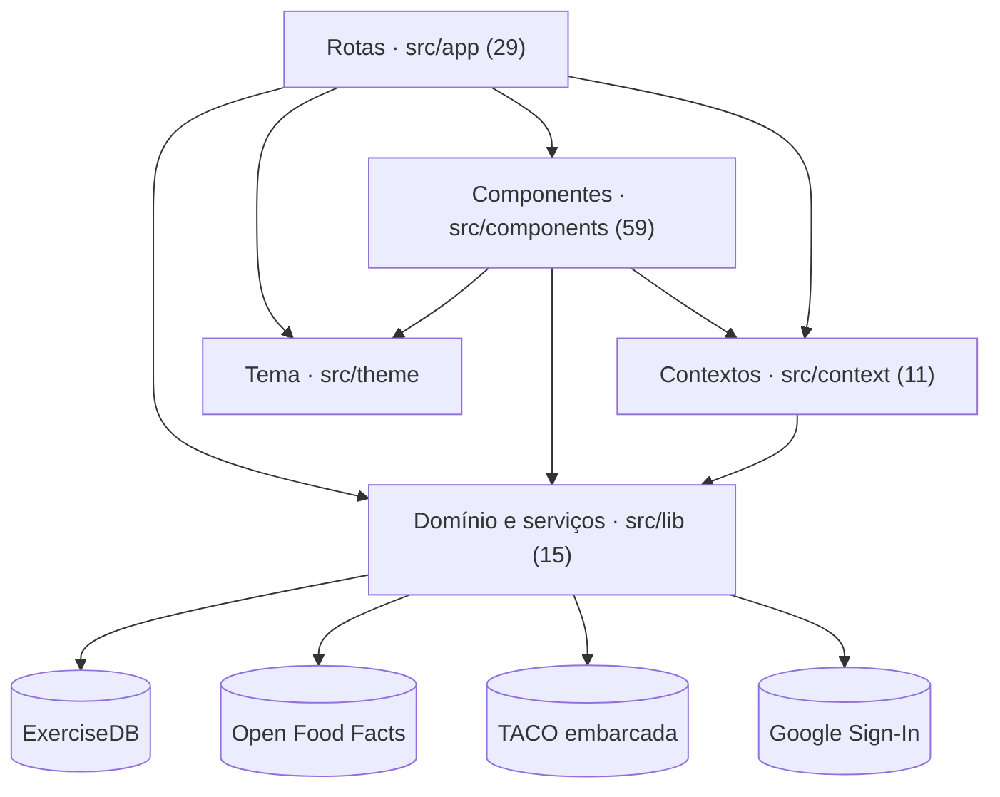
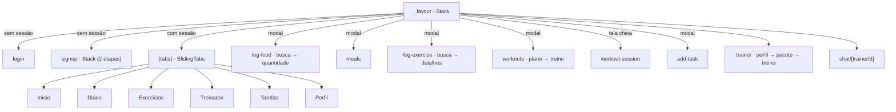
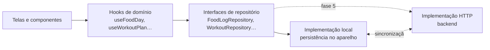

# Treina — arquitetura identificada

Estado no commit `5fd90b1`.

## Stack

- **Plataforma:** Expo SDK 58 (expo ~58.0.21); React Native 0.88.1; React 19.3; TypeScript 6.0 (strict); React Compiler habilitado (app.json → experiments.reactCompiler); Typed routes (experiments.typedRoutes)
- **Navegação:** Expo Router 58 (rotas em src/app); Stack.Protected para separar área logada; Abas próprias com swipe (src/components/sliding-tabs) sobre react-native-gesture-handler
- **UI:** Design system Material 3 próprio gerado do ícone (scripts/generate-theme.mjs + @material/material-color-utilities); lucide-react-native (ícones importados por caminho); react-native-svg (gráficos do dashboard); react-native-reanimated 4 + worklets (arrastar do dashboard, teclado do chat); expo-image (GIFs de exercícios)
- **Estado e dados:** 9 React Contexts com useState (sem biblioteca de estado); Sem persistência: nenhum AsyncStorage, SQLite, MMKV ou SecureStore; Caches em memória por módulo (Map) nos clientes de API
- **Integrações:** ExerciseDB v1 (oss.exercisedb.dev) para catálogo de exercícios; Open Food Facts search-a-licious para produtos brasileiros; TACO 4ª ed. embarcada (597 alimentos, src/lib/taco-data.ts); Google Sign-In (@react-native-google-signin/google-signin); Fotos de treinadores em randomuser.me; Links para Instagram (Linking.openURL)
- **Entrega:** EAS Build (perfis development, preview APK, production); EAS Update com runtimeVersion por fingerprint; Workflow EAS: OTA ou build Android a cada push na main

## Camadas

| Camada | Papel | Arquivos |
|---|---|---|
| Rotas (src/app) | Telas e navegadores do Expo Router. Leem contextos e chamam ações. | 29 |
| Componentes (src/components) | UI reutilizável: ui/ (17 primitivos M3), dashboard/, diary/, exercise/, trainers/, tasks/, sliding-tabs/. | 59 |
| Contextos (src/context) | Estado global em useState e as ações de cada domínio. Também são a fonte de dados (sem armazenamento). | 11 |
| Domínio e serviços (src/lib) | Tipos e regras puras (tasks, workouts, foods, dashboard-widgets), clientes de API (exercisedb, openfoodfacts), dados embarcados (taco-data, trainers). | 15 |
| Tema (src/theme) | Tokens Material 3 gerados, tipografia, tema de navegação. | 3 |

## Estado global

Nove providers aninhados em `src/app/_layout.tsx`, nesta ordem (de fora para dentro). Todos acima do `Stack.Protected`, por isso sobrevivem ao logout.

```mermaid
flowchart LR
  p0["SessionProvider"]
  p1["WeightLogProvider"]
  p0 -.contém.-> p1
  p2["FoodLogProvider"]
  p1 -.contém.-> p2
  p3["ExerciseLogProvider"]
  p2 -.contém.-> p3
  p4["WorkoutPlanProvider"]
  p3 -.contém.-> p4
  p5["CoachingProvider"]
  p4 -.contém.-> p5
  p6["ChatProvider"]
  p5 -.contém.-> p6
  p7["TasksProvider"]
  p6 -.contém.-> p7
  p8["DashboardLayoutProvider"]
  p7 -.contém.-> p8
  p1 ==>|"setWeight"| p0
  p5 ==>|"importWorkouts / setWeekday"| p4
```

Dependências entre providers:

- `WeightLogProvider` → `SessionProvider`: logWeight chama session.setWeight
- `CoachingProvider` → `WorkoutPlanProvider`: joinPackage importa treinos e define dias da semana

Nenhum provider persiste dados. Ids são gerados com `Date.now()` + contador por módulo.

## Domínios

| Domínio | Contexto | Lib | Telas |
|---|---|---|---|
| Conta e perfil | `session.tsx, signup.tsx` | `profile.ts, google-auth.ts` | `login`, `signup`, `signup/details`, `(tabs)/profile` |
| Alimentação | `food-log.tsx` | `foods.ts, taco.ts, taco-data.ts, openfoodfacts.ts` | `(tabs)/diary`, `log-food`, `log-food/[id]`, `meals` |
| Exercício avulso | `exercise-log.tsx` | `exercises.ts, exercisedb.ts` | `(tabs)/exercise`, `log-exercise`, `log-exercise/[id]` |
| Plano de treino | `workout-plan.tsx` | `workouts.ts` | `workouts`, `workouts/[id]`, `workout-session` |
| Treinadores | `coaching.tsx, chat.tsx` | `trainers.ts` | `(tabs)/trainers`, `trainer/[id]`, `trainer/package/[id]`, `trainer/workout`, `chat/[trainerId]` |
| Tarefas | `tasks.tsx` | `tasks.ts` | `(tabs)/tasks`, `add-task` |
| Peso | `weight-log.tsx` | `profile.ts` | `(tabs)/index`, `(tabs)/profile` |
| Tela inicial | `dashboard-layout.tsx` | `dashboard-widgets.ts, dashboard-data.ts` | `(tabs)/index` |

## Navegação

## Integrações externas

| Serviço | Onde | Observações |
|---|---|---|
| ExerciseDB | `src/lib/exercisedb.ts` | API gratuita, sem chave, limita rajadas (429). Nomes só em inglês. Dependência crítica de um serviço de terceiros sem SLA. |
| Open Food Facts | `src/lib/openfoodfacts.ts` | Dados colaborativos; o cliente descarta valores impossíveis por 100 g. Envia User-Agent como a API pede. |
| TACO embarcada | `src/lib/taco.ts` | 597 alimentos offline, ~37 KB. Escolha certa para o público brasileiro. |
| Google Sign-In | `src/lib/google-auth.ts` | Funciona só em build nativo; web mostra indisponível. iOS ainda com iosUrlScheme de exemplo. |
| randomuser.me | `src/lib/trainers.ts` | Fotos de pessoas fictícias para os treinadores de exemplo. |

## Pontos positivos

- Regras de domínio puras e sem React em src/lib, prontas para testes unitários (ex.: isTaskDue, getWorkoutForDate, moveWidget, insertMeal).
- Tipos discriminados bem usados (TaskRepeat, PlannedExercise com DistributiveOmit, RemoteSearch).
- Clientes de API com cache de promessas, descarte de respostas obsoletas e mensagens de erro em pt-BR.
- Design system gerado a partir do ícone, com relatório de contraste (scripts/generate-theme.mjs --report).
- Guard de sessão com Stack.Protected e tela de carregamento/erro antes das abas (use-main-flow-bootstrap).
- Comentários explicam decisões (por que a busca do ExerciseDB é só ao enviar, por que ícones são importados por caminho).

## Pontos negativos

- Contextos são ao mesmo tempo estado de tela, regra de negócio e banco de dados; trocar para API exige reescrever os 9.
- Providers ficam acima do Stack.Protected e sobrevivem ao logout com os dados da conta anterior.
- Duas fontes de verdade para o peso (profile.weightKg e weight-log).
- Dados de exemplo misturados ao estado real (histórico de peso começa com MOCK_DASHBOARD.weight).
- Nenhum teste e nenhum CI de qualidade.
- Sobras do template Expo (componentes e dependências sem uso, README e reset-project.js).

## Arquitetura recomendada para a integração

- As telas continuam falando com hooks; só a implementação do repositório muda quando o backend chegar.
- Os tipos de `src/lib` (Food, FoodEntry, Workout, Task, WeighIn) viram o contrato inicial da API.
- Dados de exemplo (treinadores, histórico de peso) passam a ser fixtures da implementação local, ativadas só em modo demo.
- Registros chaveados pela conta resolvem o vazamento entre usuários (I-02).
