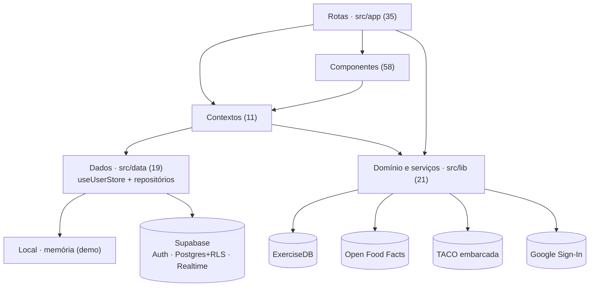
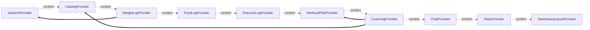
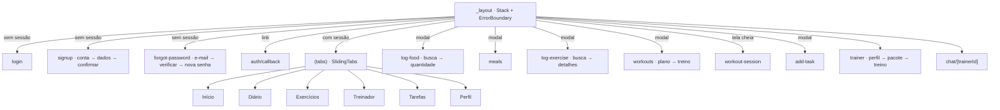
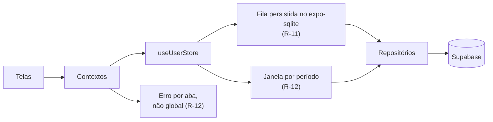

# Treina — arquitetura identificada

Estado no commit `25f3a9b`.

## Stack

- **Plataforma:** Expo SDK 58 (expo ~58.0.23); React Native 0.88.1 · React 19.3; TypeScript 6 estrito; React Compiler e typed routes habilitados
- **Navegação:** Expo Router 58, 35 arquivos de rota; Stack.Protected separa as pilhas com e sem sessão; Abas próprias com swipe (sliding-tabs)
- **UI:** Design system Material 3 gerado do ícone; 17 componentes base em components/ui (inclui password-field); lucide-react-native, react-native-svg, Reanimated 4 + Worklets, expo-image
- **Dados:** 9 contextos de domínio sobre useUserStore (estado por conta + fila de salvamento); Repositórios por domínio: local (memória) ou Supabase (src/data); expo-sqlite guarda a sessão no aparelho; expo-crypto gera ids
- **Backend:** Supabase: Auth (e-mail, Google, PKCE), Postgres com 18 tabelas e RLS, Realtime no chat; 5 migrações versionadas, seed do catálogo e teste SQL de RLS
- **Integrações:** ExerciseDB (catálogo de exercícios); Open Food Facts (produtos brasileiros); TACO embarcada (597 alimentos); Google Sign-In; Fotos de exemplo em randomuser.me
- **Entrega:** EAS Build (development, preview APK, production); EAS Update com runtime por fingerprint; Workflow: OTA ou build Android a cada push na main

## Camadas

| Camada | Papel | Arquivos |
|---|---|---|
| Rotas (src/app) | 35 arquivos: telas, layouts e o ErrorBoundary raiz. Leem contextos e chamam ações. | 35 |
| Componentes (src/components) | UI reutilizável: ui/, auth/, dashboard/, diary/, exercise/, trainers/, tasks/, weight/, sliding-tabs/, save-error-banner. | 58 |
| Contextos (src/context) | session + 9 domínios + signup. Cada domínio usa useUserStore e chama os repositórios. | 11 |
| Dados (src/data) | useUserStore, contratos de repositório, implementação local (memória) e Supabase, carregamento do perfil, tipos gerados do banco. | 19 |
| Domínio e serviços (src/lib) | Regras puras (tarefas, treinos, refeições, peso), clientes ExerciseDB e Open Food Facts, TACO, auth, cliente Supabase. | 21 |
| Supabase (supabase/) | Migrações, RLS, trigger de perfil, refeições padrão, realtime do chat, seed e teste SQL. | 8 |

## Estado global

10 providers aninhados em `src/app/_layout.tsx`, de fora para dentro. Os domínios usam `useUserStore`, chaveado pela conta: ao trocar de conta, os dados recomeçam do vazio.

Dependências entre providers:

- `Todos os domínios` → `SessionProvider`: useUserStore é chaveado pelo id da conta
- `WeightLogProvider` → `SessionProvider`: logWeight atualiza o peso do perfil na tela
- `CoachingProvider` → `WorkoutPlanProvider`: aderir importa treinos e define a semana
- `CoachingProvider` → `CatalogProvider`: busca o pacote e o treinador

Ids criados no app com `expo-crypto` (UUID), para a mudança aparecer antes de ser salva. A fila de salvamento de cada domínio fica em memória (N-03).

## Domínios

| Domínio | Contexto | Lib | Telas |
|---|---|---|---|
| Conta e perfil | `session.tsx, signup.tsx` | `auth.ts, google-auth.ts, profile.ts, supabase.ts, data/profile.ts` | `login`, `signup/*`, `forgot-password/*`, `auth/callback`, `(tabs)/profile` |
| Alimentação | `food-log.tsx` | `foods.ts, taco.ts, openfoodfacts.ts, data/supabase/food-log.ts` | `(tabs)/diary`, `log-food/*`, `meals` |
| Exercício avulso | `exercise-log.tsx` | `exercises.ts, exercisedb.ts, data/supabase/exercise-log.ts` | `(tabs)/exercise`, `log-exercise/*` |
| Plano de treino | `workout-plan.tsx` | `workouts.ts, data/supabase/workout-plan.ts` | `workouts/*`, `workout-session` |
| Treinadores | `catalog.tsx, coaching.tsx, chat.tsx` | `trainers.ts, chat.ts, data/supabase/catalog.ts, coaching.ts, chat.ts` | `(tabs)/trainers`, `trainer/*`, `chat/[trainerId]` |
| Tarefas | `tasks.tsx` | `tasks.ts, data/supabase/tasks.ts` | `(tabs)/tasks`, `add-task` |
| Peso | `weight-log.tsx` | `weight.ts, data/supabase/weight.ts` | `(tabs)/index`, `(tabs)/profile` |
| Tela inicial | `dashboard-layout.tsx` | `dashboard-widgets.ts, dashboard-data.ts` | `(tabs)/index` |

## Navegação

## Integrações externas

| Serviço | Onde | Observações |
|---|---|---|
| Supabase | `src/lib/supabase.ts, src/data/supabase/*` | Auth com PKCE e sessão no expo-sqlite; Postgres com RLS; Realtime no chat. Chave publicável no app; service role nunca usada. |
| ExerciseDB | `src/lib/exercisedb.ts` | API gratuita sem SLA, nomes só em inglês, MET estimado pelo nome. |
| Open Food Facts | `src/lib/openfoodfacts.ts` | Produtos do Brasil; valores impossíveis descartados. |
| TACO embarcada | `src/lib/taco.ts` | 597 alimentos offline. |
| Google Sign-In | `src/lib/google-auth.ts` | idToken enviado ao Supabase (signInWithIdToken). Exige os client IDs no ambiente; iOS ainda com URL scheme de exemplo. |
| randomuser.me | `supabase/seed.sql, src/lib/trainers.ts` | Fotos de pessoas fictícias no catálogo de exemplo. |

## Pontos positivos

- Camada de repositório com contrato por domínio e duas implementações (memória e Supabase), escolhida por EXPO_PUBLIC_DATA_SOURCE.
- useUserStore: dados de uma conta nunca aparecem para outra, mudanças aparecem na hora e são salvas em ordem, com banner de nova tentativa.
- Schema com checks de domínio (pesos 30–400 kg, altura 100–250 cm, gramas > 0) e RLS em todas as tabelas, verificado por supabase/tests/rls.sql.
- Fluxos de conta completos e cuidadosos: troca de código uma única vez, recuperação que não loga o app até a senha nova, saída global após trocar a senha.
- Perfil com data de nascimento (idade sempre correta) e peso atual derivado da última pesagem.
- Modo demo preserva o objetivo de front funcional sem servidor.

## Pontos negativos

- O app só abre depois que os 9 domínios carregam; uma falha em qualquer um bloqueia tudo.
- O login baixa o histórico completo de alimentos, exercícios, pesagens e chat.
- A fila de salvamento fica só em memória: mudanças pendentes se perdem se o app fechar.
- Ainda sem testes JavaScript e sem CI antes de publicar OTA.
- 11 providers aninhados que dependem da ordem.
- Parte da configuração (variáveis do EAS, client IDs do Google) fica fora do repositório e falha só em tempo de execução.

## Próximos passos de arquitetura

- Persistir a fila de salvamento para não perder mudanças ao fechar o app.
- Carregar uma janela recente no login e buscar o resto sob demanda.
- Bloquear o app só se o perfil falhar; cada aba trata o próprio erro.
- Testar `useUserStore` e o repositório local, que são o coração da camada de dados.
