# Treina — roadmap de evolução

Baseado na auditoria do commit `25f3a9b`. As fases respeitam a estratégia atual de construir o front antes do backend: as fases 1 a 4 não dependem de servidor, a fase 5 é a integração e o lançamento.

Ordem dentro de cada fase: impacto, dependências e esforço. Prioridade: P0 bloqueia, P1 alta, P2 relevante, P3 futuro.

```mermaid
flowchart LR
  subgraph F1["Fase 1 · Correções críticas"]
    direction TB
    R01["R-01 · P0<br/>Gate de qualidade antes do OTA"]
    R02["R-02 · P0<br/>Completar perfil após Google"]
    R03["R-03 · P1<br/>Remover o peso de exemplo dos cálculos"]
    R04["R-04 · P1<br/>Confirmar substituição ao aderir a pacote"]
    R05["R-05 · P1<br/>Desfazer e confirmação em exclusões"]
    R06["R-06 · P0<br/>Testes de domínio e do store"]
    R07["R-07 · P1<br/>Validar variáveis de ambiente"]
  end
  subgraph F2["Fase 2 · Consolidação das funcionalidades essenciais"]
    direction TB
    R08["R-08 · P1<br/>Metas calculadas do perfil"]
    R09["R-09 · P1<br/>Edição de registros e exercícios do treino"]
    R10["R-10 · P1<br/>Editar perfil e configurações"]
    R11["R-11 · P1<br/>Fila de salvamento persistida"]
    R12["R-12 · P1<br/>Carregamento por período e por aba"]
    R13["R-13 · P1<br/>Histórico e evolução de cargas"]
    R14["R-14 · P2<br/>Fila de treinos derivada do histórico"]
    R15["R-15 · P2<br/>Preservar histórico ao sair do pacote"]
  end
  subgraph F3["Fase 3 · Melhorias de UX/UI"]
    direction TB
    R16["R-16 · P1<br/>Passos fora do dashboard até haver fonte"]
    R17["R-17 · P2<br/>5 abas e Tarefas como hábitos"]
    R18["R-18 · P2<br/>Busca de exercícios em português"]
    R19["R-19 · P2<br/>Sessão de treino completa"]
    R20["R-20 · P2<br/>Atalhos no diário"]
    R21["R-21 · P2<br/>Onboarding e selo de modo demo"]
    R22["R-22 · P3<br/>Pequenas correções"]
  end
  subgraph F4["Fase 4 · Recursos adicionais e diferenciais"]
    direction TB
    R23["R-23 · P2<br/>Lado do treinador (responder e publicar)"]
    R24["R-24 · P2<br/>Notificações"]
    R25["R-25 · P2<br/>Código de barras"]
    R26["R-26 · P2<br/>Passos via Health Connect / HealthKit"]
    R27["R-27 · P2<br/>Relatório semanal"]
  end
  subgraph F5["Fase 5 · Preparação para escala e produção"]
    direction TB
    R28["R-28 · P0<br/>LGPD: consentimento, exportar e excluir conta"]
    R29["R-29 · P1<br/>Monitoramento de erros"]
    R30["R-30 · P1<br/>Smoke test do APK antes de liberar o canal"]
    R31["R-31 · P1<br/>Configuração iOS"]
    R32["R-32 · P2<br/>Leitura offline"]
  end
  F1 --> F2
  F2 --> F3
  F3 --> F4
  F4 --> F5
```

> As fases seguem em ordem; dentro de cada uma, as tarefas estão ordenadas por impacto, dependências e esforço.

## Fase 1 — Correções críticas

Proteger quem já usa o app e as próximas atualizações.

| ID | Tarefa | Problema que resolve | Prioridade | Impacto | Complexidade | Depende de | Critério de conclusão |
|---|---|---|---|---|---|---|---|
| R-01 | Gate de qualidade antes do OTA | Crash de abertura chegou ao aparelho por OTA (N-07). | P0 | Alto | Baixa | — | Workflow roda lint, typecheck e testes antes do job de update e falha se algo quebrar. |
| R-02 | Completar perfil após Google | Contas do Google sem dados corporais (N-01). | P0 | Alto | Baixa | — | Primeiro login sem nascimento, sexo, altura ou peso abre a etapa 'Sobre você' e grava no perfil. |
| R-03 | Remover o peso de exemplo dos cálculos | Calorias estimadas para 82 kg (N-02). | P1 | Médio | Baixa | R-02 | Sem peso real, a estimativa aparece como indisponível com atalho para registrar. |
| R-04 | Confirmar substituição ao aderir a pacote | Plano próprio apagado (I-06). | P1 | Médio | Baixa | — | Diálogo sempre que houver dias com treino. |
| R-05 | Desfazer e confirmação em exclusões | Exclusões permanentes com um toque (I-11). | P1 | Médio | Baixa | — | Snackbar com Desfazer e diálogo para excluir treino, sair do pacote e sair da conta. |
| R-06 | Testes de domínio e do store | Sem testes JavaScript (I-16). | P0 | Alto | Média | — | jest-expo com testes de src/lib, useUserStore e repositório local rodando no R-01. |
| R-07 | Validar variáveis de ambiente | Builds sem chaves falham só no uso (N-06). | P1 | Médio | Baixa | — | App e build avisam claramente quando falta uma variável obrigatória; README documenta o expo.dev. |

## Fase 2 — Consolidação das funcionalidades essenciais

Fechar os ciclos básicos e personalizar.

| ID | Tarefa | Problema que resolve | Prioridade | Impacto | Complexidade | Depende de | Critério de conclusão |
|---|---|---|---|---|---|---|---|
| R-08 | Metas calculadas do perfil | 2.200 kcal para todos (I-04). | P1 | Alto | Média | R-02 | Objetivo e atividade no cadastro; kcal e macros calculados e ajustáveis. |
| R-09 | Edição de registros e exercícios do treino | Apagar e recriar (I-12). | P1 | Alto | Média | R-06 | update nos repositórios e telas de criação no modo edição. |
| R-10 | Editar perfil e configurações | Perfil fixo (I-13). | P1 | Médio | Média | R-02 | Editar nome, nascimento, sexo, altura; configurações com metas, conta e sair. |
| R-11 | Fila de salvamento persistida | Mudanças pendentes se perdem (N-03). | P1 | Alto | Média | R-06 | Pendências gravadas no expo-sqlite e reenviadas ao abrir. |
| R-12 | Carregamento por período e por aba | Histórico completo no login e bloqueio global (N-04, N-05). | P1 | Alto | Média | R-06 | Login carrega só o perfil e uma janela recente; cada aba tem seu estado de erro. |
| R-13 | Histórico e evolução de cargas | Sem retorno ao usuário. | P1 | Alto | Média | R-12 | Tela por exercício com cargas e lista de sessões. |
| R-14 | Fila de treinos derivada do histórico | Desfazer desalinha (I-07). | P2 | Médio | Baixa | R-06 | Teste cobre desfazer fora de ordem. |
| R-15 | Preservar histórico ao sair do pacote | I-33. | P2 | Médio | Baixa | — | Treinos arquivados ou snapshot na conclusão. |

## Fase 3 — Melhorias de UX/UI

Reduzir atrito e alinhar a navegação.

| ID | Tarefa | Problema que resolve | Prioridade | Impacto | Complexidade | Depende de | Critério de conclusão |
|---|---|---|---|---|---|---|---|
| R-16 | Passos fora do dashboard até haver fonte | Número fictício (I-05). | P1 | Médio | Baixa | — | Widget oculto ou 'Conectar passos'. |
| R-17 | 5 abas e Tarefas como hábitos | I-24 e feature genérica. | P2 | Médio | Média | R-09 | Barra com 5 destinos. |
| R-18 | Busca de exercícios em português | I-25, I-26. | P2 | Médio | Média | — | Termos comuns em pt-BR encontram resultados. |
| R-19 | Sessão de treino completa | Sem descanso, séries ou retomada (I-32). | P2 | Alto | Média | R-11 | Descanso, séries, tela ligada e retomar. |
| R-20 | Atalhos no diário | Registro repetitivo. | P2 | Médio | Média | R-09 | Recentes, favoritos, copiar refeição, medidas caseiras. |
| R-21 | Onboarding e selo de modo demo | Usuário cai no dashboard sem contexto. | P2 | Médio | Baixa | R-08 | Duas ou três telas puláveis e indicação de demo. |
| R-22 | Pequenas correções | N-08, N-09, I-17, I-18, I-26, I-30, I-31. | P3 | Baixo | Baixa | R-01 | Lint limpo, helpers unificados, textos corrigidos. |

## Fase 4 — Recursos adicionais e diferenciais

Retenção e o lado do treinador.

| ID | Tarefa | Problema que resolve | Prioridade | Impacto | Complexidade | Depende de | Critério de conclusão |
|---|---|---|---|---|---|---|---|
| R-23 | Lado do treinador (responder e publicar) | Chat e catálogo só de ida (I-14). | P2 | Alto | Alta | R-12 | Treinador responde mensagens e publica pacotes com políticas próprias. |
| R-24 | Notificações | Sem lembretes nem aviso de resposta. | P2 | Médio | Média | R-23 | Lembrete de treino e push de mensagem. |
| R-25 | Código de barras | Produtos por nome. | P2 | Médio | Média | R-20 | Câmera abre o produto do Open Food Facts. |
| R-26 | Passos via Health Connect / HealthKit | Sem fonte de passos. | P2 | Médio | Alta | R-16 | Passos reais em build de desenvolvimento. |
| R-27 | Relatório semanal | Sem tendência. | P2 | Médio | Média | R-13 | Peso, média de kcal, treinos feitos vs. planejados. |

## Fase 5 — Preparação para escala e produção

Requisitos de loja, privacidade e operação.

| ID | Tarefa | Problema que resolve | Prioridade | Impacto | Complexidade | Depende de | Critério de conclusão |
|---|---|---|---|---|---|---|---|
| R-28 | LGPD: consentimento, exportar e excluir conta | Dados de saúde no servidor sem consentimento. | P0 | Alto | Média | R-10 | Consentimento no cadastro, política acessível, exclusão de conta no app apagando todas as linhas. |
| R-29 | Monitoramento de erros | Crash só visto por relatório manual. | P1 | Alto | Baixa | — | Crashes JS e nativos reportados com a versão do update. |
| R-30 | Smoke test do APK antes de liberar o canal | N-07. | P1 | Alto | Média | R-01 | Build de preview aberto automaticamente até a tela de login antes do update. |
| R-31 | Configuração iOS | I-23. | P1 | Médio | Baixa | R-07 | bundleIdentifier, URL scheme e job iOS. |
| R-32 | Leitura offline | Sem uso sem rede. | P2 | Médio | Alta | R-11, R-12 | Dados recentes disponíveis sem internet. |

## Cinco ações mais importantes

1. **R-01 + R-06:** testes e gate de qualidade antes de cada OTA.
2. **R-02 + R-03:** completar o perfil após o Google e tirar o peso de exemplo dos cálculos.
3. **R-08:** metas calculadas do perfil.
4. **R-09 + R-05:** editar registros e proteger exclusões com desfazer.
5. **R-11 + R-12:** fila de salvamento persistida e carregamento por período.
