# Treina — roadmap de evolução

Baseado na auditoria do commit `f21319a`. As fases respeitam a estratégia atual de construir o front antes do backend: as fases 1 a 4 não dependem de servidor, a fase 5 é a integração e o lançamento.

Ordem dentro de cada fase: impacto, dependências e esforço. Prioridade: P0 bloqueia, P1 alta, P2 relevante, P3 futuro.

```mermaid
gantt
  dateFormat X
  axisFormat %s
  section Fase 1
  R-01 Verificação nativa no CI :r-01, 0, 1
  R-02 Monitoramento de erros :r-02, 0, 1
  R-03 Carregamento por seção :r-03, 0, 2
  R-04 Sair só deste aparelho :r-04, 0, 1
  R-05 Fila de treinos e histórico  :r-05, 0, 1
  R-06 Calorias de exercício manual :r-06, 0, 1
  section Fase 2
  R-07 Metas calculadas :r-07, 0, 2
  R-08 Edição de registros :r-08, 0, 2
  R-09 Perfil, configurações e excl :r-09, 0, 2
  R-10 Histórico de treinos :r-10, 0, 2
  R-11 Carga por período :r-11, 0, 2
  R-12 Fila de salvamento persistid :r-12, 0, 2
  R-13 Testes de dados e RLS no CI :r-13, 0, 2
  section Fase 3
  R-14 5 abas e Tarefas como hábito :r-14, 0, 2
  R-15 Sessão de treino completa :r-15, 0, 2
  R-16 Exercícios em português :r-16, 0, 2
  R-17 Atalhos do diário :r-17, 0, 2
  R-18 Passos reais ou widget ocult :r-18, 0, 1
  R-19 Limpeza :r-19, 0, 1
  section Fase 4
  R-20 Painel do treinador :r-20, 0, 3
  R-21 Lembretes locais :r-21, 0, 2
  R-22 Código de barras :r-22, 0, 2
  R-23 Health Connect / HealthKit :r-23, 0, 3
  R-24 Relatório semanal e avaliaçã :r-24, 0, 2
  section Fase 5
  R-25 LGPD e consentimento :r-25, 0, 2
  R-26 iOS :r-26, 0, 2
  R-27 Controle de conflitos :r-27, 0, 2
  R-28 Métricas de abertura e uso :r-28, 0, 1
```

> O gráfico mostra apenas o esforço relativo (baixa = 1, média = 2, alta = 3), não datas.

## Fase 1 — Correções críticas

Impedir que um erro feche o app no aparelho sem ninguém saber.

| ID | Tarefa | Problema que resolve | Prioridade | Impacto | Complexidade | Depende de | Critério de conclusão |
|---|---|---|---|---|---|---|---|
| R-01 | Verificação nativa no CI | O crash do ExpoSQLite passou por todos os checks (N-13). | P0 | Alto | Baixa | — | Job de checks roda npx expo install --check e npx expo-doctor e falha com versão incompatível. |
| R-02 | Monitoramento de erros | O último crash só foi diagnosticado por relatório de bugs manual. | P0 | Alto | Baixa | — | Crashes e erros de API chegam a um painel com a versão do update. |
| R-03 | Carregamento por seção | Um domínio com erro bloqueia o app (N-09). | P1 | Alto | Média | — | Abas abrem com sessão e perfil; cada seção mostra seu próprio carregando e erro. |
| R-04 | Sair só deste aparelho | Sair encerra todas as sessões (N-12). | P1 | Médio | Baixa | — | signOut({ scope: 'local' }) no Sair; troca de senha continua global. |
| R-05 | Fila de treinos e histórico do pacote | Ponteiro desalinha ao desfazer e histórico some ao sair do pacote (N-06, N-07). | P1 | Médio | Baixa | — | Testes cobrem desfazer fora de ordem; conclusões mantêm nome e resumo após sair do pacote. |
| R-06 | Calorias de exercício manual | Manual entra com 0 kcal (N-08). | P1 | Médio | Baixa | — | MET padrão por categoria ou intensidade escolhida. |

## Fase 2 — Consolidação das funcionalidades essenciais

Cumprir as promessas do cadastro e fechar o ciclo dos registros.

| ID | Tarefa | Problema que resolve | Prioridade | Impacto | Complexidade | Depende de | Critério de conclusão |
|---|---|---|---|---|---|---|---|
| R-07 | Metas calculadas | 2.200 kcal para todos (N-01). | P1 | Alto | Média | — | Objetivo e atividade no cadastro; metas de kcal e macros calculadas, ajustáveis e salvas por conta. |
| R-08 | Edição de registros | Corrigir exige excluir e recriar (N-03). | P1 | Alto | Média | — | Alimento, exercício, tarefa e exercício do treino editáveis ao toque, com update nos repositórios. |
| R-09 | Perfil, configurações e excluir conta | Perfil fixo, sem área de conta e sem exclusão (N-04, N-05). | P0 | Alto | Média | R-07 | Editar dados corporais e objetivo; configurações; excluir conta remove todos os dados. |
| R-10 | Histórico de treinos | Cargas e sensação gravadas e invisíveis. | P1 | Alto | Média | — | Tela por exercício com evolução e lista de sessões. |
| R-11 | Carga por período | Histórico inteiro na abertura (N-10). | P1 | Médio | Média | R-03 | Diário, exercícios e chat carregam só o período visível e buscam mais sob demanda. |
| R-12 | Fila de salvamento persistida | Mudanças offline somem ao fechar (N-11). | P1 | Médio | Média | — | Fila guardada no expo-sqlite e reenviada ao abrir ou reconectar. |
| R-13 | Testes de dados e RLS no CI | Fila, troca de conta e repositórios sem teste (N-23). | P1 | Médio | Média | — | Testes de useUserStore e repositórios; rls.sql roda no CI. |

## Fase 3 — Melhorias de UX/UI

Reduzir atrito e alinhar a navegação à proposta.

| ID | Tarefa | Problema que resolve | Prioridade | Impacto | Complexidade | Depende de | Critério de conclusão |
|---|---|---|---|---|---|---|---|
| R-14 | 5 abas e Tarefas como hábitos | 6 destinos e feature genérica (N-15). | P2 | Médio | Média | R-08 | Barra com 5 abas; hábitos de saúde a partir do Início. |
| R-15 | Sessão de treino completa | Sem descanso, séries, tela ligada ou retomada (N-24). | P2 | Alto | Média | R-12 | Timer de descanso, carga por série, keep-awake e retomar sessão. |
| R-16 | Exercícios em português | Busca em inglês e serviço frágil (N-22). | P2 | Médio | Média | — | Catálogo em cache no Supabase com nomes traduzidos. |
| R-17 | Atalhos do diário | Registro repetitivo. | P2 | Médio | Média | R-11 | Recentes, favoritos, copiar refeição e medidas caseiras. |
| R-18 | Passos reais ou widget oculto | 6.840 passos fictícios (N-02). | P1 | Médio | Baixa | — | Widget oculto ou 'Conectar passos' até haver fonte real. |
| R-19 | Limpeza | Duplicações, mocks de reserva, env sem uso, detalhes de UI (N-16 a N-21, N-25, N-26). | P3 | Baixo | Baixa | — | parseDecimal único, sem MOCK_PROFILE nas telas, env removida, ícone e textos corrigidos, desfazer em refeições. |

## Fase 4 — Recursos adicionais e diferenciais

Retenção e reforço do diferencial do treinador.

| ID | Tarefa | Problema que resolve | Prioridade | Impacto | Complexidade | Depende de | Critério de conclusão |
|---|---|---|---|---|---|---|---|
| R-20 | Painel do treinador | Chat sem destinatário, catálogo de seed. | P1 | Alto | Alta | R-02 | Treinador publica pacotes e responde mensagens; aluno recebe push. |
| R-21 | Lembretes locais | Treino e hábitos dependem de abrir o app. | P2 | Médio | Média | R-14 | Lembretes configuráveis nas configurações. |
| R-22 | Código de barras | Produtos exigem busca por nome. | P2 | Médio | Média | R-17 | Câmera lê EAN e abre o produto. |
| R-23 | Health Connect / HealthKit | Sem passos reais. | P2 | Médio | Alta | R-18 | Passos no dashboard com permissão explicada. |
| R-24 | Relatório semanal e avaliação de pacotes | Sem visão de tendência; comentários de seed. | P3 | Médio | Média | R-10 | Resumo semanal e avaliação ao concluir o programa. |

## Fase 5 — Preparação para escala e produção

Cumprir requisitos de loja e privacidade e abrir outras plataformas.

| ID | Tarefa | Problema que resolve | Prioridade | Impacto | Complexidade | Depende de | Critério de conclusão |
|---|---|---|---|---|---|---|---|
| R-25 | LGPD e consentimento | Dados de saúde sem consentimento nem exportação (N-05). | P0 | Alto | Média | R-09 | Consentimento no cadastro, política acessível, exportar dados. |
| R-26 | iOS | Sem build e Google no iOS (N-14). | P2 | Médio | Média | R-01 | bundleIdentifier, URL scheme, Entrar com Apple e job iOS. |
| R-27 | Controle de conflitos | Gravações substituem o registro inteiro (H-02). | P2 | Médio | Média | R-12 | updated_at com checagem ou merge por campo. |
| R-28 | Métricas de abertura e uso | Performance não medida. | P2 | Médio | Baixa | R-02 | Tempo de abertura e funis de cadastro e registro acompanhados. |

## Cinco ações mais importantes

1. **R-01 + R-02:** verificação nativa no CI e monitoramento de erros. Um crash de abertura já chegou ao aparelho sem aviso.
2. **R-09 + R-25:** perfil editável, configurações, excluir conta e consentimento. Requisitos de loja e LGPD.
3. **R-07:** metas calculadas do perfil, cumprindo o que o cadastro promete.
4. **R-08 + R-10:** edição de registros e histórico de treinos, que fecham os ciclos de uso diário.
5. **R-03 + R-11 + R-12:** carregamento por seção e por período e fila persistida, para o app continuar rápido e não perder dados.
