# Treina — roadmap de evolução

Baseado na auditoria do commit `5fd90b1`. As fases respeitam a estratégia atual de construir o front antes do backend: as fases 1 a 4 não dependem de servidor, a fase 5 é a integração e o lançamento.

Ordem dentro de cada fase: impacto, dependências e esforço. Prioridade: P0 bloqueia, P1 alta, P2 relevante, P3 futuro.

```mermaid
gantt
  dateFormat X
  axisFormat %s
  section Fase 1
  R-01 Isolar dados por conta :r-01, 0, 1
  R-02 Remover dados fictícios do e :r-02, 0, 1
  R-03 Camada de repositório por do :r-03, 0, 2
  R-04 Persistência local :r-04, 0, 2
  R-05 Confirmar substituição do pl :r-05, 0, 1
  R-06 Revisão de textos e normaliz :r-06, 0, 1
  R-07 Testes de domínio e CI :r-07, 0, 2
  section Fase 2
  R-08 Metas calculadas do perfil :r-08, 0, 2
  R-09 Edição de registros, treinos :r-09, 0, 2
  R-10 Editar perfil e tela de conf :r-10, 0, 2
  R-11 Peso com uma fonte de verdad :r-11, 0, 1
  R-12 Histórico e progressão de tr :r-12, 0, 2
  R-13 Fila de treinos derivada do  :r-13, 0, 1
  R-14 Preservar histórico ao sair  :r-14, 0, 1
  section Fase 3
  R-15 Desfazer e confirmações em a :r-15, 0, 1
  R-16 Chat marcado como prévia :r-16, 0, 1
  R-17 Navegação com 5 destinos e T :r-17, 0, 2
  R-18 Busca de exercícios em portu :r-18, 0, 2
  R-19 Sessão de treino completa :r-19, 0, 2
  R-20 Atalhos no diário :r-20, 0, 2
  R-21 Onboarding pós-cadastro :r-21, 0, 1
  R-22 Limpeza do template :r-22, 0, 1
  section Fase 4
  R-23 Leitor de código de barras :r-23, 0, 2
  R-24 Lembretes locais :r-24, 0, 2
  R-25 Passos via Health Connect /  :r-25, 0, 3
  R-26 Relatório semanal :r-26, 0, 2
  R-27 Progresso no programa e aval :r-27, 0, 2
  section Fase 5
  R-28 Backend, autenticação real e :r-28, 0, 3
  R-29 Sincronização offline-first :r-29, 0, 3
  R-30 Privacidade e LGPD :r-30, 0, 2
  R-31 Catálogo de treinadores e ch :r-31, 0, 3
  R-32 Monitoramento e analytics :r-32, 0, 1
  R-33 Configuração iOS e workflow  :r-33, 0, 1
```

> O gráfico mostra apenas o esforço relativo (baixa = 1, média = 2, alta = 3), não datas.

## Fase 1 — Correções críticas

Tornar o front confiável para testes reais com o APK de preview.

| ID | Tarefa | Problema que resolve | Prioridade | Impacto | Complexidade | Depende de | Critério de conclusão |
|---|---|---|---|---|---|---|---|
| R-01 | Isolar dados por conta | Dados de uma conta aparecem para a próxima (I-02). | P0 | Alto | Baixa | — | Sair e entrar com outra conta mostra diário, treinos, tarefas e peso vazios. |
| R-02 | Remover dados fictícios do estado do usuário | Histórico de peso, passos e metas inventados (I-03, I-05). | P0 | Alto | Baixa | — | Conta nova vê só o peso do cadastro; widget de passos oculto ou 'Conectar'; dados de exemplo só num modo demo explícito. |
| R-03 | Camada de repositório por domínio | Contextos são o banco de dados; integração exigiria reescrita (I-20). | P0 | Alto | Média | — | Cada contexto lê e grava via interface (list/add/update/remove) com implementação local; telas não mudam. |
| R-04 | Persistência local | Tudo some ao fechar o app (I-01, I-32). | P0 | Alto | Média | R-03 | Reabrir o app mantém sessão, diário, plano, sessão de treino em andamento e layout do dashboard. |
| R-05 | Confirmar substituição do plano ao aderir a pacote | Plano próprio apagado sem aviso (I-06). | P1 | Médio | Baixa | — | Diálogo aparece sempre que algum dia da semana já tiver treino. |
| R-06 | Revisão de textos e normalização de e-mail no login | Idioma misto e perfil não encontrado (I-08, I-09). | P1 | Médio | Baixa | — | Login 100% pt-BR; um helper normaliza e valida e-mail em login e cadastro. |
| R-07 | Testes de domínio e CI | Sem rede de segurança (I-16, I-17, I-31). | P1 | Alto | Média | — | jest-expo configurado; testes para tasks, workouts, foods, dashboard-widgets e taco; workflow roda lint, tsc e testes antes do OTA. |

## Fase 2 — Consolidação das funcionalidades essenciais

Fechar o ciclo criar, editar e excluir e cumprir as promessas do cadastro.

| ID | Tarefa | Problema que resolve | Prioridade | Impacto | Complexidade | Depende de | Critério de conclusão |
|---|---|---|---|---|---|---|---|
| R-08 | Metas calculadas do perfil | 2.200 kcal para todos (I-04). | P1 | Alto | Média | R-04 | Cadastro coleta objetivo e atividade; metas de kcal e macros calculadas e ajustáveis. |
| R-09 | Edição de registros, treinos e tarefas | Corrigir exige apagar e recriar (I-12). | P1 | Alto | Média | R-03 | Tocar em alimento, exercício, tarefa ou exercício do treino abre a tela no modo edição. |
| R-10 | Editar perfil e tela de configurações | Perfil fixo e sem área de conta (I-13). | P1 | Médio | Média | R-08 | Editar nome, nascimento, altura, sexo, objetivo; configurações com metas, conta e sair. |
| R-11 | Peso com uma fonte de verdade | Perfil e histórico divergem (I-15). | P1 | Médio | Baixa | R-03 | Peso atual é sempre a última pesagem; dá para registrar e editar pesagens de outras datas. |
| R-12 | Histórico e progressão de treinos | Registros sem retorno ao usuário. | P1 | Alto | Média | R-04 | Tela por exercício com cargas ao longo do tempo e lista de sessões com duração e sensação. |
| R-13 | Fila de treinos derivada do histórico | Ponteiro desalinha ao desfazer (I-07). | P2 | Médio | Baixa | R-07 | Teste cobre desfazer fora de ordem; próximo treino continua correto. |
| R-14 | Preservar histórico ao sair de pacote | Dias concluídos perdem o treino (I-33). | P2 | Médio | Baixa | R-03 | Conclusões guardam snapshot ou treinos são arquivados. |

## Fase 3 — Melhorias de UX/UI

Reduzir atrito e alinhar a navegação à proposta.

| ID | Tarefa | Problema que resolve | Prioridade | Impacto | Complexidade | Depende de | Critério de conclusão |
|---|---|---|---|---|---|---|---|
| R-15 | Desfazer e confirmações em ações destrutivas | Exclusões com um toque (I-11). | P1 | Médio | Baixa | — | Snackbar com Desfazer em itens; diálogo para excluir treino, sair do pacote e sair da conta. |
| R-16 | Chat marcado como prévia | Mensagens sem resposta (I-14). | P1 | Médio | Baixa | — | Aviso visível ou resposta automática no modo demo até existir backend. |
| R-17 | Navegação com 5 destinos e Tarefas como hábitos | 6 abas e feature genérica (I-24). | P2 | Médio | Média | R-09 | Barra com 5 abas; tarefas reposicionadas como hábitos de saúde acessíveis pelo Início. |
| R-18 | Busca de exercícios em português | Barreira de idioma e busca inconsistente (I-25, I-26). | P2 | Médio | Média | — | Termos comuns em pt-BR encontram resultados; nomes e músculos exibidos traduzidos; busca com debounce. |
| R-19 | Sessão de treino completa | Sem descanso, séries ou tela ligada. | P2 | Alto | Média | R-04 | Timer de descanso, registro por série com última carga, tela permanece ligada, sessão retomável. |
| R-20 | Atalhos no diário | Registro repetitivo. | P2 | Médio | Média | R-04 | Recentes e favoritos na busca; copiar refeição de outro dia; medidas caseiras. |
| R-21 | Onboarding pós-cadastro | Usuário cai num dashboard sem contexto. | P2 | Médio | Baixa | R-08 | Duas ou três telas explicam metas calculadas, diário e treino, com opção de pular. |
| R-22 | Limpeza do template | Código e dependências sem uso (I-18, I-19). | P3 | Baixo | Baixa | R-07 | Componentes e pacotes não usados removidos; helpers unificados; README do projeto. |

## Fase 4 — Recursos adicionais e diferenciais

Aumentar retenção e reforçar o diferencial do treinador.

| ID | Tarefa | Problema que resolve | Prioridade | Impacto | Complexidade | Depende de | Critério de conclusão |
|---|---|---|---|---|---|---|---|
| R-23 | Leitor de código de barras | Produtos industrializados exigem busca por nome. | P2 | Médio | Média | R-20 | Câmera lê EAN e abre o produto do Open Food Facts. |
| R-24 | Lembretes locais | Treinos e hábitos dependem de o usuário lembrar. | P2 | Médio | Média | R-17 | Lembrete de treino do dia, refeições e hábitos configurável nas configurações. |
| R-25 | Passos via Health Connect / HealthKit | Widget de passos sem fonte. | P2 | Médio | Alta | R-02 | Passos reais no dashboard em build de desenvolvimento; permissão explicada. |
| R-26 | Relatório semanal | Sem visão de tendência. | P2 | Médio | Média | R-12 | Semana com peso, média de kcal, treinos feitos versus planejados. |
| R-27 | Progresso no programa e avaliação do pacote | Pacote sem acompanhamento nem prova social real. | P3 | Médio | Média | R-14 | Mostra semana atual do programa; ao concluir, aluno avalia. |

## Fase 5 — Preparação para escala e produção

Integrar o backend e cumprir requisitos de loja e privacidade.

| ID | Tarefa | Problema que resolve | Prioridade | Impacto | Complexidade | Depende de | Critério de conclusão |
|---|---|---|---|---|---|---|---|
| R-28 | Backend, autenticação real e sessão segura | Login simulado (I-10). | P0 | Alto | Alta | R-03 | IS_AUTH_MOCKED removido; idToken verificado no servidor; token em expo-secure-store com renovação; recuperação de senha. |
| R-29 | Sincronização offline-first | Dados só no aparelho. | P1 | Alto | Alta | R-04, R-28 | Registros feitos offline sincronizam ao reconectar sem duplicar. |
| R-30 | Privacidade e LGPD | Dados de saúde sem consentimento nem exclusão. | P0 | Alto | Média | R-28 | Consentimento no cadastro, política acessível, exportar dados e excluir conta dentro do app. |
| R-31 | Catálogo de treinadores e chat pelo backend | Catálogo fixo e chat local (I-14, I-22). | P1 | Alto | Alta | R-28 | Treinadores e pacotes vindos da API com ids estáveis; chat em tempo real com notificação push. |
| R-32 | Monitoramento e analytics | Erros em OTA invisíveis. | P1 | Médio | Baixa | — | Crashes e erros de API reportados com versão do update; eventos de funil do cadastro e do registro. |
| R-33 | Configuração iOS e workflow completo | iOS não configurado (I-23). | P1 | Médio | Baixa | R-28 | bundleIdentifier, URL scheme do Google e job iOS no workflow EAS. |

## Cinco ações mais importantes

1. **R-03 + R-04:** camada de repositório e persistência local. Destrava testes reais e a integração.
2. **R-01 + R-02:** isolar dados por conta e tirar dados fictícios do estado do usuário.
3. **R-08:** metas calculadas do perfil, cumprindo a promessa do cadastro.
4. **R-09 + R-12:** edição de registros e histórico de treinos, que fecham os ciclos de uso diário.
5. **R-07:** testes de domínio e CI antes do OTA, para a integração não regredir.
