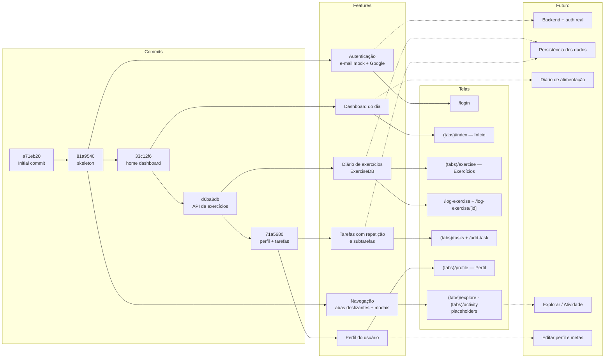
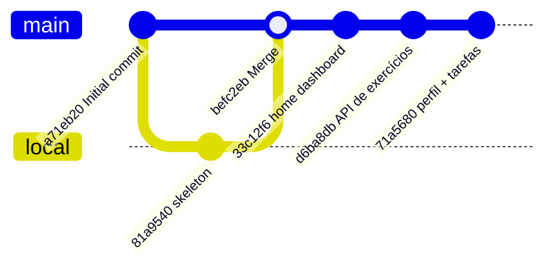
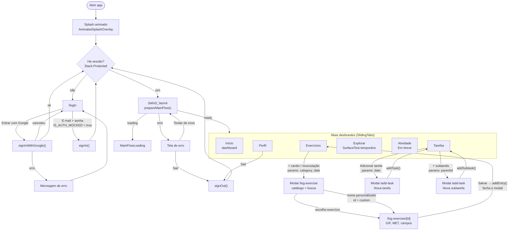
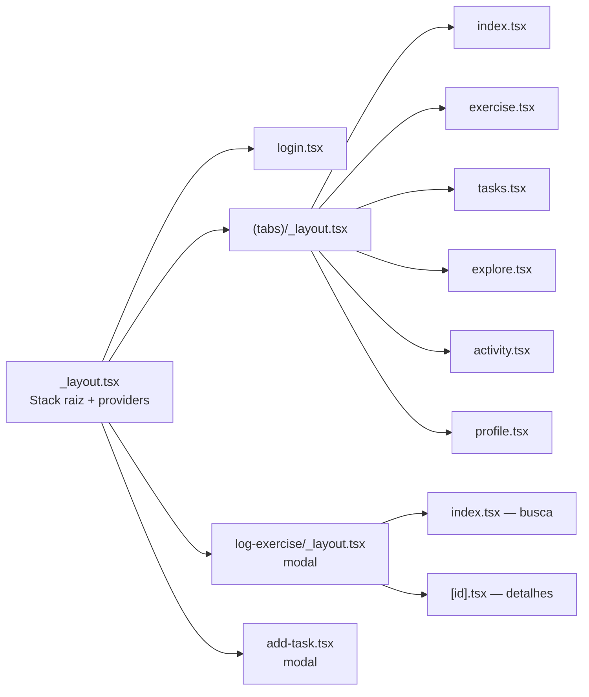
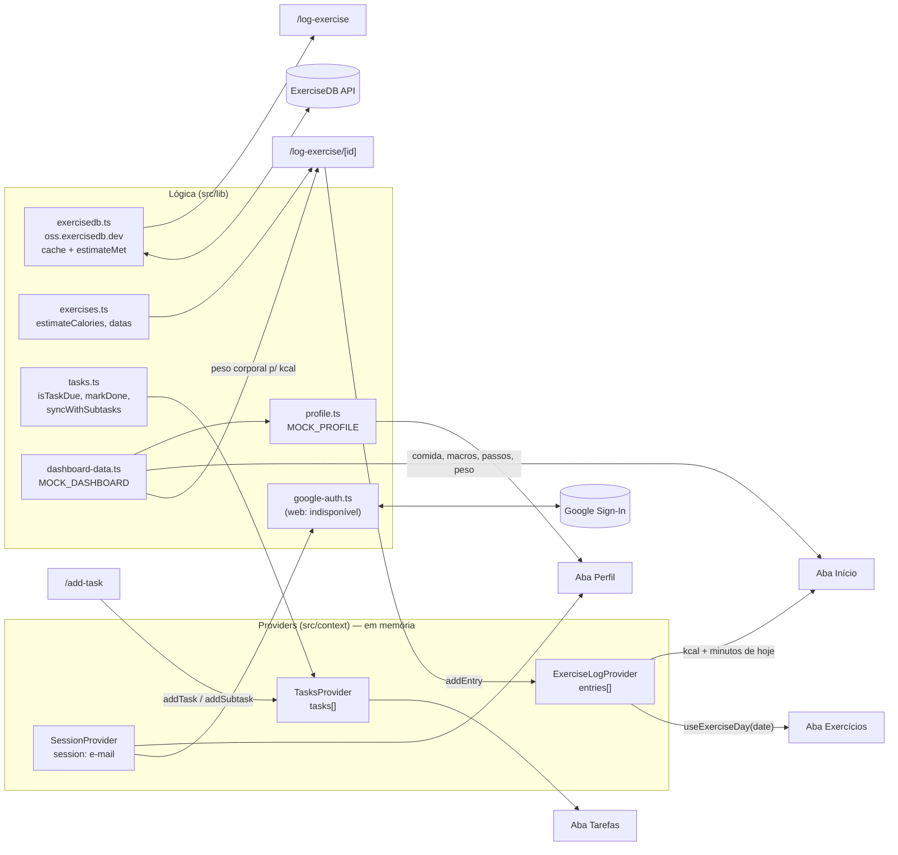
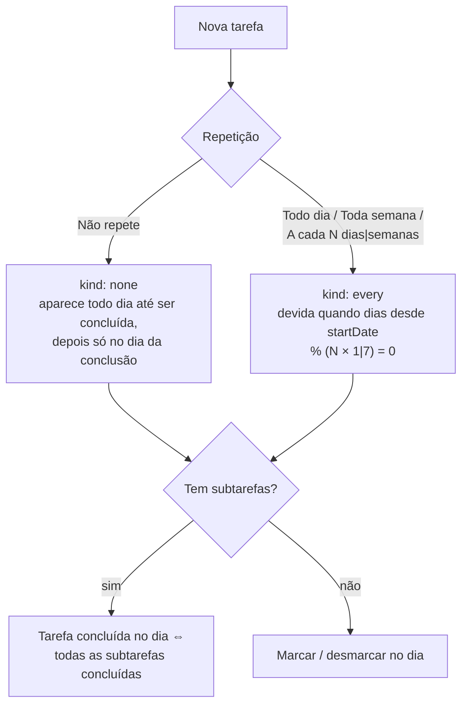
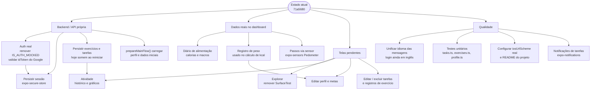

# Treina — Fluxograma do projeto

Visão geral do app **Treina** (Expo SDK 57 + Expo Router): features, commits aplicados, telas e possíveis
alterações futuras. Os diagramas usam [Mermaid](https://mermaid.js.org/) e são renderizados direto pelo GitHub.

> Estado analisado: `71a5680` (2026-10-28).

---

## 1. Visão geral (features × telas × futuro)

---

## 2. Histórico de commits

> O `81a9540` foi criado localmente, sem relação com o `a71eb20` do GitHub; o merge `befc2eb` uniu os dois históricos.

| Commit | Data | O que entrou | Arquivos-chave |
| --- | --- | --- | --- |
| `a71eb20` Initial commit | 2026-10-18 | README inicial | `README.md` |
| `81a9540` skeleton | 2026-10-18 | Base Expo Router, login (e-mail mock + Google Sign-In), sessão, splash animado, tela de carregamento/erro do fluxo principal, abas deslizantes customizadas, tema claro/escuro, placeholders | `src/app/_layout.tsx`, `src/app/login.tsx`, `src/context/session.tsx`, `src/lib/google-auth*.ts`, `src/components/sliding-tabs/*`, `src/hooks/use-main-flow-bootstrap.ts` |
| `befc2eb` Merge | 2026-10-18 | Junta o skeleton com o `main` remoto | — |
| `33c12f6` home dashboard | 2026-10-18 | Dashboard "Hoje": calorias (anel), macros, passos/exercício, peso (gráfico) com dados mock | `src/components/dashboard/*`, `src/lib/dashboard-data.ts` |
| `d6ba8db` API de exercícios | 2026-10-26 | Aba Exercícios com seletor de dia, cardio × musculação, modal de busca no ExerciseDB (paginação, cache, 429), detalhes com GIF e estimativa de kcal por MET; dashboard passa a usar o exercício real | `src/lib/exercisedb.ts`, `src/lib/exercises.ts`, `src/context/exercise-log.tsx`, `src/app/log-exercise/*`, `src/app/(tabs)/exercise.tsx` |
| `71a5680` perfil + tarefas | 2026-10-28 | Aba Tarefas (repetição diária/semanal/a cada N, subtarefas sincronizadas), modal de nova tarefa/subtarefa, aba Perfil (idade, peso, altura, sair) | `src/lib/tasks.ts`, `src/context/tasks.tsx`, `src/app/(tabs)/tasks.tsx`, `src/app/add-task.tsx`, `src/app/(tabs)/profile.tsx`, `src/lib/profile.ts` |

---

## 3. Fluxo de telas (navegação)

### Mapa de rotas (`src/app/`)

---

## 4. Fluxo de dados das features

### Regras das tarefas

---

## 5. Possíveis alterações futuras

Levantadas a partir dos `TODO` / `TEMPORARY` no código e das lacunas atuais.

| Área | Onde está hoje | Sugestão |
| --- | --- | --- |
| Login por e-mail | `src/context/session.tsx` — `IS_AUTH_MOCKED = true` | Requisição real de auth e validação no `login.tsx` |
| Login Google | `session.tsx` — `TODO: send user.idToken to your backend` | Verificar o token no backend e criar sessão |
| Sessão | `useState` em memória | Persistir com `expo-secure-store` para não deslogar ao reabrir |
| Bootstrap | `src/lib/prepare-main-flow.ts` vazio | Buscar perfil/metas antes de mostrar as abas |
| Dashboard | `src/lib/dashboard-data.ts` — `MOCK_DASHBOARD` | Diário de alimentação, passos e pesagens reais |
| Peso nos cálculos | `log-exercise/[id].tsx` — `TODO: use the user's real latest weigh-in` | Usar o último peso do perfil |
| Exercícios / Tarefas | Providers em memória (`TEMPORARY`) | Persistência local (SQLite) e/ou backend |
| Perfil | `src/lib/profile.ts` — `MOCK_PROFILE` | Tela de edição de nome, nascimento, altura e metas |
| Explorar | `SurfaceTest` (`TEMPORARY`) | Voltar a `ComingSoon` ou implementar a feature |
| Atividade | `ComingSoon` | Histórico/estatísticas de treinos e tarefas |
| ExerciseDB | Nomes só em inglês, MET estimado pelo nome | Tradução dos nomes e tabela de MET mais precisa |
| Rótulos das abas | `src/constants/tabs.ts` — nomes temporários | Definir nomes/ícones finais de Explorar e Atividade |
