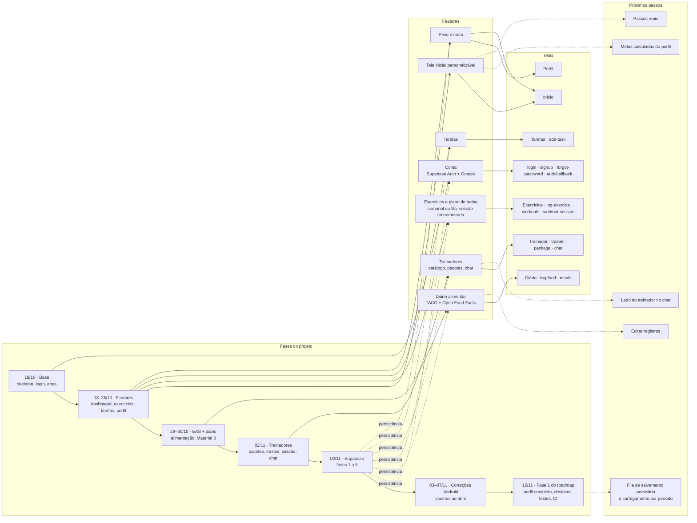
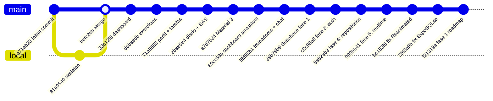
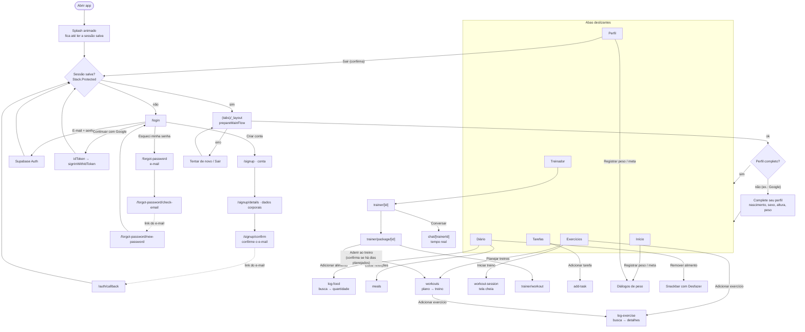
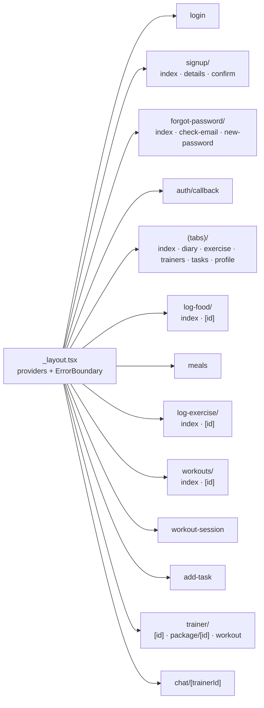
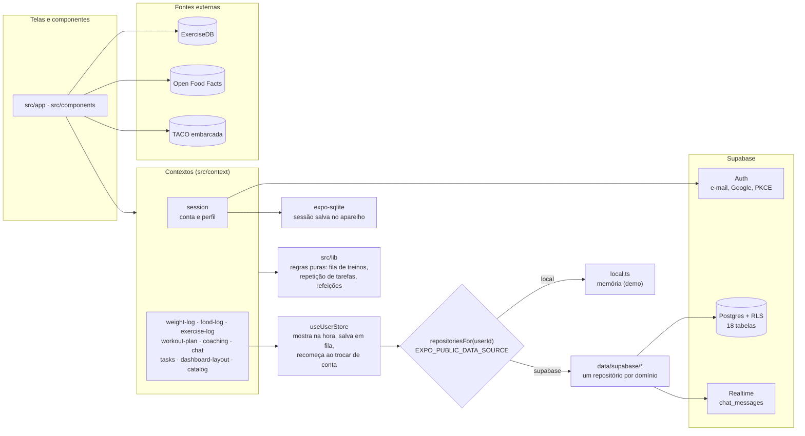
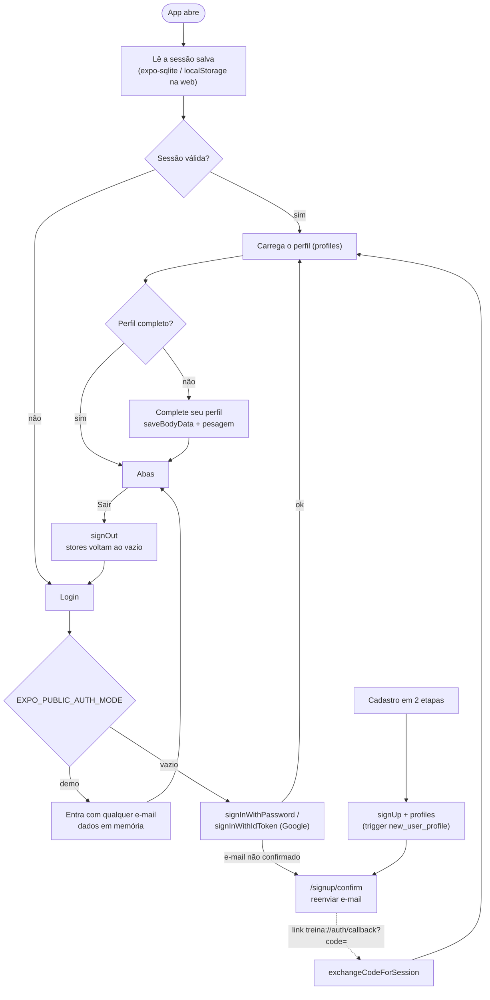
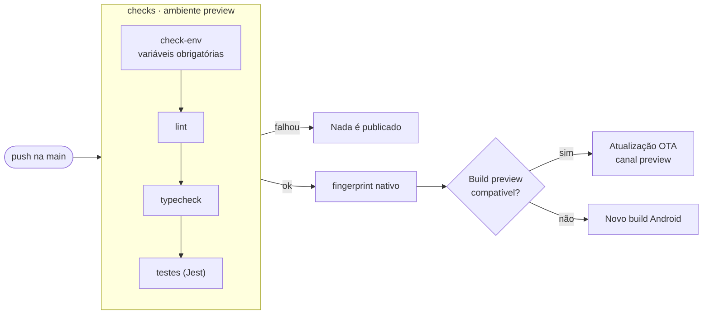

# Treina — Fluxograma do projeto

Visão geral do app **Treina** (Expo SDK 58 + Expo Router + Supabase): features, commits aplicados, telas,
arquitetura de dados e próximos passos. Os diagramas usam [Mermaid](https://mermaid.js.org/) e são renderizados
direto pelo GitHub.

> Estado analisado: `f21319a` na `main` (2026-11-12), 34 commits.

---

## 1. Visão geral (features × telas × futuro)

---

## 2. Histórico de commits

| Período | Commits | O que entrou |
| --- | --- | --- |
| 18/10 · Base | `a71eb20`, `81a9540`, `befc2eb` | Expo Router, login (e-mail simulado + Google), splash animado, abas deslizantes próprias, tema claro/escuro. O `81a9540` foi criado localmente e unido ao `a71eb20` do GitHub pelo merge `befc2eb`. |
| 18–28/10 · Features | `33c12f6`, `d6ba8db`, `71a5680` | Dashboard do dia, aba Exercícios com ExerciseDB e cálculo de kcal por MET, tarefas com repetição e subtarefas, perfil. |
| 29–30/10 · EAS, diário e visual | `3e47e46` … `89cc59a` | Configuração do EAS e workflow de OTA, diário alimentar (TACO embarcada + Open Food Facts), refeições configuráveis, design system Material 3 gerado do ícone, tela inicial com widgets arrastáveis. |
| 02/11 · Treinadores | `5fd90b1`, `a645770`, `de10529` | Aba Treinador, perfil do treinador, pacotes de treinos, plano semanal ou em fila, sessão cronometrada com sensação, chat; limpeza de código não usado; ajustes no login. |
| 02/11 · Supabase | `39b79b9` … `090bb41` | Fase 1: camada de repositório. Fase 2: schema, RLS e seed do catálogo. Fase 3: autenticação real, confirmação e recuperação de senha. Fase 4: repositórios Supabase. Fase 5: chat em tempo real. Ajustes do build web (`bfb892c`, `98473de`). |
| 03–07/11 · Correções | `f38f27a` … `25f3a9b` | Ajustes de peso e exercícios, ícone adaptativo, tela de erro no lugar do crash (`94d5d86`), correção do `NaN` do Reanimated na lixeira (`bc153f6`) e do crash `ExpoSQLite` (`25f3a9b`): o Expo 58.0.21 trazia um runtime de módulos incompatível com o `expo-sqlite` pré-compilado; a atualização para 58.0.23 alinhou os pacotes. |
| 12/11 · Fase 1 do roadmap | `f21319a` | Tela "Complete seu perfil" para contas sem dados corporais (Google), cálculo de kcal sem peso de exemplo, confirmação ao aderir e ao sair de pacote, desfazer ao remover alimento, exercício e tarefa, confirmação ao excluir treino e ao sair da conta, 28 testes com Jest em `src/lib`, `check-env` para as variáveis e workflow que roda variáveis, lint, typecheck e testes antes do OTA. |

---

## 3. Fluxo de telas (navegação)

### Mapa de rotas (`src/app/`)

---

## 4. Arquitetura de dados

| Camada | Arquivos | Papel |
| --- | --- | --- |
| Contextos | `src/context/*.tsx` (11) | Estado de cada domínio e ações que as telas chamam |
| Store por conta | `src/data/use-user-store.ts` | Carrega os dados da conta, mostra mudanças na hora, salva em fila ordenada e mostra "Tentar novamente" se falhar (`save-error-banner`) |
| Repositórios | `src/data/types.ts`, `local.ts`, `supabase/*` | Interface por domínio; implementação em memória (modo demo) ou Supabase |
| Supabase | `supabase/migrations/*`, `seed.sql`, `tests/rls.sql` | 18 tabelas, Row Level Security por `auth.uid()`, perfil criado no cadastro, refeições padrão, chat em tempo real |
| Regras | `src/lib/*` | Lógica pura que continua no app (fila de treinos, repetição de tarefas, ordem das refeições, kcal por MET), agora coberta por 28 testes em `src/lib/__tests__` |
| Desfazer | `components/undo-snackbar.tsx`, `ui/confirm-dialog.tsx` | Snackbar com Desfazer para remoções simples e diálogo de confirmação para ações grandes |

---

## 5. Fluxo de autenticação

---

## 6. Entrega (workflow do EAS)

Antes do `f21319a`, o workflow publicava a atualização direto, sem verificação; foi assim que o crash do `ExpoSQLite` chegou ao celular. Agora qualquer falha em variáveis, lint, typecheck ou testes interrompe a publicação. Ainda não há um teste do APK aberto no aparelho antes de liberar o canal.

---

## 7. O que ainda é simulado ou falta

```mermaid
flowchart TD
    Now(["Estado atual<br/>f21319a"]) --> Done["Feito na Fase 1"]
    Done --> D1["Completar perfil após Google"]
    Done --> D2["kcal sem peso de exemplo"]
    Done --> D3["Desfazer e confirmações"]
    Done --> D4["Testes + gate no workflow"]
    Done --> D5["check-env das variáveis"]

    Now --> M["Ainda simulado"]
    M --> M1["Passos: 6.840 fixos"]
    M --> M2["Metas fixas: 2.200 kcal e macros"]
    M --> M3["Chat: treinador não responde"]

    Now --> P["Fase 2 · consolidação"]
    P --> P1["Metas calculadas do perfil"]
    P --> P2["Editar registros, perfil e exercícios do treino"]
    P --> P3["Fila de salvamento persistida"]
    P --> P4["Carregamento por período e erro por aba"]
    P --> P5["Histórico e evolução de cargas"]

    Now --> L["Produção"]
    L --> L1["LGPD: consentimento e excluir conta"]
    L --> L2["Monitoramento de erros"]
    L --> L3["Smoke test do APK e iOS"]
```

| Área | Situação na `main` | Próximo passo |
| --- | --- | --- |
| Conta | Supabase Auth, Google, confirmação e recuperação de senha; perfil incompleto pede os dados antes das abas | Editar o perfil depois (só peso e meta são editáveis) |
| Dados | Persistidos por conta com RLS; fila de salvamento com nova tentativa; remoções com Desfazer | Edição de registros, fila persistida no aparelho, carregamento por período |
| Cálculos | Sem peso real, a tela pede para registrar o peso em vez de usar um valor de exemplo | Metas calculadas (kcal e macros) a partir do perfil |
| Treinadores | Catálogo do banco; aderir e sair do pacote pedem confirmação; chat em tempo real com aviso | Lado do treinador para responder e publicar |
| Tela inicial | Calorias, macros, exercício e peso reais | Passos reais e metas pessoais |
| Qualidade | 28 testes (Jest) em `src/lib`, lint e typecheck limpos, gate no workflow | Testes de `useUserStore` e dos repositórios; smoke test do APK |
| Entrega | Workflow bloqueia OTA se algo falhar; `check-env` valida as variáveis | Monitoramento de erros e configuração iOS |
