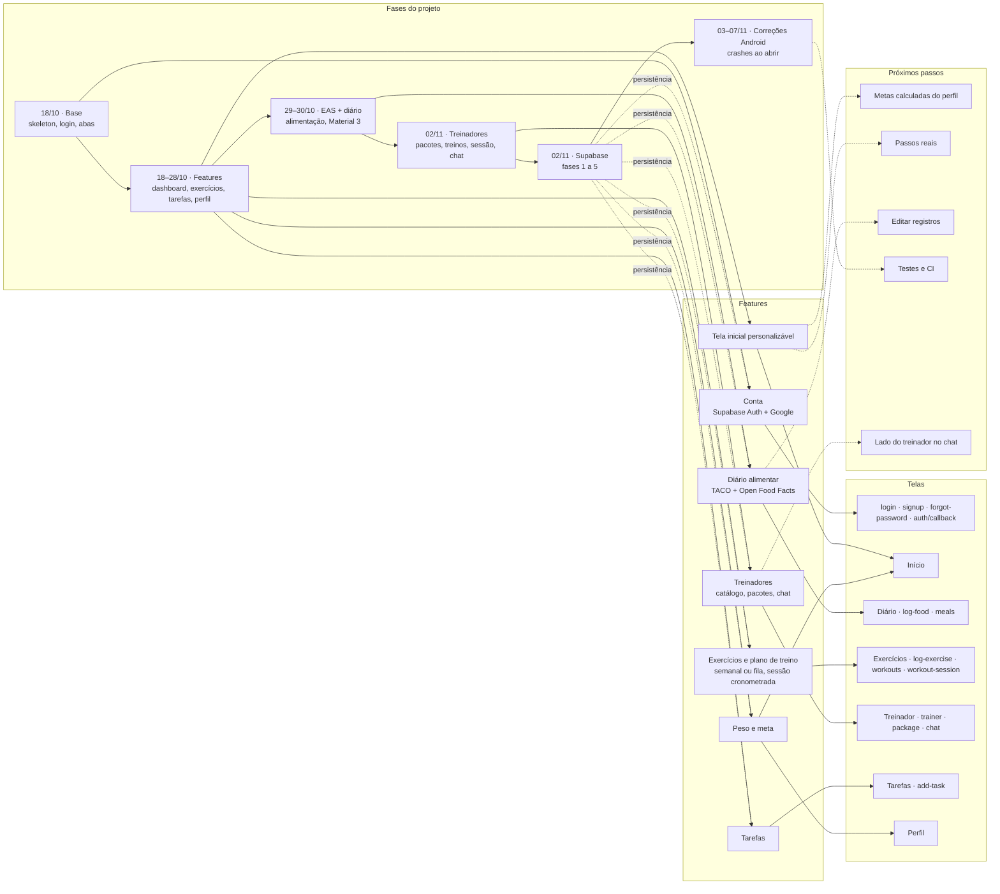
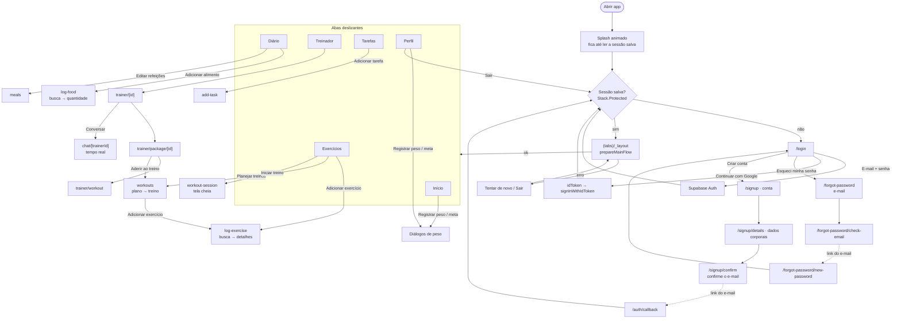
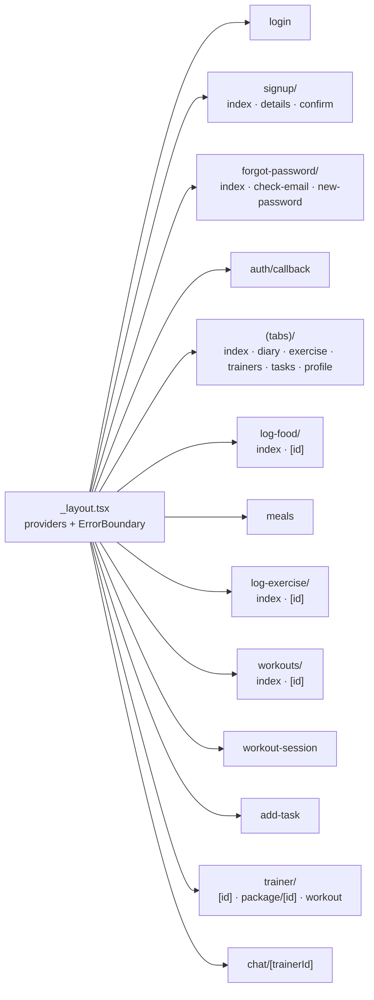
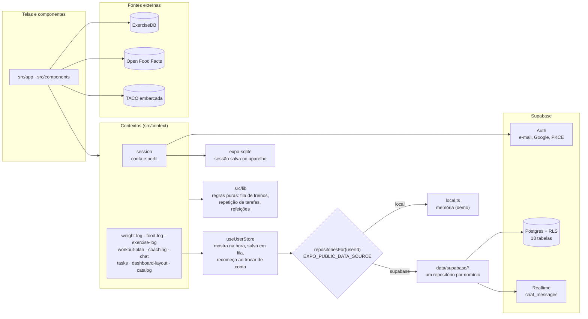
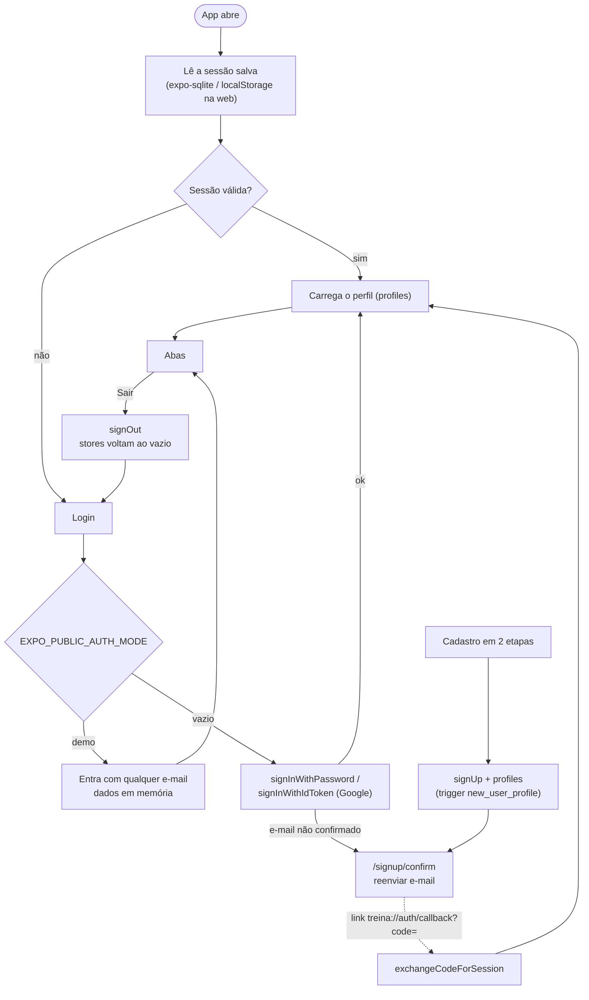

# Treina — Fluxograma do projeto

Visão geral do app **Treina** (Expo SDK 58 + Expo Router + Supabase): features, commits aplicados, telas,
arquitetura de dados e próximos passos. Os diagramas usam [Mermaid](https://mermaid.js.org/) e são renderizados
direto pelo GitHub.

> Estado analisado: `25f3a9b` na `main` (2026-11-07), 33 commits.

---

## 1. Visão geral (features × telas × futuro)

---

## 2. Histórico de commits

| Período | Commits | O que entrou |
| --- | --- | --- |
| 18/10 · Base | `a71eb20`, `81a9540`, `befc2eb` | Expo Router, login (e-mail simulado + Google), splash animado, abas deslizantes próprias, tema claro/escuro. O `81a9540` foi criado localmente e unido ao `a71eb20` do GitHub pelo merge `befc2eb`. |
| 18–28/10 · Features | `33c12f6`, `d6ba8db`, `71a5680` | Dashboard do dia, aba Exercícios com ExerciseDB e cálculo de kcal por MET, tarefas com repetição e subtarefas, perfil. |
| 29–30/10 · EAS, diário e visual | `3e47e46` … `89cc59a` | Configuração do EAS e workflow de OTA, diário alimentar (TACO embarcada + Open Food Facts), refeições configuráveis, design system Material 3 gerado do ícone, tela inicial com widgets arrastáveis. |
| 02/11 · Treinadores | `5fd90b1`, `a645770`, `de10529` | Aba Treinador, perfil do treinador, pacotes de treinos, plano semanal ou em fila, sessão cronometrada com sensação, chat; limpeza de código não usado; ajustes no login. |
| 02/11 · Supabase | `39b79b9` … `090bb41` | Fase 1: camada de repositório. Fase 2: schema, RLS e seed do catálogo. Fase 3: autenticação real, confirmação e recuperação de senha. Fase 4: repositórios Supabase. Fase 5: chat em tempo real. Ajustes do build web (`bfb892c`, `98473de`). |
| 03–07/11 · Correções | `f38f27a` … `25f3a9b` | Ajustes de peso e exercícios, ícone adaptativo, tela de erro no lugar do crash (`94d5d86`), correção do `NaN` do Reanimated na lixeira (`bc153f6`) e do crash `ExpoSQLite` (`25f3a9b`): o Expo 58.0.21 trazia um runtime de módulos incompatível com o `expo-sqlite` pré-compilado; a atualização para 58.0.23 alinhou os pacotes. |

---

## 3. Fluxo de telas (navegação)

### Mapa de rotas (`src/app/`)

---

## 4. Arquitetura de dados

| Camada | Arquivos | Papel |
| --- | --- | --- |
| Contextos | `src/context/*.tsx` (11) | Estado de cada domínio e ações que as telas chamam |
| Store por conta | `src/data/use-user-store.ts` | Carrega os dados da conta, mostra mudanças na hora, salva em fila ordenada e mostra "Tentar novamente" se falhar (`save-error-banner`) |
| Repositórios | `src/data/types.ts`, `local.ts`, `supabase/*` | Interface por domínio; implementação em memória (modo demo) ou Supabase |
| Supabase | `supabase/migrations/*`, `seed.sql`, `tests/rls.sql` | 18 tabelas, Row Level Security por `auth.uid()`, perfil criado no cadastro, refeições padrão, chat em tempo real |
| Regras | `src/lib/*` | Lógica pura que continua no app (fila de treinos, repetição de tarefas, ordem das refeições, kcal por MET) |

---

## 5. Fluxo de autenticação

---

## 6. O que ainda é simulado ou falta

```mermaid
flowchart TD
    Now(["Estado atual<br/>25f3a9b"]) --> M["Ainda simulado"]
    M --> M1["Passos: 6.840 fixos<br/>(MOCK_DASHBOARD)"]
    M --> M2["Metas fixas: 2.200 kcal, macros,<br/>400 kcal de exercício"]
    M --> M3["Chat: treinador ainda não tem app<br/>para responder"]

    Now --> P["Produto"]
    P --> P1["Metas calculadas do perfil<br/>(idade, sexo, altura, peso, objetivo)"]
    P --> P2["Editar alimento, exercício<br/>e exercício do treino"]
    P --> P3["Histórico e evolução de cargas"]
    P --> P4["Passos via Health Connect / HealthKit"]
    P --> P5["Lembretes e notificações"]

    Now --> Q["Qualidade e entrega"]
    Q --> Q1["Testes de src/lib e CI<br/>antes do OTA"]
    Q --> Q2["Variáveis do Supabase e do Google<br/>no ambiente preview do EAS"]
    Q --> Q3["Configuração iOS<br/>(bundleIdentifier, URL scheme)"]
    Q --> Q4["Conferir runtime das OTA:<br/>evitar JS novo em APK antigo"]

    Now --> L["Lançamento"]
    L --> L1["Consentimento LGPD, exportar<br/>e excluir conta"]
    L --> L2["Monitoramento de erros"]
    L --> L3["Painel do treinador"]
```

| Área | Situação na `main` | Próximo passo |
| --- | --- | --- |
| Conta | Supabase Auth real, Google, confirmação e recuperação de senha, modo demo opcional | Variáveis do Google no `.env.local` e no EAS |
| Dados | Persistidos no Supabase por conta, com RLS; fila de salvamento com nova tentativa | Edição de registros nos repositórios que só têm `add`/`remove` |
| Catálogo de treinadores | Vem do banco (`trainers`, `training_packages`, seed) | Painel para o treinador publicar |
| Chat | Tempo real pelo Supabase; aviso de que o treinador ainda não responde | App ou painel do treinador |
| Tela inicial | Calorias, macros, exercício e peso reais | Passos reais e metas calculadas |
| Android | Crashes de abertura corrigidos (`bc153f6`, `25f3a9b`) | Gerar APK novo com os módulos nativos atuais e testar |
| Qualidade | Typecheck passa; sem testes | `jest-expo` + testes de `src/lib` e `supabase/tests/rls.sql` no CI |
